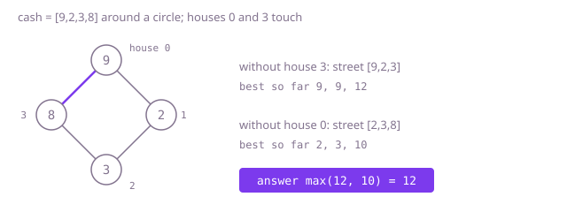

## The question

Houses stand around a circle, each holding some cash, and no two neighbouring houses may both be emptied; the first and last houses are neighbours. Return the largest total that can be taken.

What makes it harder than it looks is that one extra neighbour pair breaks the straight-street answer: in Example 1 a straight street would take houses 0 and 3 for 17, and on the circle that is not allowed. The fixes have their own edges. Dropping the last house every time misses answers that need it (`[1,5,1,1,9]` needs house 4); a circle of one house has no neighbour at all, and the usual split leaves nothing to take; and three houses are all neighbours of each other.

## How to think about it

The first idea is the House Robber recursion, take or leave each house, with one more thing to remember: whether house 0 was taken, because then house `n - 1` is off limits. Splitting on that choice gives two straight streets: if house 0 is left alone, the rest is the street from 1 to `n - 1`; if house `n - 1` is left alone, it is the street from 0 to `n - 2`. Every allowed choice leaves at least one end alone, so it lies in one of the two streets, and every choice on either street is allowed on the circle.

Each street is the straight problem, so the same steps apply: the plain recursion repeats work and grows exponentially; storing each house's result makes it linear; and two running totals make it linear with constant space. The circle of one house is handled first, because both streets would be empty and the answer would come out as 0.

For Example 1, `cash = [9,2,3,8]`: without house 3 the street is `[9,2,3]` and its running best is 9, 9, 12; without house 0 it is `[2,3,8]` with running best 2, 3, 10. The answer is 12.



## Brute force

Split into the two streets and, on each, try leaving and taking every house. It comes first because it is the definition plus the split, and it fixes the answers to compare against. It is correct because the two streets together contain every allowed choice on the circle, and the recursion tries every allowed choice on a street.

```java
static int maxLoot(int[] cash) {
    int n = cash.length;
    if (n == 1) {
        return cash[0];
    }
    return Math.max(best(cash, 0, n - 2), best(cash, 1, n - 1)); // without the last, without the first
}

/** Best total from house i to house last, trying both choices for every house. */
private static int best(int[] cash, int i, int last) {
    if (i > last) {
        return 0;
    }
    return Math.max(best(cash, i + 1, last), cash[i] + best(cash, i + 2, last));
}
```

**Complexity:** time O(φ^n) with φ ≈ 1.618, the Fibonacci growth of the calls on each street; extra space O(n) for the recursion, at most 1,000 deep, which fits in the stack: it simply never finishes on a long road.

## Better: memoised recursion

The same split, and on each street the recursion stores each house's result the first time it is computed. Each street gets its own memo, because "best from house `i`" depends on where the street ends.

```java
static int maxLoot(int[] cash) {
    int n = cash.length;
    if (n == 1) {
        return cash[0];
    }
    return Math.max(best(cash, 0, n - 2, fresh(n)), best(cash, 1, n - 1, fresh(n)));
}

private static int[] fresh(int n) {
    int[] memo = new int[n];
    Arrays.fill(memo, -1); // -1 means not worked out yet; totals are never negative
    return memo;
}

private static int best(int[] cash, int i, int last, int[] memo) {
    if (i > last) {
        return 0;
    }
    if (memo[i] < 0) {
        memo[i] = Math.max(best(cash, i + 1, last, memo), cash[i] + best(cash, i + 2, last, memo));
    }
    return memo[i];
}
```

**Complexity:** time O(n), extra space O(n) for the memos and the recursion; at most 1,000 deep here, which fits in the stack, but a road of a few hundred thousand houses would overflow it.

**Prefer it when:** you already have the recursion and want it fast with the least change, or you need the tables afterwards to list the houses chosen.

## Optimal: two straight streets, two running totals

Handle one house on its own. Otherwise run the straight-street pass twice, over houses 0 to `n - 2` and over houses 1 to `n - 1`, each keeping only the best totals up to the previous house and the one before it, and return the larger result.

```java
static int maxLoot(int[] cash) {
    int n = cash.length;
    if (n == 1) {
        return cash[0]; // no neighbour; both streets below would be empty
    }
    // at least one end is left alone, so drop the last house or drop the first
    return Math.max(street(cash, 0, n - 2), street(cash, 1, n - 1));
}

/** Best total from the straight street of houses from..to, both included. */
private static int street(int[] cash, int from, int to) {
    int twoBack = 0;
    int oneBack = 0;
    for (int i = from; i <= to; i++) {
        int here = Math.max(oneBack, twoBack + cash[i]); // leave house i, or take it
        twoBack = oneBack;
        oneBack = here;
    }
    return oneBack;
}
```

**Complexity:** time O(n), two passes; extra space O(1). The largest total, 5 × 10^8, fits an `int`.

## Complexity

| Approach | Time | Extra space |
| --- | --- | --- |
| Brute force | O(φ^n), φ ≈ 1.618 | O(n) recursion, at most 1,000 deep |
| Better: memoised recursion | O(n) | O(n), recursion at most 1,000 deep |
| Optimal: two straight streets, two running totals | O(n) | O(1) |

## Where it shows up

Circular schedules have this shape: picking which hours of a repeating 24-hour day a machine runs when it may not run two hours in a row, with 23:00 next to 00:00, or picking seats at a round table so that no two chosen people sit side by side. The trick of breaking a cycle by fixing what happens at one point, then solving the straight version, is general: it is how cyclic constraints are usually turned into linear ones.

## Follow-up answers

**What if you had to choose exactly k houses?** The state needs the count: best total for the first `i` houses using exactly `j` of them, with the same take-or-leave rule, which costs O(n × k) time and O(k) space per street if rows are reused. Without the circle that is one pass; with it, the same two streets.

**Why is it safe to split the circle into two straight streets?** The only extra rule on the circle is that houses 0 and `n - 1` are not both taken, so every allowed choice leaves at least one of them alone and lies entirely in one street. In the other direction, a choice on either street never takes both ends, so it is allowed on the circle. The two maxima together are therefore exactly the circle's maximum; choices that leave both ends alone are counted twice, which does no harm to a maximum.

**What if the houses formed a tree, each house the neighbour of its parent and children?** Do a post-order walk and return two numbers per house: the best total in its subtree when it is taken (its cash plus the children's not-taken totals) and when it is not (the sum of each child's better total). The answer is the better of the root's two numbers, in O(n) time; on a very deep tree, use an explicit stack instead of recursion.
