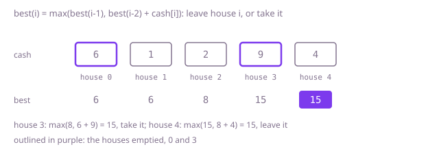

## The question

Each house on a street holds some cash, and no two neighbouring houses may both be emptied. Return the largest total that can be taken.

What makes it harder than it looks is that both quick rules are wrong. Taking every other house misses answers that skip two houses in a row: in Example 2 the best is houses 1 and 4, 10 + 8 = 18, while the even houses give 14 and the odd houses 11. Taking the richest house first fails too: on `[5,6,5]` it takes the 6 and blocks both 5s. And the number of allowed sets grows exponentially with the street, so trying them all is out at 1,000 houses.

## How to think about it

The first idea is to decide each house in turn, take it or leave it, and try both. Taking house `i` means house `i + 1` is off limits, so the recursion is "best from `i` = max(best from `i + 1`, `cash[i]` + best from `i + 2`)". It is correct and its calls nearly double with each house, because the best total from house 7 is worked out again for every way of deciding the houses before it.

Storing each "best from `i`" the first time it is computed makes every house cost one comparison. Then notice that each value needs only the next two, or, going from the front, that the best total for the first `i` houses needs only the best totals for the first `i - 1` and `i - 2`: leave house `i` and keep the first, or take it and add its cash to the second. Two variables carry the street.

For Example 1, `cash = [6,1,2,9,4]`: after house 0 the best is 6; after house 1, max(6, 0 + 1) = 6; after house 2, max(6, 6 + 2) = 8; after house 3, max(8, 6 + 9) = 15; after house 4, max(15, 8 + 4) = 15.



## Brute force

Decide each house from the front: leave it and move to the next, or take it and jump past its neighbour, and keep the better total. It comes first because it says the rule directly and fixes the answers to compare against. It is correct because every allowed set either leaves house `i` or takes it, and taking it forbids exactly house `i + 1`, so both branches together cover every allowed set.

```java
static int maxLoot(int[] cash) {
    return best(cash, 0);
}

/** Best total from house i to the end of the street. */
private static int best(int[] cash, int i) {
    if (i >= cash.length) {
        return 0;
    }
    return Math.max(best(cash, i + 1), cash[i] + best(cash, i + 2)); // leave house i, or take it
}
```

**Complexity:** time O(φ^n) with φ ≈ 1.618, since the calls grow like the Fibonacci numbers; extra space O(n) for the recursion, at most 1,000 deep, which fits in the stack: it simply never finishes on a long street.

## Better: memoised recursion

The same recursion, with each "best from `i`" stored the first time it is computed. Every house is then worked out once.

```java
static int maxLoot(int[] cash) {
    int[] memo = new int[cash.length];
    Arrays.fill(memo, -1); // -1 means not worked out yet; totals are never negative
    return best(cash, 0, memo);
}

private static int best(int[] cash, int i, int[] memo) {
    if (i >= cash.length) {
        return 0;
    }
    if (memo[i] < 0) {
        memo[i] = Math.max(best(cash, i + 1, memo), cash[i] + best(cash, i + 2, memo));
    }
    return memo[i];
}
```

**Complexity:** time O(n), extra space O(n) for the array and the recursion; at most 1,000 deep here, which fits in the stack, but a street of a few hundred thousand houses would overflow it.

**Prefer it when:** you have the recursion already and want it fast with the least change, or you will need the full table afterwards, for example to list the houses chosen.

## Optimal: two running totals

Walk the street once, keeping the best total for the street up to the previous house and up to the one before it. For each house, the new best is the larger of leaving it (the previous best) and taking it (the one before, plus its cash).

```java
static int maxLoot(int[] cash) {
    int twoBack = 0; // best total for the street up to two houses before this one
    int oneBack = 0; // best total for the street up to the house before this one
    for (int amount : cash) {
        int here = Math.max(oneBack, twoBack + amount); // leave this house, or take it and skip its neighbour
        twoBack = oneBack;
        oneBack = here;
    }
    return oneBack;
}
```

**Complexity:** time O(n), extra space O(1). The largest total, 500 houses at 10^6, is 5 × 10^8 and fits an `int`.

## Complexity

| Approach | Time | Extra space |
| --- | --- | --- |
| Brute force | O(φ^n), φ ≈ 1.618 | O(n) recursion, at most 1,000 deep |
| Better: memoised recursion | O(n) | O(n), recursion at most 1,000 deep |
| Optimal: two running totals | O(n) | O(1) |

## Where it shows up

Any choice along a line where picking one item rules out its neighbour has this shape: scheduling shifts so that nobody works two in a row, choosing which adjacent ad slots to fill when neighbouring slots may not carry ads, or picking which plots in a row to plant when neighbouring plots would compete for the same water. The general form, the most valuable set of nodes with no two joined, is hard on arbitrary graphs, but on a path, as here, or on a tree, it falls to a pass that keeps "taken" and "not taken" totals.

## Follow-up answers

**What if you also had to return which houses were chosen?** Keep the whole table of best totals instead of two variables. Walk back from the end: if the best for the first `i` houses equals the best for the first `i - 1`, house `i` was left; otherwise it was taken, so record it and jump back two. Reverse the list at the end.

**What if no two chosen houses could be within two of each other?** Taking house `i` then rules out `i - 1` and `i - 2`, so the rule becomes max(best up to `i - 1`, best up to `i - 3` + `cash[i]`) and you keep three running totals instead of two.

**What if the houses stood in a circle, so the first and last were neighbours?** Then the first and last cannot both be taken. Solve the street without the last house and the street without the first, and take the larger; a circle of one house is just that house. That is the next question, House Robber II.
