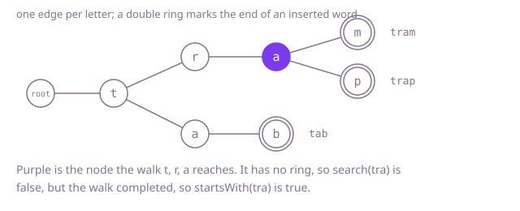

## The question

Build a structure that stores words and answers two questions about text: was exactly this word inserted, and does some inserted word begin with this text. Inserting a word twice changes nothing, and a word counts as beginning with itself.

What makes it harder than it looks is that the two questions are different and easy to confuse: after inserting `"tram"`, the text `"tra"` is the beginning of a word but not a word, so `search` must say no where `startsWith` says yes. And the point of the exercise is cost. With 50,000 words and 200,000 queries, any structure that looks at every stored word per query does about ten billion string comparisons.

## How to think about it

The first idea is a list of words, scanned for every question. It is correct and it repeats work: every query compares against words that cannot match, and words that begin the same way are compared from their first letter again and again. Two things are worth remembering. Sorted words that start with the same text sit next to each other, so a sorted set can find the first candidate for a prefix with one search. And better still, words that start the same way could share their storage, so that a lookup follows the letters of the query and nothing else.

That second idea is the trie: a tree with one edge per letter, where each node stands for the text spelled on the path from the root. Looking something up walks one node per letter, so the cost depends on the length of the query and not on how many words are stored. The one extra fact each node needs is whether an inserted word ends there. Without that mark, `search` could not tell the beginning `"tra"` from the word `"tram"`.

Walk Example 1. Insert `"tram"`, `"trap"` and `"tab"`. The path t, r, a is built once and shared by the first two words, which then split into m and p; `"tab"` shares only the t and splits at a. The nodes for m, p and b are marked as word ends. Now `search("tra")` walks t, r, a and arrives at a node that exists but is not marked, so the answer is `false`. `startsWith("tra")` makes the same walk and only needs the walk to finish, so the answer is `true`. `search("trap")` ends on a marked node, so it is `true`.



## Brute force

Keep a list of words. `insert` adds a word unless it is already there, `search` looks for an equal word and `startsWith` looks for a word that begins with the text. It comes first because it needs no design and fixes the answer the faster versions must match. It is correct because every question is answered by checking each stored word directly.

```java
private final List<String> words = new ArrayList<>();

void insert(String word) {
    if (!search(word)) { // adding a word twice must change nothing
        words.add(word);
    }
}

boolean search(String word) {
    for (String stored : words) { // look at every stored word
        if (stored.equals(word)) {
            return true;
        }
    }
    return false;
}

boolean startsWith(String prefix) {
    for (String stored : words) {
        if (stored.startsWith(prefix)) {
            return true;
        }
    }
    return false;
}
```

**Complexity:** with n stored words and a query of length L, every call O(n × L) in the worst case, including `insert` because of the duplicate check; extra space O(total letters stored).

## Better: a sorted set

Keep the words in a `TreeSet`, which stays sorted. `search` is a lookup. For `startsWith`, look at the smallest stored word that is greater than or equal to the prefix. Words that begin with the prefix are all at least the prefix and sit together, right at the start of everything that is at least the prefix, so if any word begins with the prefix, that smallest word does.

```java
private final TreeSet<String> words = new TreeSet<>();

void insert(String word) {
    words.add(word); // a set ignores a word that is already there
}

boolean search(String word) {
    return words.contains(word);
}

boolean startsWith(String prefix) {
    String next = words.ceiling(prefix); // smallest stored word >= prefix
    return next != null && next.startsWith(prefix);
}
```

**Complexity:** each call O(L log n) in the worst case, since the tree is balanced and each comparison of two words costs up to L; extra space O(total letters stored). There is no hashing, so this is a true worst case.

**Prefer it when:** you also need the words in alphabetical order or a range of them, for example every word that starts with a prefix, which `subSet` gives without building anything. It needs far less code than a trie and its memory is one tree node per word, where a trie spends a node per distinct prefix.

## Optimal: a tree of letters

Give each node 26 child slots, one per letter, and a flag that says a word ends there. `insert` walks the letters, creating missing children, and sets the flag on the last node. `search` and `startsWith` share one walk; `search` also needs the flag. This is the reference solution.

```java
private static final class Node {
    final Node[] children = new Node[26]; // one slot per letter
    boolean endsWord; // true when a word finishes at this node
}

private final Node root = new Node();

void insert(String word) {
    Node node = root;
    for (int i = 0; i < word.length(); i++) {
        int slot = word.charAt(i) - 'a';
        if (node.children[slot] == null) {
            node.children[slot] = new Node(); // create the path as we go
        }
        node = node.children[slot];
    }
    node.endsWord = true;
}

boolean search(String word) {
    Node node = walk(word);
    return node != null && node.endsWord; // reaching the node is not enough
}

boolean startsWith(String prefix) {
    return walk(prefix) != null;
}

/** The node reached by spelling text from the root, or null when the path breaks. */
private Node walk(String text) {
    Node node = root;
    for (int i = 0; i < text.length() && node != null; i++) {
        node = node.children[text.charAt(i) - 'a'];
    }
    return node;
}
```

**Complexity:** each call O(L) in the worst case, since the walk visits one node per letter and indexing an array does no hashing or comparing; extra space O(T × 26) in the worst case for T letters stored, one node of 26 slots per distinct prefix.

## Complexity

| Approach | `insert` | `search` / `startsWith` | Extra space |
| --- | --- | --- | --- |
| Brute force | O(n × L) worst case | O(n × L) worst case | O(T) |
| Better: sorted set | O(L log n) worst case | O(L log n) worst case | O(T) |
| Optimal: tree of letters | O(L) worst case | O(L) worst case | O(T × 26) worst case |

Here n is the number of stored words, L the length of the word or prefix in the call, and T the total number of letters stored.

## Where it shows up

`merchant-suggest` shows suggestions as the user types, so every keystroke is a prefix query over all merchant names. Its reference does not use a trie: for each merchant it adds one sorted entry per word of the name, the rest of the name from that word on, and finds the first entry that starts with the typed text by binary search, then reads the contiguous block that follows. That is the sorted-set idea above, in an array. Its walkthrough names a trie that stores the best few results at every node as the alternative, which makes a suggestion a walk of the typed letters plus a copy, at the price of memory for a node per distinct prefix. Beyond that coding-round problem, tries sit behind autocomplete, spell checkers that need "is there any word starting like this", and routing tables that match the longest known prefix of an address.

## Follow-up answers

**How would you return every word that starts with a prefix?** Walk to the node for the prefix, then traverse its subtree depth first, building the word as you go and emitting it whenever a node has the end-of-word flag. Visiting children from `a` to `z` gives the words in alphabetical order. The cost is the size of the subtree plus the length of the prefix.

**How can you cut the memory use of a trie with many long, rarely shared words?** Merge chains of single-child nodes into one edge that holds a string, which is a compressed trie, or radix tree. Use a map instead of an array of 26 children when most nodes have few children, at the price of hashing on each step.

**How would you support deleting a word?** Walk to the word and clear its flag. Then walk back up, removing each node that has no children and no flag, and stop at the first node that is still needed by another word.
