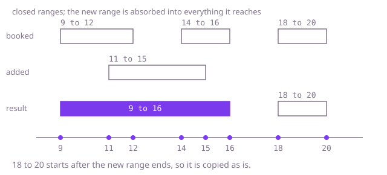

## The question

You get a list of booked ranges that is already sorted and free of overlaps, plus one new range. Put the new range in, merging it with every existing range it overlaps or touches, and return the new list.

What makes it harder than it looks: touching counts, so a range ending at 12 and one starting at 12 become one, and a strict comparison where you needed a non-strict one silently leaves them apart. The new range can swallow zero, one or many existing ranges, and it can land before everything, after everything or in a gap, so there are many edges to get wrong at once. And because the list is already sorted, doing a full sort again throws away the one thing the input promised you.

## How to think about it

The first idea is to forget the promise: add the new range to the list, sort by start, and merge everything with the usual sweep. It is correct, but it pays O(n log n) for a list that was already in order. What does the order give me? Relative to the new range, every existing range is in one of three groups: it ends before the new one starts, it overlaps or touches the new one, or it starts after the new one ends. Because the list is sorted and its ranges are apart, the groups come in exactly that order, and they are contiguous blocks. So I can locate the two edges of the middle block by binary search and copy around it. The copy still costs O(n), because the answer is a new array, so the bound does not move. What simplifies things is a single walk: copy the first group, absorb the middle group into the new range by taking the smallest start and the largest end, then copy the third group.

Walk Example 1, `booked = [[9, 12], [14, 16], [18, 20]]`, `added = [11, 15]`. No range ends before 11, so nothing is copied first. Then `[9, 12]` starts at 9, no later than 15, so it is absorbed: the new range is `[9, 15]`. `[14, 16]` starts at 14, no later than 15, so it is absorbed too: `[9, 16]`. `[18, 20]` starts at 18, after 16, so the absorbing stops. The result is `[9, 16]`, then the copied `[18, 20]`.



## Brute force

Put the new range at the end of a copy of the list, sort by start, and run the merge sweep: keep the last merged range, and for each next range either stretch its end (the next one starts no later than the end) or start a new merged range. It is what you say first, because it reuses the standard merge and it fixes the answer every faster version must agree with. It is correct because after sorting, any range that overlaps or touches the merged one so far starts no later than its end. Merged ranges are copies, so the input rows are never changed.

```java
static int[][] insert(int[][] booked, int[] added) {
    int[][] all = Arrays.copyOf(booked, booked.length + 1);
    all[booked.length] = added;
    Arrays.sort(all, (a, b) -> Integer.compare(a[0], b[0]));
    List<int[]> merged = new ArrayList<>();
    for (int[] range : all) {
        int[] open = merged.isEmpty() ? null : merged.get(merged.size() - 1);
        if (open != null && range[0] <= open[1]) {
            open[1] = Math.max(open[1], range[1]); // touching counts: <=
        } else {
            merged.add(new int[] {range[0], range[1]}); // a copy, so the input is never changed
        }
    }
    return merged.toArray(new int[0][]);
}
```

**Complexity:** time O(n log n), extra space O(n).

## Better: binary search for both edges, then copy

This is a different tool at the same cost as the optimal walk: both are O(n). The sorted, separate ranges make the three groups blocks, and a block edge is what a binary search finds. The first range that does not end before the new one starts is where the middle block begins; the first range that starts after the new one ends is where it stops. Everything before and after is copied in bulk, and the middle block collapses into one range from the smaller start to the larger end.

```java
static int[][] insert(int[][] booked, int[] added) {
    int lo = 0, hi = booked.length;
    while (lo < hi) { // first range that does not end before added starts
        int mid = (lo + hi) >>> 1;
        if (booked[mid][1] < added[0]) lo = mid + 1; else hi = mid;
    }
    int first = lo;
    hi = booked.length;
    while (lo < hi) { // first range that starts after added ends
        int mid = (lo + hi) >>> 1;
        if (booked[mid][0] <= added[1]) lo = mid + 1; else hi = mid;
    }
    int after = lo;
    int start = added[0], end = added[1];
    if (first < after) { // the middle block is not empty
        start = Math.min(start, booked[first][0]);
        end = Math.max(end, booked[after - 1][1]);
    }
    int[][] result = new int[booked.length - (after - first) + 1][];
    System.arraycopy(booked, 0, result, 0, first);
    result[first] = new int[] {start, end};
    System.arraycopy(booked, after, result, first + 1, booked.length - after);
    return result;
}
```

**Complexity:** time O(log n) to locate the edges plus O(n) to copy, so O(n) in all; extra space O(n) for the result.

**Prefer it when:** the list is large and the new range touches few ranges. Finding the block costs O(log n), and `System.arraycopy` moves the untouched references in bulk, so it can move less work than a one-by-one walk, though I have not measured it. It needs random access, so it is for arrays. The cost is two searches whose `<` and `<=` are easy to get backwards.

## Optimal: one walk in three phases

The binary search does not improve the bound, because an array result has to be copied anyway, so the simplest O(n) code is the right one to write. Walk the list with one cursor in the three groups' order. Copy ranges that end before the new one starts. Then, while a range starts no later than the new range's current end, stretch the new range to cover it and move on. Add the stretched range, and copy what is left. Touching counts as overlapping, so "ends before" is strict and "reaches" is not. This is the reference solution.

```java
static int[][] insert(int[][] booked, int[] added) {
    List<int[]> result = new ArrayList<>(booked.length + 1);
    int i = 0;
    while (i < booked.length && booked[i][1] < added[0]) { // ends before the new range starts
        result.add(booked[i++]);
    }
    int start = added[0];
    int end = added[1];
    while (i < booked.length && booked[i][0] <= end) { // reaches the new range: absorb it
        start = Math.min(start, booked[i][0]);
        end = Math.max(end, booked[i][1]);
        i++;
    }
    result.add(new int[] {start, end});
    while (i < booked.length) { // starts after the merged range ends
        result.add(booked[i++]);
    }
    return result.toArray(new int[0][]);
}
```

**Complexity:** time O(n), extra space O(n) for the new list.

## Complexity

| Approach | Time | Extra space |
| --- | --- | --- |
| Brute force: append, sort, merge | O(n log n) | O(n) |
| Better: binary search for both edges, then copy | O(n) (O(log n) to locate, O(n) to copy) | O(n) |
| Optimal: one walk in three phases | O(n) | O(n) |

## Where it shows up

`shift-roster-lookup` has the same left-to-right cursor in `uncovered`. Its shifts are sorted by start, and it binary-searches for the last shift starting at or before the query, then walks forward with a `covered` cursor. For each shift it compares the shift's start with the cursor to decide whether there is a gap, and widens the cursor to the larger end. It stops at the first shift starting at or after the end of the query. The comparisons that decide "is this range behind the cursor, does it reach the cursor, or is it past it" are the ones used here.

Beyond that, the pattern appears wherever sorted, separate ranges are edited one at a time: a calendar that merges a new meeting block into neighbouring busy blocks, a table of allocated address ranges that coalesces a new allocation with adjacent ones, and a text editor that merges a new highlighted span into the spans around it.

## Follow-up answers

**How would you do it if the list were stored in a balanced tree?** Find the first range that could reach the new one with a floor lookup on its start, then remove ranges one by one while they overlap or touch, widening the new range, and insert the result. Each range is removed at most once, so the amortised cost per insert is O(log n).

**What if the new range may arrive before the list is sorted?** The three-group walk is no longer valid. Sort first, or treat the whole input as unsorted and merge everything with the sort-and-sweep, which is the merge-intervals problem.

**How would you remove a range instead of adding one?** The same three groups apply. Ranges wholly inside the removed span disappear, and the two ends that stick out are trimmed. A range that contains the removed span splits into two pieces.
