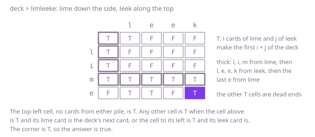

## The question

Given two piles of cards and a deck, each as a string, decide whether the deck is the two piles riffled together: every card of both piles used once, and each pile's cards in their original order.

What makes it harder than it looks is the moment both piles show the card the deck needs next. A greedy choice fails either way on Example 1: preferring `lime` takes the wrong e for the fifth card, and preferring `leek` the wrong l for the first. Checking the parts separately fails too: Example 2 has exactly the right cards, and each pile can be found in it on its own, just not in separate cards. Trying both choices at every tie is correct, but on piles that are long runs of one card it branches at nearly every card. And the lengths have to add up, or a deck with a card missing or one too many slips through.

## How to think about it

The first idea is to deal the deck card by card. When only one pile shows the card, take it from that pile; when both do, try one, and if that fails, back up and try the other. It is correct, because it tries every way of assigning the deck's cards to the piles that keeps each pile in order. But with two piles of 100 a's there are C(200, 100), about 9 × 10^58, such assignments, and a deck that fails only at the end makes the search try a great many of them.

What is worth remembering is that, after the first k cards of the deck, the only thing that matters is how many came from each pile: i from `left` and j from `right`, with i + j = k, and not the order they came in. So the search has only (n + 1) × (m + 1) different states for piles of n and m cards. Remember the states that have failed, since a success ends the search at once, and each state is explored only once.

Turned into a table, `can[i][j]` says whether the first i cards of `left` and the first j of `right` make the first i + j cards of the deck. `can[0][0]` is true. Otherwise the last of those i + j cards came either from `left`, when `can[i - 1][j]` holds and card i of `left` is that card, or from `right`, when `can[i][j - 1]` holds and card j of `right` is. Each row reads only the row above and itself, so one row of booleans does it: before cell j is updated it still holds the row above, and cell j − 1 already holds this row. And first check that the lengths add up.

Walk Example 1, `left = "lime"` down the side, `right = "leek"` along the top, `deck = "limleeke"`. The first column is true while `lime` spells the start of the deck, l, li, lim, and false at four cards, where the deck has its second l. From three cards of `lime`, the row runs true across all of `leek`: l, e, e, k are the deck's fourth to seventh cards. The last card, an e, comes from `lime` into the corner, which is true. The cell for one card of `leek` and none of `lime` is true too, and so are two cells in the last row, but nothing reaches the corner from them: they come from taking the first card from `leek`, or the e of `lime` too early.



## Brute force

Deal the deck from the top and, whenever both piles show the next card, try both. It comes first because it is the riffle itself written as code, and it fixes the answers the faster versions must match. It is correct because every way of splitting the deck that keeps each pile in order is a sequence of these choices, and the search tries them all.

```java
static boolean canShuffle(String left, String right, String deck) {
    if (left.length() + right.length() != deck.length()) {
        return false; // every card of both piles is used exactly once
    }
    return from(left, right, deck, 0, 0);
}

/** Whether the rest of deck is left from i on riffled with right from j on. */
private static boolean from(String left, String right, String deck, int i, int j) {
    if (i == left.length() && j == right.length()) {
        return true; // both piles used up, and so is the deck, since the lengths add up
    }
    char card = deck.charAt(i + j);
    if (i < left.length() && left.charAt(i) == card && from(left, right, deck, i + 1, j)) {
        return true; // the card dropped from the left pile
    }
    // or from the right pile; when both piles show the card, both choices are tried
    return j < right.length() && right.charAt(j) == card && from(left, right, deck, i, j + 1);
}
```

**Complexity:** time exponential, up to one call per way of splitting a prefix of the deck, which for two piles of 100 equal cards is about C(202, 101) ≈ 3.6 × 10^59; extra space O(n + m) for the recursion, at most 200 deep, which fits the test thread's default stack easily.

## Better: remember the failed states

The same search, with a table of the states (i, j) already known to fail. A state that succeeds ends the whole search, so only failures need remembering.

```java
static boolean canShuffle(String left, String right, String deck) {
    if (left.length() + right.length() != deck.length()) {
        return false;
    }
    return from(left, right, deck, 0, 0, new boolean[left.length() + 1][right.length() + 1]);
}

/** Whether the rest of deck is left from i on riffled with right from j on; failed[i][j] marks known failures. */
private static boolean from(String left, String right, String deck, int i, int j, boolean[][] failed) {
    if (i == left.length() && j == right.length()) {
        return true;
    }
    if (failed[i][j]) {
        return false; // the same i and j failed before, whatever order the cards came in then
    }
    char card = deck.charAt(i + j);
    if (i < left.length() && left.charAt(i) == card && from(left, right, deck, i + 1, j, failed)) {
        return true;
    }
    if (j < right.length() && right.charAt(j) == card && from(left, right, deck, i, j + 1, failed)) {
        return true;
    }
    failed[i][j] = true;
    return false;
}
```

**Complexity:** time O(n × m), since each state fails at most once and does constant work besides its two calls; extra space O(n × m) for the table, plus the recursion, at most 200 deep, which fits the test thread's default stack easily.

**Prefer it when:** ties are rare and most decks are riffles. The search then stops at the first split that works after about one call per card, n + m in all, where the table works out every one of its (n + 1) × (m + 1) cells; the record of failures is still allocated in full, but the JVM clears it in bulk rather than working out each cell.

## Optimal: one row of the table

Fill `can` one row per card of `left`, keeping a single row of booleans over `right`. This is the reference solution.

```java
static boolean canShuffle(String left, String right, String deck) {
    if (left.length() + right.length() != deck.length()) {
        return false; // every card of both piles is used exactly once
    }
    // can[j]: the first i cards of left and the first j of right can make the first i + j of deck
    boolean[] can = new boolean[right.length() + 1];
    for (int i = 0; i <= left.length(); i++) {
        for (int j = 0; j <= right.length(); j++) {
            if (i == 0 && j == 0) {
                can[0] = true; // no cards from either pile make the empty start of the deck
                continue;
            }
            char card = deck.charAt(i + j - 1);
            boolean lastFromLeft = i > 0 && can[j] && left.charAt(i - 1) == card; // can[j] still holds row i - 1
            boolean lastFromRight = j > 0 && can[j - 1] && right.charAt(j - 1) == card; // can[j - 1] holds row i
            can[j] = lastFromLeft || lastFromRight;
        }
    }
    return can[right.length()];
}
```

**Complexity:** time O(n × m), extra space O(m). The answer does not change when the piles swap places, so passing the shorter pile as `right` makes the space O(min(n, m)).

## Complexity

| Approach | Time | Extra space |
| --- | --- | --- |
| Brute force | exponential, up to about C(n + m + 2, n + 1) calls | O(n + m) recursion, at most 200 deep, fits |
| Better: remember the failed states | O(n × m) | O(n × m), recursion at most 200 deep, fits |
| Optimal: one row of the table | O(n × m) | O(m) |

## Where it shows up

Checking that a merged stream is consistent with its sources has this shape: a log that interleaves the events of two services must keep each service's own order, and a recorded run of two threads is only possible if it is an interleaving of what each thread did, which is the simplest case of checking a concurrent execution. Merge tools and replay debuggers ask the same question, and with more than two sources the table gains a dimension per source.

## Follow-up answers

**What if you also had to say which pile each card of the deck came from?** Keep the full table instead of one row. Walk back from the corner: if the last card can have come from `left`, so the cell above is true and card i of `left` matches, record `left` and step up; otherwise it came from `right`, so step left. Reverse the record at the end. When both are possible, either choice leads to a valid split, since several splits can exist. The walk adds O(n + m) time to the O(n × m) table.

**What if the deck were cut into three piles instead of two?** The state becomes how many cards came from each of the three, so the table has three dimensions: a cell is true when the last card can have come from one of the three piles with that pile's count one smaller. That is O(n × m × p) time, and keeping only two layers, O(m × p) space.

**How little extra memory does the check need?** One row over the shorter pile, since the piles can be swapped: min(n, m) + 1 booleans, which a bit set packs into a few machine words for piles of 100. The row cannot shrink further in general, because the next row reads every cell of it.
