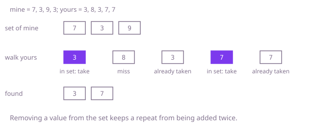

## The question

Given two lists of track numbers, return the numbers that appear in both, each listed once, in ascending order. Either list can repeat a number, and either can be empty.

What makes it harder than it looks: a number that repeats in both lists must still come out once, so a plain "for each match, add it" produces duplicates. Negative and extreme `int` values are ordinary here, so a trick that uses the value as an array index breaks. The result must be in ascending order, which a hash set does not give you. And scanning the second list for each value of the first is about 10 billion steps at 100,000 values each.

## How to think about it

The first idea is to take each value of the first list and scan the second list for it, skipping values already added. It is correct, but the question "is this value in the other list" is asked once per value, and each time it costs a full scan. Two cheaper answers to that question exist. If both lists are sorted, equal values meet when two indexes walk forward together: advance whichever side is smaller, and when they are equal, record the value once and step both. That also yields the result in ascending order for free. Or put one list in a hash set, which answers the question in one step and ignores repeats on its own side; walking the other list, a value that is found is taken out of the set as it is collected, so a repeat in the second list cannot be collected twice. The sort is then only over the shared values.

Walk Example 1, `mine = [7, 3, 9, 3]`, `yours = [3, 8, 3, 7, 7]`. The set holds 7, 3, 9. In `yours`: 3 is in the set, so take it out and collect it. 8 is not in the set. The second 3 is no longer in the set, so it is skipped. 7 is in the set, so take it out and collect it. The second 7 is skipped. The collected values are 3 and 7, and sorting them gives `[3, 7]`.



## Brute force

For each value of `mine`, skip it if it is already in the result, otherwise scan `yours` for it and add it if found. Sort the result at the end. It is what you say first, and it fixes the answer every faster version must agree with. It is correct because a value is added exactly when it is in `yours` and not yet listed, which is the definition of "in both, once".

```java
static int[] shared(int[] mine, int[] yours) {
    List<Integer> found = new ArrayList<>();
    for (int track : mine) {
        if (found.contains(track)) {
            continue; // already listed
        }
        for (int other : yours) {
            if (other == track) {
                found.add(track);
                break;
            }
        }
    }
    int[] result = new int[found.size()];
    for (int i = 0; i < result.length; i++) {
        result[i] = found.get(i);
    }
    Arrays.sort(result);
    return result;
}
```

**Complexity:** time O(n times m) for list lengths n and m (the check of `found` adds O(n times k) for k shared values, and k is at most the smaller of n and m), extra space O(k).

## Better: sort both lists, walk them together

Sort a copy of each list. Keep one index in each. If the value at the first index is smaller, advance the first; if it is larger, advance the second; if they are equal, record the value unless it equals the last value recorded (a repeat), and advance both. Because both are sorted, a value from one side can never be passed over without having been compared with its match, and the output is already ascending.

```java
static int[] shared(int[] mine, int[] yours) {
    int[] a = mine.clone();
    int[] b = yours.clone(); // sort copies, the caller's arrays stay as they are
    Arrays.sort(a);
    Arrays.sort(b);
    int[] out = new int[Math.min(a.length, b.length)];
    int count = 0;
    int i = 0, j = 0;
    while (i < a.length && j < b.length) {
        if (a[i] < b[j]) {
            i++;
        } else if (a[i] > b[j]) {
            j++;
        } else {
            if (count == 0 || out[count - 1] != a[i]) { // equal values sit together, so only the last one matters
                out[count++] = a[i];
            }
            i++;
            j++;
        }
    }
    return Arrays.copyOf(out, count);
}
```

**Complexity:** time O(n log n + m log m) for the two sorts plus O(n + m) for the walk, extra space O(n + m) for the sorted copies.

**Prefer it when:** the lists are already sorted, where the sorts disappear and it is O(n + m) time with no extra memory beyond the result, or when a hash set would be heavy because there are very many values. It also never hashes, so it has no bad-bucket case. The result comes out in order without a final sort.

## Optimal: hash set of one list, check the other

Put the first list into a hash set. Walk the second list; `remove` returns true only if the value was in the set, so the first time a shared value is met it is collected and removed, and later repeats find nothing. The statement asks for ascending order, so sort the collected values at the end. This is the reference solution.

```java
static int[] shared(int[] mine, int[] yours) {
    Set<Integer> mineSet = new HashSet<>();
    for (int track : mine) {
        mineSet.add(track);
    }
    List<Integer> found = new ArrayList<>();
    for (int track : yours) {
        if (mineSet.remove(track)) { // true only the first time this value is met
            found.add(track);
        }
    }
    int[] result = new int[found.size()];
    for (int i = 0; i < result.length; i++) {
        result[i] = found.get(i);
    }
    Arrays.sort(result);
    return result;
}
```

**Complexity:** time O(n + m + k log k) on average for k shared values; O((n + m) log n + k log k) in the worst case, because Java's `HashSet` turns a crowded bucket of `Integer` keys into a tree. Extra space O(n + k).

## Complexity

| Approach | Time | Extra space |
| --- | --- | --- |
| Brute force: scan the second list for each value | O(n times m) | O(k) |
| Better: sort both, two indexes | O(n log n + m log m) | O(n + m) |
| Optimal: hash set, then sort the shared values | O(n + m + k log k) average, O((n + m) log n + k log k) worst | O(n + k) |

## Where it shows up

`playlist-dedupe` computes this in `PlaylistTools.similarity`. It turns each playlist into a set of song keys, so a song repeated in one playlist collapses to one entry, then counts how many keys of the first set are in the second. The count is the shared part, and the rest of the similarity is arithmetic on it: shared over the size of the union. Its `dedupe` method uses the same set trick on a single list, keeping an entry only when `seen.add` returns true.

In practice the same intersection finds customers who appear in two exports, tags shared by two documents, and the permissions two roles have in common.

## Follow-up answers

**What if both lists are already sorted?** Use the two-index walk and skip the sorts and the set: it is O(n + m) time with no extra structure. Skip repeated values as you go so that each shared value is added once.

**What if one list is tiny and the other does not fit in memory?** Put the tiny list in the set and stream the large one through it, one pass, adding a value to the result the first time it is found in the set and removing it. Memory is the size of the tiny list.

**How would you keep the number of times a value is shared, not just that it is shared?** Count the values of one list in a map. For each value of the other list with a positive count, add it to the result and decrement the count. A value then appears as many times as the smaller of its two counts.
