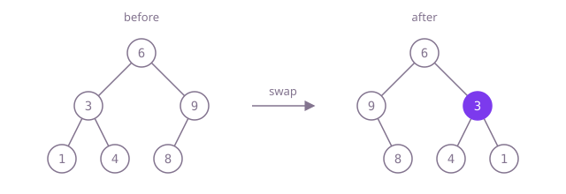

## The question

Given the root of a binary tree, mirror it: every node's left and right children trade places, at every level, and the same root comes back. The nodes stay the same objects; only their `left` and `right` fields change.

What makes it harder than it looks: the swap is two assignments that each overwrite something the other needs. Write `root.left = invert(root.right)` first and the old left subtree is gone before you mirror it, so both sides end up as the same subtree. And swapping only the root's children is not enough; the mirror has to reach every node.

## How to think about it

The first idea is to separate finding the nodes from changing them: walk the tree once to collect every node in a list, then go through the list and swap each node's two children. That is correct and linear, but it holds every node in memory at once, when a swap at one node never depends on any other node.

So swap as you walk. A queue gives the level-by-level version: take a node, swap its children, put the children in the queue. The structure of the tree suggests something shorter still: mirroring a tree is swapping the root's children and then mirroring each of the two subtrees, which is the same question on smaller trees. Recursion says that in four lines and keeps one call per level on the stack. With depth capped at 1,000 that stack is small and safe.

Walk Example 1, `[6,3,9,1,4,8]`. At 6, keep the old left (3), set 6's left to the mirror of 9 and its right to the mirror of 3. Mirroring 9 moves its 8 from the left to the right. Mirroring 3 swaps 1 and 4 into 4, 1. Read level by level, the result is `[6,9,3,null,8,4,1]`.



## Brute force

Collect the nodes first, then swap. It comes first because it is what you say first, and it fixes the answer to compare against. It is correct because every node lands in the list exactly once (each is reached from its one parent), and a node's swap touches only its own two fields, so the order of the swaps does not matter.

```java
static TreeNode invert(TreeNode root) {
    List<TreeNode> nodes = new ArrayList<>();
    if (root != null) {
        nodes.add(root);
    }
    for (int i = 0; i < nodes.size(); i++) { // the list doubles as the queue of the walk
        TreeNode n = nodes.get(i);
        if (n.left != null) nodes.add(n.left);
        if (n.right != null) nodes.add(n.right);
    }
    for (TreeNode n : nodes) {
        TreeNode left = n.left;
        n.left = n.right;
        n.right = left;
    }
    return root;
}
```

**Complexity:** time O(n), extra space O(n) for the list of every node.

## Better: swap during a level-order walk

Do the swap the moment a node comes off the queue, then queue its children. Nothing is kept once its children are queued, so the queue only ever holds part of two adjacent levels.

```java
static TreeNode invert(TreeNode root) {
    ArrayDeque<TreeNode> queue = new ArrayDeque<>();
    if (root != null) {
        queue.add(root);
    }
    while (!queue.isEmpty()) {
        TreeNode n = queue.poll();
        TreeNode left = n.left; // saved: the next line overwrites it
        n.left = n.right;
        n.right = left;
        if (n.left != null) queue.add(n.left);
        if (n.right != null) queue.add(n.right);
    }
    return root;
}
```

**Complexity:** time O(n), extra space O(w) for the queue, where w is the widest level (up to about n/2 in a complete tree).

**Prefer it when:** the depth is not capped. A path of 100,000 nodes has width 1, so the queue stays tiny, while one call per level would overflow Java's stack.

## Optimal: recursion

Keep the old left child, set the left to the mirrored right subtree and the right to the mirrored old left one, and return the node. This is the reference solution.

```java
static TreeNode invert(TreeNode root) {
    if (root == null) {
        return null;
    }
    TreeNode left = root.left; // kept: the next line overwrites it
    root.left = invert(root.right);
    root.right = invert(left);
    return root;
}
```

**Complexity:** time O(n), extra space O(h) for the call stack, where h is the depth; at most 1,000 frames here, but a path of tens of thousands of nodes would overflow Java's default stack.

## Complexity

| Approach | Time | Extra space |
| --- | --- | --- |
| Brute force | O(n) | O(n) |
| Better: swap during a level-order walk | O(n) | O(w), the widest level |
| Optimal: recursion | O(n) | O(h) call stack, safe for depth up to 1,000, overflows on paths of tens of thousands |

## Where it shows up

No coding-round problem is linked to this question. Mirroring a tree shows up when a layout tree has to be flipped for right-to-left languages, when a game or editor mirrors a scene or document structure horizontally, and as a building block for checking symmetry: a tree is symmetric exactly when it equals its own mirror.

## Follow-up answers

**How would you do it without recursion, and when does that matter?** Use the level-order walk above (or an explicit stack): swap each node's children as it comes off the queue and queue the children. It matters when the depth is not capped: a Java thread's default stack holds roughly ten thousand small frames, fewer while the code still runs interpreted, so a lopsided tree of 100,000 nodes overflows the recursive version, while the queue lives on the heap and for a path never holds more than one node.

**How would you check whether a tree is its own mirror image?** Compare the tree with itself, crossed over: two subtrees are mirrors when their roots hold the same value, the left of one mirrors the right of the other, and the right of one mirrors the left of the other. Start with the root's two children. That is O(n) time without changing or copying the tree.

**What changes if the original tree must stay untouched?** Build a new tree instead of swapping fields: the copy of a node gets the value, the mirrored copy of the old right subtree as its left child and the mirrored copy of the old left subtree as its right. The time is still O(n), but it allocates n new nodes, which is exactly what this question's tests reject.
