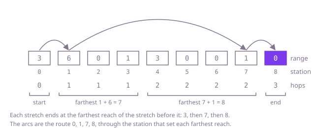

## The question

Each relay station forwards a message to any station up to its range further along the road. Return the fewest hops from station 0 to the last station, which can always be reached.

What makes it harder than it looks is that both natural greedy rules are wrong. Forwarding as far as possible each time takes 4 hops on Example 1, where 3 are enough, and so does forwarding to the station with the largest range. The count is easy to get wrong at the ends: a message that starts at the last station needs no hop at all, and a pass that also looks at the last station adds one hop too many whenever the stations reached so far end exactly on it (`[2,1,1]` needs 1 hop, not 2). Trying every route grows exponentially, and even remembering the answer per station costs O(n²) when the ranges are long.

## How to think about it

The first idea is to try every route: from station 0, try every hop length, recurse, and keep the fewest. It repeats a great deal, because the fewest hops from station 7 is worked out again for every route that lands on 7.

Remembering the answer per station removes that. Fill a table from the end: the fewest hops from a station is one more than the fewest from any station it can reach. Each station is decided once, but deciding it scans its whole range, so this is O(n × max range), about 5 × 10^9 steps on 100,000 stations with long ranges.

The step to the greedy is to count by hops instead of by stations. The stations the message can reach within `k` hops form one unbroken stretch from station 0, because a hop may always be shorter: anything between a station and its farthest reach can be landed on. The stretch for `k + 1` hops ends at the farthest reach, `i + range[i]`, of any station in the stretch for `k` hops. So the answer is the number of stretches needed before one covers the last station, and one pass finds them: keep where the current stretch ends and the farthest reach seen so far, and when the pass reaches the end of the current stretch, one hop more is needed and the next stretch ends at that farthest reach. The pass stops before the last station, because arriving there needs no hop of its own.

This also says which hop to make, and why the two wrong rules fail. The right next station is the one in range whose own reach `i + range[i]` is farthest: whatever another station could reach in its later hops, the stretch from this one covers too. Forwarding as far as possible picks the farthest station, which may have a short range of its own; picking the largest range ignores where the station stands.

Walk Example 1, `range = [3,6,0,1,3,0,0,1,0]`. The start stretch is station 0, whose reach is 3, so one hop covers stations 1 to 3. Their reaches are 7, 2 and 4, so two hops cover stations 4 to 7. Their reaches are 7, 5, 6 and 8, and 8 is the last station: three hops. The route is 0 → 1 → 7 → 8, through the station that set each farthest reach.



## Brute force

From each station, try every hop length, find the fewest hops from where it lands, and add one. It comes first because it is the rule written as code, and it fixes the answers to compare against. It is correct because every route is some first hop followed by a route from the station it lands on, and a station with no route onward returns a marker that is never chosen.

```java
static int fewestHops(int[] range) {
    return hopsFrom(range, 0);
}

/** Fewest hops from station i to the last station; MAX_VALUE when no route gets there. */
private static int hopsFrom(int[] range, int i) {
    int last = range.length - 1;
    if (i == last) {
        return 0;
    }
    int best = Integer.MAX_VALUE;
    for (int step = 1; step <= range[i] && i + step <= last; step++) {
        int rest = hopsFrom(range, i + step);
        if (rest != Integer.MAX_VALUE) { // that station has a route onward
            best = Math.min(best, rest + 1);
        }
    }
    return best;
}
```

**Complexity:** time O(2^n) in the worst case, when every station can reach every later one; extra space O(n) for the recursion. A route can be up to n - 1 hops long, so on a long row of short ranges the recursion overflows the stack before it finishes.

## Better: fewest hops from each station, filled from the end

Fill a table from the last station backwards. The last station needs 0 hops; any other station needs one more than the best station in its range. A station whose range holds no station with a route onward keeps a marker, so it is never chosen either.

```java
static int fewestHops(int[] range) {
    int n = range.length;
    int[] hops = new int[n]; // hops[i]: fewest hops from station i to the last one
    for (int i = n - 2; i >= 0; i--) {
        int best = Integer.MAX_VALUE; // stays MAX_VALUE when no station in range gets there
        int farthest = Math.min(n - 1, i + range[i]);
        for (int j = i + 1; j <= farthest; j++) {
            best = Math.min(best, hops[j]);
        }
        hops[i] = best == Integer.MAX_VALUE ? best : best + 1;
    }
    return hops[0];
}
```

**Complexity:** time O(n × max range), which is O(n²) when the ranges are long; extra space O(n).

**Prefer it when:** you need the fewest hops from every station, not just station 0: the table holds all of them.

## Optimal: count the stretches

Walk the stations once, keeping the end of the stretch the current number of hops covers and the farthest reach seen so far. When the walk reaches the end of the stretch, add a hop and move the end to the farthest reach. Stop before the last station. This is the reference solution.

```java
static int fewestHops(int[] range) {
    int hops = 0;
    int stretchEnd = 0; // last station the message can reach with `hops` hops
    int farthest = 0; // farthest station it can reach with one hop more
    for (int i = 0; i < range.length - 1; i++) { // the last station sends nothing on
        farthest = Math.max(farthest, i + range[i]);
        if (i == stretchEnd) { // every station of this stretch has been seen: one hop more
            hops++;
            stretchEnd = farthest;
        }
    }
    return hops;
}
```

**Complexity:** time O(n), extra space O(1). It relies on the guarantee that the last station can be reached; without it, a stretch that cannot grow would be counted as if it did (see the follow-ups).

## Complexity

| Approach | Time | Extra space |
| --- | --- | --- |
| Brute force | O(2^n) worst case | O(n) recursion, up to n deep, overflows on long rows |
| Better: fewest hops from each station | O(n × max range), O(n²) with long ranges | O(n) |
| Optimal: count the stretches | O(n) | O(1) |

## Where it shows up

The same pass answers the classic covering question: the fewest intervals that together cover a span, choosing each time the interval that starts inside the covered part and reaches farthest. That is the fewest sprinklers to water a strip of garden, the fewest video clips to cover a recording, or the fewest repeaters to carry a signal along a pipeline or a road, each with its own reach.

## Follow-up answers

**What if you also had to return the stations the message passes through?** Remember which station set `farthest`. Each time the walk reaches the end of a stretch, that station lies in the stretch just finished and reaches the end of the next one, so it is the next stop on a fewest-hops route: add it to the route (at the first stretch end it is station 0 itself), and finish with the last station. On Example 1 that gives 0, 1, 7, 8.

**What if the last station might be out of reach, and you had to return -1 then?** The stretch then stops growing: at the end of a stretch the farthest reach is still the end itself. Check for that when the walk reaches the end of a stretch and return -1; the rest of the pass is unchanged.

**What if each hop had a cost and you wanted the cheapest route instead of the fewest hops?** The stretches work because every hop costs the same. With costs, fill a table from the end where each station takes the cost of its hop plus the cheapest station in its range; a segment tree over the table answers each range minimum in O(log n), so O(n log n) overall. With costs on arbitrary pairs of stations it is a shortest-path search, such as Dijkstra's algorithm.
