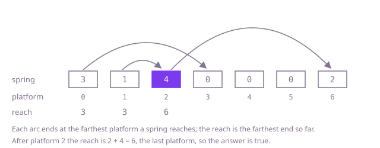

## The question

You start on platform 0 of a row, and each platform's spring lets you jump forward by 1 up to its strength. Return whether some sequence of jumps reaches the last platform.

What makes it harder than it looks is that the obvious greedy, always take the longest jump, is wrong: in Example 1 the longest jump from platform 0 lands on a platform with no spring, while a shorter one goes on to the end. A spring of 0 is not a dead end when an earlier spring carries you over it, and it is no obstacle at all on the last platform (`[1,0]` is true). A strong spring helps only if its platform can be reached (Example 3). And trying every sequence of jumps grows exponentially with the row.

## How to think about it

The first idea is a search: from each platform, try every jump length and recurse. It is correct, but it explores the same platform again from every route that lands on it, so a row with no way through costs up to 2^n calls.

Remembering the answer per platform removes the repetition. Fill a table from the end: a platform is good if some platform it can land on is good. Each platform is decided once, but deciding it scans up to `spring[i]` platforms, so the table costs O(n × max spring), about 5 × 10^9 steps on a row of 100,000 strong springs.

The step to the greedy is one observation about shape: the platforms you can reach always form one block starting at platform 0, with no gaps. If you can land on platform `p` by jumping from platform `q`, you can land on every platform between `q` and `p` as well, because shorter jumps are allowed. So nothing about the jumps themselves needs remembering, only how far that block extends. Walk the row from the left, and while the current platform is inside the block, extend the block to `i + spring[i]` if that is farther. If the block reaches the last platform, the answer is true; if the walk steps past the end of the block, you are stuck. This never chooses a jump, which is why it is safe: it tracks how far the best choice could get, and the no-gaps argument shows that every platform inside the block really can be reached. The longest-jump rule fails exactly because it commits to one landing platform instead.

Walk Example 1, `spring = [3,1,4,0,0,0,2]`. Platform 0 extends the reach to 3; platform 1 reaches only 2, so the reach stays 3; platform 2 reaches 2 + 4 = 6, the last platform, so the answer is true. In Example 2, `[1,2,0,3,0,0,0,1]`, the reach goes 1, 3, 3, 6, 6, 6, 6, and platform 7 lies beyond it.



## Brute force

Try every jump from platform 0, and from wherever it lands try every jump again, until a route reaches the last platform or every route is exhausted. It comes first because it is the rule written as code, and it fixes the answers to compare against. It is correct because every sequence of jumps is some first jump followed by a sequence from the platform it lands on.

```java
static boolean canReachEnd(int[] spring) {
    return reachable(spring, 0);
}

/** Whether the last platform can be reached from platform i. */
private static boolean reachable(int[] spring, int i) {
    if (i == spring.length - 1) {
        return true;
    }
    for (int step = 1; step <= spring[i] && i + step < spring.length; step++) {
        if (reachable(spring, i + step)) { // try every landing platform in turn
            return true;
        }
    }
    return false;
}
```

**Complexity:** time O(2^n) in the worst case, a row with no way through where every platform can land on every later one up to a dead end; extra space O(n) for the recursion. A route can be up to n - 1 jumps long, so on a long row of weak springs the recursion overflows the stack long before the search would finish.

## Better: decide each platform from the end

Fill a table from the last platform backwards. The last platform is good, and any other platform is good if one of the platforms its spring can land on is good; one good landing platform is enough, so the scan stops there.

```java
static boolean canReachEnd(int[] spring) {
    int n = spring.length;
    boolean[] good = new boolean[n]; // good[i]: the last platform can be reached from i
    good[n - 1] = true;
    for (int i = n - 2; i >= 0; i--) {
        int farthest = Math.min(n - 1, i + spring[i]);
        for (int j = i + 1; j <= farthest; j++) {
            if (good[j]) { // one good landing platform is enough
                good[i] = true;
                break;
            }
        }
    }
    return good[0];
}
```

**Complexity:** time O(n × max spring), which is O(n²) when the springs are strong; extra space O(n).

**Prefer it when:** you need the answer from every starting platform, not just platform 0: `good` holds all of them.

## Optimal: the farthest reach

Walk the row once, keeping the farthest platform reachable so far. Every platform up to it is reachable, so each one in turn may extend it. Stop with true as soon as it covers the last platform, and with false when the next platform lies beyond it. This is the reference solution.

```java
static boolean canReachEnd(int[] spring) {
    int reach = 0; // farthest platform reachable so far; every platform up to it is reachable
    for (int i = 0; i <= reach; i++) {
        reach = Math.max(reach, i + spring[i]);
        if (reach >= spring.length - 1) {
            return true;
        }
    }
    return false; // the next platform is beyond the reach: stuck
}
```

**Complexity:** time O(n), extra space O(1). `i + spring[i]` is at most 2 × 10^5, well inside an `int`.

## Complexity

| Approach | Time | Extra space |
| --- | --- | --- |
| Brute force | O(2^n) worst case | O(n) recursion, up to n deep, overflows on long rows |
| Better: decide each platform from the end | O(n × max spring), O(n²) with strong springs | O(n) |
| Optimal: the farthest reach | O(n) | O(1) |

## Where it shows up

Any check of whether ranges laid end to end cover a line has this shape: whether a chain of radio repeaters, each covering some distance ahead, carries a signal the whole length of a road; whether the intervals a set of sensors cover leave a gap along a pipeline; whether a platform game level can be finished at all. The farthest-reach pass is the interval-covering check with the intervals already sorted by their start.

## Follow-up answers

**What if you had to return the fewest jumps instead?** The block of reachable platforms grows in rounds: the platforms reachable in one jump, then in two, and so on, each round's block ending at the farthest reach of the one before. Count the rounds until the block covers the last platform. That is the next question, Jump Game II.

**What if some platforms were broken and could not be landed on?** Skip them in the pass: a broken platform never extends the reach, though a jump may still pass over it. The no-gaps argument still holds for the platforms that are not broken, because a spring that reaches past a broken platform can land on any unbroken one before it.

**What if springs could also throw you backwards?** Then the reachable platforms need not form one block, so the single reach is not enough. Search the platforms as a graph, breadth-first from platform 0, marking each platform when it is first reached. Scanning every landing platform costs O(n × max spring); keeping the platforms not yet reached in a sorted set and removing each one as it is reached brings it to O(n log n).
