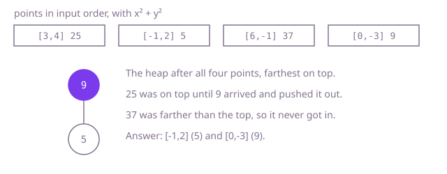

## The question

Given up to 100,000 points on a grid and a number `k`, return the `k` points closest to the origin, in any order. The input guarantees the answer is unique.

What makes it harder than it looks: two small traps and one choice. The distance needs no square root, since comparing `x² + y²` gives the same order, but with coordinates up to 100,000 that sum reaches `2 * 10^10` and silently wraps around in an `int`, making some far points look close. And the obvious answer, sorting everything, orders all n points when you only need to separate k of them from the rest.

## How to think about it

The first idea is to sort the points by squared distance and take the first k. It is correct, and it fixes the answer to compare against, but it spends O(n log n) putting the far points in order, and the order of the k you return is not even asked for.

What is worth keeping is only the k best so far. Read the points one by one and hold the k closest seen. When a new point arrives, the one it could replace is the farthest of those k, so that is the one you need at hand: a max-heap of size k, keyed by squared distance, keeps it on top. Each point costs O(log k), which is a real saving when k is small.

The last step drops the heap. You do not need the k points in any order, only to split the list into "the k closest" and "the rest". That is the quicksort partition step: pick a pivot distance, move closer points left and farther points right, and continue only in the side that contains position k. On average each round halves the work, so the total is linear.

Walk Example 1 with `k = 2`. The squared distances are 25, 5, 37 and 9. Reading in order with a max-heap: `[3, 4]` (25) and `[-1, 2]` (5) go in, with 25 on top. `[6, -1]` (37) is farther than the top, so it is skipped. `[0, -3]` (9) is closer than 25, so `[3, 4]` leaves and `[0, -3]` enters. The heap holds `[-1, 2]` and `[0, -3]`.



## Brute force

Sort a copy of the points by squared distance, computed in `long`, and return the first k. It comes first because it is the definition written as code, and it fixes the answer the faster versions must agree with. It is correct because after the sort the first k points are by definition the k closest, and the uniqueness guarantee means no tie is split at position k.

```java
static int[][] kClosest(int[][] points, int k) {
    int[][] sorted = points.clone();
    // long: x * x + y * y reaches 2 * 10^10, past the int range
    Arrays.sort(sorted, Comparator.comparingLong(p -> (long) p[0] * p[0] + (long) p[1] * p[1]));
    return Arrays.copyOf(sorted, k);
}
```

**Complexity:** time O(n log n), extra space O(n) for the sorted copy.

## Better: a max-heap of the k closest

Keep a max-heap on squared distance. Add each point; when the heap holds more than k, remove the top, the farthest of the k + 1. At the end the heap holds the k closest.

```java
static int[][] kClosest(int[][] points, int k) {
    PriorityQueue<int[]> heap = // the farthest kept point on top
            new PriorityQueue<>(Comparator.comparingLong((int[] p) -> squared(p)).reversed());
    for (int[] p : points) {
        heap.add(p);
        if (heap.size() > k) {
            heap.poll(); // drop the farthest of the k + 1
        }
    }
    return heap.toArray(new int[0][]);
}

private static long squared(int[] p) {
    return (long) p[0] * p[0] + (long) p[1] * p[1];
}
```

**Complexity:** time O(n log k), extra space O(k).

**Prefer it when:** the points arrive one at a time, or there are too many to hold at once: the heap reads each point once and keeps only k of them, and it never reorders the input. Its O(n log k) is also a guarantee, with no unlucky case.

## Optimal: quickselect

Partition a copy of the points around a random pivot distance into three parts: closer, as close, and farther. If position k falls inside the closer part, continue there; if it falls inside the "as close" part, the first k slots are the answer; otherwise continue in the farther part. The three-way split keeps repeated distances from slowing it down. This is the reference solution.

```java
static int[][] kClosest(int[][] points, int k) {
    int[][] p = points.clone();
    Random random = new Random();
    int lo = 0;
    int hi = p.length - 1;
    while (lo < hi) {
        long pivot = squared(p[lo + random.nextInt(hi - lo + 1)]);
        // three parts: [lo, lt) closer than the pivot, [lt, gt] as close, (gt, hi] farther
        int lt = lo;
        int i = lo;
        int gt = hi;
        while (i <= gt) {
            long d = squared(p[i]);
            if (d < pivot) {
                swap(p, lt++, i++);
            } else if (d > pivot) {
                swap(p, i, gt--);
            } else {
                i++;
            }
        }
        if (k <= lt) {
            hi = lt - 1; // the k closest all lie in the closer part
        } else if (k <= gt + 1) {
            break; // the first k slots hold the answer
        } else {
            lo = gt + 1;
        }
    }
    return Arrays.copyOf(p, k);
}

private static long squared(int[] point) {
    return (long) point[0] * point[0] + (long) point[1] * point[1]; // up to 2 * 10^10: past int
}

private static void swap(int[][] p, int a, int b) {
    int[] t = p[a];
    p[a] = p[b];
    p[b] = t;
}
```

**Complexity:** time O(n) on average and O(n²) in the worst case, which a random pivot makes vanishingly unlikely; extra space O(n) for the copy, O(1) beyond it.

## Complexity

| Approach | Time | Extra space |
| --- | --- | --- |
| Brute force | O(n log n) | O(n) |
| Better: max-heap of the k closest | O(n log k) | O(k) |
| Optimal: quickselect | O(n) average, O(n²) worst case | O(n) for the copy |

## Where it shows up

No coding-round problem is linked to this question. "The k nearest" is everywhere: a map app listing the ten closest charging stations, a recommender finding the items whose feature vectors are nearest to a user's, or a game server picking the players within reach of an explosion. Real systems with millions of points add a spatial index such as a grid or a k-d tree so they look at only nearby points, then use exactly this heap on what the index returns.

## Follow-up answers

**What if the points arrive as a stream too large to keep in memory?** Use the max-heap version. It reads each point once, keeps only k of them, and never needs to look back, so memory is O(k) however long the stream is. Quickselect needs all the points in memory at once.

**How would you return the k points sorted by distance?** Find the k closest with quickselect, then sort just those k: O(n + k log k) on average. With the heap, poll it until empty, which gives them farthest first, and reverse.

**What changes if ties at the boundary are allowed?** Then "the k closest" is not one set, so the question must say which tied points to keep, for example the ones that come first in the list, or all points at the boundary distance. For "first in the list", use the index as a second key in the heap's comparator or the sort; quickselect is not stable, so it would need the index carried along and compared the same way.
