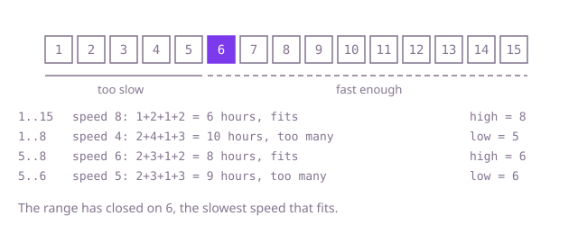

## The question

Koko eats bananas at a fixed number per hour, from one pile per hour at most, resting when a pile runs out early in the hour. Given the piles and the hours available, return the slowest speed that still finishes every pile in time.

What makes it harder than it looks: there is no array to search. The thing being searched is the speed itself, a number from 1 to a billion, and each guess costs a pass over the piles. Each pile's hours round up, so plain integer division undercounts. And at slow speeds the total hours outgrow an `int`: three piles of a billion bananas at 1 banana an hour need three billion hours, which wraps to a negative count and makes the slowest speed look fast enough.

## How to think about it

The first idea is to try speeds 1, 2, 3 and so on, and stop at the first that meets the limit. It is correct because the first speed that fits is the slowest one, and it is hopeless when the answer is in the hundreds of millions.

What is worth noticing: the hours needed never go up when the speed goes up. So the speeds line up as "too slow" for everything below the answer and "fast enough" for the answer and everything above. That is a sorted yes/no sequence, and binary search finds the first "yes" in it with about 30 guesses over a range up to a billion. The range starts at 1 and ends at the largest pile: at that speed every pile takes one hour, and there are at most `hours` piles, so it always fits.

Walk Example 1, `piles = [7, 15, 4, 11]`, `hours = 8`, over speeds 1 to 15. Speed 8 needs 1 + 2 + 1 + 2 = 6 hours, which fits, so the answer is 8 or lower. Speed 4 needs 2 + 4 + 1 + 3 = 10, too many, so the answer is 5 or higher. Speed 6 needs 2 + 3 + 1 + 2 = 8, which fits. Speed 5 needs 2 + 3 + 1 + 3 = 9, too many. The range has closed on 6.



## Brute force

Try every speed from 1 up and return the first that fits. It comes first because it is the question read literally, and it fixes the answer to compare against. It is correct because the speeds are tried in increasing order, and it always ends, by the largest pile's size at the latest.

```java
static int minSpeed(int[] piles, int hours) {
    for (int speed = 1; ; speed++) { // ends by the largest pile's size, where every pile takes one hour
        if (hoursAt(piles, speed) <= hours) {
            return speed;
        }
    }
}

static long hoursAt(int[] piles, int speed) {
    long total = 0; // 10^4 piles of up to 10^9 hours each do not fit in an int
    for (int bananas : piles) {
        total += (bananas - 1) / speed + 1; // whole hours, rounded up
    }
    return total;
}
```

**Complexity:** time O(n * m), where m is the largest pile, extra space O(1).

## Better: start the scan at the lowest possible speed

Each hour clears at most `speed` bananas, so a speed below the total bananas divided by `hours` cannot finish. Start the scan there instead of at 1, with the same `hoursAt`.

```java
static int minSpeed(int[] piles, int hours) {
    long bananas = 0;
    for (int pile : piles) {
        bananas += pile; // up to 10^13 bananas: a long
    }
    int speed = (int) Math.max(1, (bananas + hours - 1) / hours); // no slower speed can finish
    while (hoursAt(piles, speed) > hours) {
        speed++;
    }
    return speed;
}
```

**Complexity:** time O(n * (a - b + 1)), where a is the answer and b the starting speed; O(n * m) in the worst case. Extra space O(1).

**Prefer it when:** the piles are close in size, so the rounding wastes little and the answer sits a few steps above the starting speed. With uneven piles and a tight limit the scan is as slow as the brute force.

## Optimal: binary search on the speed

Search the speeds 1 to the largest pile for the first that fits, keeping a range `[low, high]` whose `high` always fits. A middle speed that fits becomes the new `high`; one that does not moves `low` past it. This is the reference solution.

```java
static int minSpeed(int[] piles, int hours) {
    int low = 1;
    int high = 1;
    for (int bananas : piles) {
        high = Math.max(high, bananas); // at the largest pile's size every pile takes one hour
    }
    while (low < high) {
        int middle = (low + high) >>> 1;
        if (hoursAt(piles, middle) <= hours) {
            high = middle; // fast enough: the answer is middle or slower
        } else {
            low = middle + 1;
        }
    }
    return low;
}

private static long hoursAt(int[] piles, int speed) {
    long total = 0; // up to 10^4 piles of 10^9 hours each: too big for an int
    for (int bananas : piles) {
        total += (bananas - 1) / speed + 1; // whole hours, rounded up
    }
    return total;
}
```

**Complexity:** time O(n log m), where m is the largest pile, extra space O(1).

## Complexity

| Approach | Time | Extra space |
| --- | --- | --- |
| Brute force | O(n * m) | O(1) |
| Better: start the scan at the lowest possible speed | O(n * (a - b + 1)), O(n * m) worst case | O(1) |
| Optimal: binary search on the speed | O(n log m) | O(1) |

## Where it shows up

Capacity planning: the smallest number of workers, the lowest bandwidth or the smallest batch size that meets a deadline, whenever "is this enough?" can be checked and more is never worse. Load tests that look for the highest request rate a service holds within its latency target use the same search on the rate.

## Follow-up answers

**Can you find the speed in O(n log m) time, where m is the largest pile?** Yes: binary search the speed between 1 and the largest pile, checking each guess with one O(n) pass that counts the hours. About log m guesses, each O(n).

**What if Koko could move on to another pile in the same hour once one is finished?** Then no time is lost to rounding, and the hours needed are the total bananas divided by the speed, rounded up once. The answer is the total bananas divided by `hours`, rounded up, with no search at all.

**What if several eaters shared the piles?** The check changes: for a guessed speed, decide whether the piles can be split among the eaters so that each eater's hours fit. Splitting arbitrary piles evenly is a hard scheduling problem, but if each eater must take a run of neighbouring piles, a greedy fill per eater answers the check in O(n), and the binary search on the speed stays the same.
