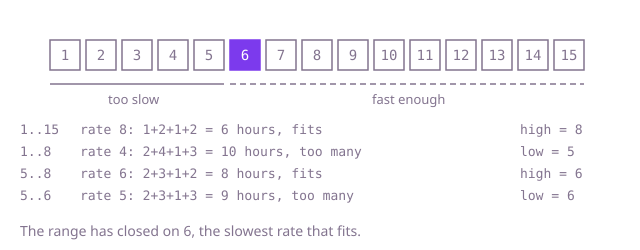

## The question

A printer prints at a fixed number of pages per hour, one job per hour at most, idling when a job ends early in the hour. Given the jobs and the hours available, return the slowest rate that still finishes everything in time.

What makes it harder than it looks: there is no array to search. The thing being searched is the rate itself, a number from 1 to a billion, and each guess costs a pass over the jobs. Each job's hours round up, so plain integer division undercounts. And at slow rates the total hours outgrow an `int`: three jobs of a billion pages at 1 page an hour need three billion hours, which wraps to a negative count and makes the slowest rate look fast enough.

## How to think about it

The first idea is to try rates 1, 2, 3 and so on, and stop at the first that meets the deadline. It is correct because the first rate that fits is the slowest one, and it is hopeless when the answer is in the hundreds of millions.

What is worth noticing: the hours needed never go up when the rate goes up. So the rates line up as "too slow" for everything below the answer and "fast enough" for the answer and everything above. That is a sorted yes/no sequence, and binary search finds the first "yes" in it with about 30 guesses over a range up to a billion. The range starts at 1 and ends at the largest job: at that rate every job takes one hour, and there are at most `hours` jobs, so it always fits.

Walk Example 1, `jobs = [7, 15, 4, 11]`, `hours = 8`, over rates 1 to 15. Rate 8 needs 1 + 2 + 1 + 2 = 6 hours, which fits, so the answer is 8 or lower. Rate 4 needs 2 + 4 + 1 + 3 = 10, too many, so the answer is 5 or higher. Rate 6 needs 2 + 3 + 1 + 2 = 8, which fits. Rate 5 needs 2 + 3 + 1 + 3 = 9, too many. The range has closed on 6.



## Brute force

Try every rate from 1 up and return the first that fits. It comes first because it is the question read literally, and it fixes the answer to compare against. It is correct because the rates are tried in increasing order, and it always ends, by the largest job's size at the latest.

```java
static int minRate(int[] jobs, int hours) {
    for (int rate = 1; ; rate++) { // ends by the largest job's size, where every job takes one hour
        if (hoursAt(jobs, rate) <= hours) {
            return rate;
        }
    }
}

static long hoursAt(int[] jobs, int rate) {
    long total = 0; // 10^4 jobs of up to 10^9 hours each do not fit in an int
    for (int pages : jobs) {
        total += (pages - 1) / rate + 1; // whole hours, rounded up
    }
    return total;
}
```

**Complexity:** time O(n * m), where m is the largest job, extra space O(1).

## Better: start the scan at the lowest possible rate

Every hour prints at most `rate` pages, so a rate below the total pages divided by `hours` cannot finish. Start the scan there instead of at 1, with the same `hoursAt`.

```java
static int minRate(int[] jobs, int hours) {
    long pages = 0;
    for (int job : jobs) {
        pages += job; // up to 10^13 pages: a long
    }
    int rate = (int) Math.max(1, (pages + hours - 1) / hours); // no slower rate can finish
    while (hoursAt(jobs, rate) > hours) {
        rate++;
    }
    return rate;
}
```

**Complexity:** time O(n * (a - b + 1)), where a is the answer and b the starting rate; O(n * m) in the worst case. Extra space O(1).

**Prefer it when:** the jobs are close in size, so the rounding wastes little and the answer sits a few steps above the starting rate. With uneven jobs and a tight deadline the scan is as slow as the brute force.

## Optimal: binary search on the rate

Search the rates 1 to the largest job for the first that fits, keeping a range `[low, high]` whose `high` always fits. A middle rate that fits becomes the new `high`; one that does not moves `low` past it. This is the reference solution.

```java
static int minRate(int[] jobs, int hours) {
    int low = 1;
    int high = 1;
    for (int pages : jobs) {
        high = Math.max(high, pages); // at the largest job's size every job takes one hour
    }
    while (low < high) {
        int middle = (low + high) >>> 1;
        if (hoursAt(jobs, middle) <= hours) {
            high = middle; // fast enough: the answer is middle or slower
        } else {
            low = middle + 1;
        }
    }
    return low;
}

private static long hoursAt(int[] jobs, int rate) {
    long total = 0; // up to 10^4 jobs of 10^9 hours each: too big for an int
    for (int pages : jobs) {
        total += (pages - 1) / rate + 1; // whole hours, rounded up
    }
    return total;
}
```

**Complexity:** time O(n log m), where m is the largest job, extra space O(1).

## Complexity

| Approach | Time | Extra space |
| --- | --- | --- |
| Brute force | O(n * m) | O(1) |
| Better: start the scan at the lowest possible rate | O(n * (a - b + 1)), O(n * m) worst case | O(1) |
| Optimal: binary search on the rate | O(n log m) | O(1) |

## Where it shows up

Capacity planning: the smallest number of workers, the lowest bandwidth or the smallest batch size that meets a deadline, whenever "is this enough?" can be checked and more is never worse. Load tests that look for the highest request rate a service holds within its latency target use the same search on the rate.

## Follow-up answers

**Can you find the rate in O(n log m) time, where m is the largest job?** Yes: binary search the rate between 1 and the largest job, checking each guess with one O(n) pass that counts the hours. About log m guesses, each O(n).

**What if the printer could switch to another job in the same hour once one ends?** Then no time is wasted on rounding, and the hours needed are the total pages divided by the rate, rounded up once. The answer is the total pages divided by `hours`, rounded up, with no search at all.

**What if there were several printers working in parallel?** The check changes: for a guessed rate, decide whether the jobs can be split among the printers so that each printer's hours fit. Splitting arbitrary jobs evenly is a hard scheduling problem, but if jobs must be taken in queue order, a greedy fill per printer answers the check in O(n), and the binary search on the rate stays the same.
