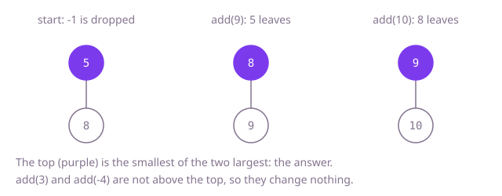

## The question

Values arrive one at a time, starting from an initial batch, and after each new value you report the k-th largest of everything seen so far. Repeated values count as separate values.

What makes it harder than it looks: the obvious answer, sort and index, is correct but repeats almost all of its work on every call, and the tests make 100,000 calls on 100,000 values. The other trap is repeats: a set looks like a natural "sorted collection" in Java, but it silently merges equal values, so three 7s become one.

## How to think about it

The first idea is to keep every value, and on each `add` sort them and read the value `k` places from the top. It is correct, and it fixes the answer to compare against, but every call sorts the whole history again.

What does it keep that it never needs? The k-th largest can only go up as values arrive, so a value that is already below it can never become the answer again. Only the k largest values matter, and the answer is the smallest of those k. A new value either is no larger than that smallest one, and changes nothing, or it pushes the smallest out and takes a place among the k. Both steps need the smallest of a small set, again and again, which is exactly what a min-heap gives: the smallest on top, and an insert or removal in O(log k).

Walk Example 1 with `k = 2` and the start `[5, -1, 8]`. The heap keeps the two largest, 5 and 8, with 5 on top; -1 is dropped. `add(3)`: 3 is not larger than 5, so nothing changes and the answer is 5. `add(9)`: 9 beats 5, so 5 leaves and 9 enters; the heap holds 8 and 9 and the answer is 8. `add(10)`: 10 beats 8, the heap holds 9 and 10, answer 9. `add(-4)`: too small, answer 9.



## Brute force

Keep every value in a list. On each `add`, append the value, copy the list into an array, sort it and read the value `k` places from the end. It comes first because it is the definition written as code, so it fixes the answer the faster versions must agree with. It is correct because the sorted array lists every value seen, repeats included, and the k-th from the end is by definition the k-th largest.

```java
class KthLargest {
    private final int k;
    private final List<Integer> values = new ArrayList<>();

    KthLargest(int k, int[] nums) {
        this.k = k;
        for (int value : nums) {
            values.add(value);
        }
    }

    int add(int value) {
        values.add(value);
        int[] sorted = new int[values.size()];
        for (int i = 0; i < sorted.length; i++) {
            sorted[i] = values.get(i);
        }
        Arrays.sort(sorted); // the whole history, every call
        return sorted[sorted.length - k];
    }
}
```

**Complexity:** `add` O(n log n) time for n values seen so far, the constructor O(n); extra space O(n).

## Better: a sorted array of the k largest

Keep only the k largest values, in ascending order in an array. The answer is the first slot. A value no larger than it is ignored; a larger one pushes the first slot out and is put in its place in the order, found by binary search, with the values in between shifted along.

```java
class KthLargest {
    private final int k;
    private final int[] top; // the k largest so far, ascending, in the first size slots
    private int size;

    KthLargest(int k, int[] nums) {
        this.k = k;
        this.top = new int[k];
        int[] sorted = nums.clone();
        Arrays.sort(sorted);
        size = Math.min(k, sorted.length);
        System.arraycopy(sorted, sorted.length - size, top, 0, size); // keep only the largest k
    }

    int add(int value) {
        if (size == k) {
            if (value <= top[0]) {
                return top[0]; // too small to matter, now or later
            }
            System.arraycopy(top, 1, top, 0, --size); // the smallest of the k drops out
        }
        int at = Arrays.binarySearch(top, 0, size, value);
        if (at < 0) {
            at = -at - 1; // where the value belongs
        }
        System.arraycopy(top, at, top, at + 1, size - at);
        top[at] = value;
        size++;
        return top[0];
    }
}
```

**Complexity:** `add` O(k) time for the shift (the search is O(log k)), the constructor O(n log n); extra space O(n) while the constructor sorts its copy, then O(k).

**Prefer it when:** k is small, a few dozen at most. A flat array of `int` has no boxing and fits in cache, so the shift costs less than the heap's object handling, and the k largest are already in order if you also need to list them. With `k = 50,000`, as in the tests, each insert moves tens of thousands of values and the heap wins.

## Optimal: a min-heap of the k largest

Keep a min-heap that never holds more than k values. While it holds fewer than k, every value goes in. After that, a new value enters only if it is larger than the top, and then the top leaves. The top of the heap is the answer after every call. This is the reference solution.

```java
class KthLargest {
    private final int k;
    private final PriorityQueue<Integer> top = new PriorityQueue<>(); // the k largest so far, smallest on top

    KthLargest(int k, int[] nums) {
        this.k = k;
        for (int value : nums) {
            add(value);
        }
    }

    int add(int value) {
        if (top.size() < k) {
            top.add(value);
        } else if (value > top.peek()) { // it beats the current k-th largest, which drops out
            top.poll();
            top.add(value);
        }
        return top.peek();
    }
}
```

**Complexity:** `add` O(log k) time, the constructor O(n log k); extra space O(k).

## Complexity

| Approach | Time per add | Constructor | Extra space |
| --- | --- | --- | --- |
| Brute force | O(n log n) | O(n) | O(n) |
| Better: sorted array of the k largest | O(k) | O(n log n) | O(k), O(n) while constructing |
| Optimal: min-heap of the k largest | O(log k) | O(n log k) | O(k) |

## Where it shows up

No coding-round problem is linked to this question. The same bounded min-heap keeps a live "top k" over data that never stops: the ten slowest requests seen by a service in the last hour of logs, the highest scores on a game leaderboard, or the k largest transfers flagged for review. A monitoring system that alerts on the 99th percentile of a window sometimes keeps exactly this heap holding the top 1% of samples.

## Follow-up answers

**What if values could also be removed from the stream?** A heap cannot remove an arbitrary value cheaply. Keep the values in a balanced ordered structure that counts repeats, such as a `TreeMap` from value to count, split into "the k largest" and "the rest", and move the boundary value across when a removal or insert changes the split. Every call is then O(log n), and the structure holds all n values, not just k.

**How would you report the k-th largest within only the last w values?** Values now leave as well as arrive, so this is the removal question with a fixed order of removals: keep the last w values in a queue to know which one leaves, and use the two-part ordered structure above for the k-th largest. Each new value costs one insert and one removal, both O(log w).

**What if k could change between calls?** A heap built for one k has thrown away what a larger k needs. If k only shrinks, poll the heap down to the new size. If it can grow, keep all values in an ordered structure with counts, or an order-statistic tree, which answers "the k-th largest" for any k in O(log n).
