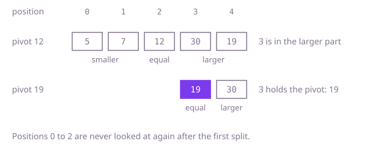

## The question

Given an unsorted array and a number `k`, return the value that would be k-th if the array were sorted from largest to smallest, with repeated values counted separately.

What makes it harder than it looks: sorting answers it in one line, so the real question is whether you can avoid ordering values you never look at. The faster method, quickselect, has two well-known ways to go quadratic, and the tests contain both: an array of one value repeated 100,000 times, which defeats a partition that puts equal values all on one side, and an already sorted array, which defeats a pivot taken from a fixed position. And a set looks like a shortcut to "sorted", but it merges repeats.

## How to think about it

The first idea is to sort and read position `n - k`. It is correct and fixes the answer to compare against, and at O(n log n) it is not even slow; it just does more than asked, since it orders every value.

If you only need the top k, keep only the top k. Read the values once and hold a min-heap of the k largest so far; a new value enters only if it beats the smallest of them, which is on top. At the end the top of the heap is the answer. That is O(n log k), better when k is small, and it reads the values only once.

To do less than "keep k values", look at what sorting does around one position. Pick a pivot value and split the array into values smaller than it, equal to it and larger than it. You now know the exact sorted positions the equal values occupy. If position `n - k` falls among them, the pivot is the answer. If not, the answer is on one side, and the other side can be ignored for good. With a random pivot, each split throws away a good share of what is left on average, so the total work is linear. Splitting into three parts, not two, is what keeps a run of equal values from costing one round each.

Walk Example 1, `[12, 5, 30, 7, 19]` with `k = 2`. The answer sits at ascending position 3 (from 0). Say the pivot is 12: smaller are 5 and 7 (positions 0 and 1), equal is 12 (position 2), larger are 30 and 19 (positions 3 and 4). Position 3 is in the larger part, so only 30 and 19 remain. Say the next pivot is 19: nothing is smaller, 19 itself takes position 3, and 30 is larger. Position 3 holds the pivot, so the answer is 19.



## Brute force

Sort a copy and read the value `k` places from the end. It comes first because it is the definition written as code, and it fixes the answer the faster versions must agree with. It is correct because the sorted array keeps every repeat, so the value at ascending position `n - k` is the k-th largest.

```java
static int kthLargest(int[] nums, int k) {
    int[] sorted = nums.clone();
    Arrays.sort(sorted); // ascending, repeats kept
    return sorted[sorted.length - k];
}
```

**Complexity:** time O(n log n), extra space O(n) for the copy.

## Better: a min-heap of the k largest

Read the values once and keep the k largest in a min-heap; whenever it grows past k, drop the top. The top at the end is the smallest of the k largest, which is the answer.

```java
static int kthLargest(int[] nums, int k) {
    PriorityQueue<Integer> top = new PriorityQueue<>(); // the k largest so far, smallest on top
    for (int value : nums) {
        top.add(value);
        if (top.size() > k) {
            top.poll(); // it is not among the k largest
        }
    }
    return top.peek();
}
```

**Complexity:** time O(n log k), extra space O(k).

**Prefer it when:** the values arrive one at a time or must not be reordered: this code reads each value once, never writes to the array, and keeps only k values. When k is small its O(n log k) is close to linear, and it has no unlucky input.

## Optimal: three-way quickselect with a random pivot

Pick a random pivot, split the current range into smaller, equal and larger parts in one pass, and keep only the part that contains the target position. Stop when the target falls in the equal part. This is the reference solution.

```java
static int kthLargest(int[] nums, int k) {
    int target = nums.length - k; // its position if nums were sorted ascending
    Random random = new Random();
    int lo = 0;
    int hi = nums.length - 1;
    while (true) {
        int pivot = nums[lo + random.nextInt(hi - lo + 1)];
        // three parts: [lo, lt) smaller than the pivot, [lt, gt] equal, (gt, hi] larger
        int lt = lo;
        int i = lo;
        int gt = hi;
        while (i <= gt) {
            if (nums[i] < pivot) {
                swap(nums, lt++, i++);
            } else if (nums[i] > pivot) {
                swap(nums, i, gt--);
            } else {
                i++;
            }
        }
        if (target < lt) {
            hi = lt - 1;
        } else if (target > gt) {
            lo = gt + 1;
        } else {
            return pivot; // equal values keep the whole middle part in one step
        }
    }
}

private static void swap(int[] a, int i, int j) {
    int t = a[i];
    a[i] = a[j];
    a[j] = t;
}
```

**Complexity:** time O(n) on average and O(n²) in the worst case, which the random pivot makes vanishingly unlikely for any input, sorted and all-equal ones included; extra space O(1), since it reorders `nums` in place.

## Complexity

| Approach | Time | Extra space |
| --- | --- | --- |
| Brute force | O(n log n) | O(n) |
| Better: min-heap of the k largest | O(n log k) | O(k) |
| Optimal: three-way quickselect | O(n) average, O(n²) worst case | O(1) |

## Where it shows up

No coding-round problem is linked to this question. Selection without sorting is how databases and analytics tools compute a median or a percentile over a column, how `std::nth_element` in C++ works, and how a load balancer can find the slowest few percent of response times in a batch without ordering the rest. A heap of size k is the streaming version of the same question, used when the data never stops arriving.

## Follow-up answers

**Can you guarantee linear time in the worst case, not only on average?** Yes, with the median-of-medians pivot: split the range into groups of five, take each group's median, and recursively find the median of those medians to use as the pivot. It is guaranteed to leave out at least about 30% of the range each round, so the total is O(n) in the worst case. The constant is large, so in practice a random pivot is faster, and libraries use median of medians only as a fallback when quickselect is going badly.

**What if the values were known to lie between -10,000 and 10,000?** Count them: an array of 20,001 counters, one pass to fill it, then walk from the largest value down, subtracting counts until k is used up. That is O(n + R) time and O(R) space for a range of R values, with no comparisons between values at all.

**What if you were not allowed to change the array?** Quickselect needs to reorder, so it would work on a copy, O(n) extra space. The min-heap version already leaves the array alone and needs only O(k) space. With O(1) space, binary search on the value: for a candidate value, count how many array values are at least it, and narrow the range of values until the count crosses k. That is O(n log R) for a value range of size R, about 31 passes for these values.
