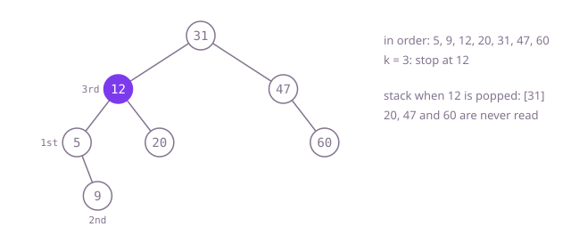

## The question

Given a binary search tree and a number `k`, return the `k`-th smallest value, counting from 1. The tests ask many times on one large tree, mostly with small `k`.

What makes it harder than it looks: any walk that reads every node gets the right answer, so the whole question is how little of the tree you can read. With 100,000 nodes and 2,000 calls asking for one of the smallest thousand values, reading everything each time costs hundreds of millions of steps, while the answer only ever needs the path down to the smallest value and then k steps along. Counting from 1, not 0, is the other easy slip.

## How to think about it

The first idea ignores the ordering: collect every value, sort, and take position `k - 1`. It is correct but sorts what the tree already keeps sorted.

The ordering means an in-order walk, left subtree, node, right subtree, meets the values in increasing order, so the sort can go: write the in-order sequence into a list and take its `k`-th entry. That is linear but still reads the whole tree. What remains is to stop: the in-order walk knows the `k`-th value the moment it meets it. With an explicit stack the walk is a loop that can simply return there. Each call goes down the left edge to the smallest value, at most h nodes, and then takes k steps along the sorted order.

Walk Example 1, `k = 3`. Go left from 31 to 12 to 5, pushing each: the stack is `[31, 12, 5]`. Pop 5: first. 5 has a right child 9; push it and pop it: second. Pop 12: third, so the answer is 12. The stack still holds 31, which is never counted, and 20, 47 and 60 are never read.



## Brute force

Collect every value, sort, and index. It comes first because it is what you say first, and it fixes the answer to compare against. It is correct because the `k`-th smallest value is by definition at position `k - 1` of the sorted values.

```java
static int kthSmallest(TreeNode root, int k) {
    List<Integer> values = new ArrayList<>();
    ArrayDeque<TreeNode> todo = new ArrayDeque<>();
    todo.push(root);
    while (!todo.isEmpty()) { // every node, in any order
        TreeNode n = todo.pop();
        values.add(n.val);
        if (n.left != null) todo.push(n.left);
        if (n.right != null) todo.push(n.right);
    }
    Collections.sort(values);
    return values.get(k - 1); // k counts from 1
}
```

**Complexity:** time O(n log n) per call; extra space O(n) for the values.

## Better: an in-order walk into a list

Use the ordering instead of a sort: an in-order walk writes the values already sorted.

```java
static int kthSmallest(TreeNode root, int k) {
    List<Integer> sorted = new ArrayList<>();
    inOrder(root, sorted);
    return sorted.get(k - 1);
}

private static void inOrder(TreeNode node, List<Integer> out) {
    if (node == null) {
        return;
    }
    inOrder(node.left, out); // everything smaller first
    out.add(node.val);
    inOrder(node.right, out);
}
```

**Complexity:** time O(n) per call; extra space O(n) for the list plus O(h) for the call stack, at most 1,000 frames here, but a path of tens of thousands of nodes would overflow Java's default stack.

**Prefer it when:** many calls hit the same unchanging tree: build the sorted list once, outside the method, and every later call is an O(1) lookup (the code above would need the list kept between calls). As written, with a fresh walk on each of this question's 2,000 calls, it is too slow.

## Optimal: stop the in-order walk at k

Run the in-order walk with an explicit stack: push the left edge, pop the smallest value not yet counted, count it, and continue from its right child. Return as soon as the count reaches `k`. This is the reference solution.

```java
static int kthSmallest(TreeNode root, int k) {
    ArrayDeque<TreeNode> stack = new ArrayDeque<>(); // the nodes whose left side is still being read
    TreeNode node = root;
    while (true) {
        while (node != null) {
            stack.push(node);
            node = node.left;
        }
        node = stack.pop(); // the smallest value not yet counted
        if (--k == 0) {
            return node.val; // stop here: the rest of the tree is never read
        }
        node = node.right;
    }
}
```

**Complexity:** time O(h + k) per call, where h is the depth: one walk down to the smallest value, then k values in order, with the left edges walked between them adding at most about h more; extra space O(h) for the stack, on the heap.

## Complexity

| Approach | Time | Extra space |
| --- | --- | --- |
| Brute force | O(n log n) per call | O(n) |
| Better: an in-order walk into a list | O(n) per call | O(n) list plus O(h) call stack, safe for depth up to 1,000, overflows on paths of tens of thousands |
| Optimal: stop the in-order walk at k | O(h + k) per call | O(h) stack on the heap |

## Where it shows up

No coding-round problem is linked to this question. Reading the first few entries of an ordered index without scanning the rest is what a database does for `ORDER BY ... LIMIT k`, what a leaderboard does to show the top of a sorted tree map, and what `TreeMap`'s iterators do in Java: each `next()` is the pop-and-push-the-left-edge step of the loop above.

## Follow-up answers

**How would you answer quickly if the tree changes often and k varies?** Store in each node the size of its subtree and keep it up to date on insert and delete. Then at a node, if the left subtree has `k - 1` nodes the node is the answer, if it has more go left, otherwise subtract the left size plus one and go right. That is O(h) per call regardless of `k`, and O(log n) in a balanced tree; the price is keeping the sizes right on every update.

**How would you find the k-th largest value instead?** Walk in reverse order, right subtree, node, left subtree: push the right edge, pop, then continue from the left child, and stop at the `k`-th pop. Or, if the size n is known, ask for the `(n - k + 1)`-th smallest.

**Why does the walk cost O(h + k) and not O(k)?** Before the first value can be counted, the walk must go down the left edge to the smallest node, which can be h nodes deep, as in this question's large tree, where the smallest values sit under a 983-node path. After that, the pops and the short left-edge walks between them read only nodes that are counted or lie on the way to them, which is O(h + k) in total.
