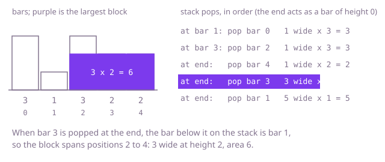

## The question

Given the heights of a row of bars of width 1 on a flat base, find the area of the largest rectangle that sits on the base and stays inside the bars. A rectangle may span several neighbouring bars, and its height is capped by the shortest of them.

What makes it harder than it looks is that the best rectangle is not always the tallest bar or the widest stretch: a short bar can win by spanning everything (`[7, 12, 8, 9]` gives 28 from the 7), and a tall bar can win alone. With 100,000 bars, trying every start and end is about five billion rectangles, far too slow. And the area can reach a billion, so it must be computed with care in an `int`.

## How to think about it

The first idea is to try every stretch of bars, from a start to an end, and take the shortest bar in it times the width. That is correct, and it repeats a lot: neighbouring stretches share almost all of their bars. Look at the answer from the other side instead. The best rectangle has some bar as its shortest, and that bar's height is the rectangle's height. So for each bar, ask how far a rectangle of exactly that height can stretch: left and right until it meets a strictly shorter bar. If you know those two boundaries for every bar, the answer is the largest `height * (width between the boundaries)`.

The boundaries are the nearest shorter bar on each side, and they can be found without searching outwards. Walk left to right and keep the bars that have not yet met a shorter bar on their right. Their heights never fall along that list, because a bar that would sit above a shorter one has already been finished. When a shorter bar arrives, it is the right boundary of every taller bar waiting on top, and the bar left beneath each of them is its left boundary, because everything between was at least as tall.

Walk Example 1, `heights = [3, 1, 3, 2, 2]`. Bar 0 (height 3) waits. Bar 1 (height 1) is shorter, so bar 0 is finished: nothing waits beneath it, so its left boundary is the start, and it spans just itself, area 3. Bar 1 waits, and bar 2 (3) waits above it. Bar 3 (2) finishes bar 2: the bar beneath is bar 1, so the width is 1, area 3. Bar 3 waits, and bar 4 (2) is not shorter than it, so it waits too. The bars are used up but three are still waiting, because nothing shorter ever came. Treat the end as a bar of height 0 that finishes them: bar 4 gives 2 × 1, bar 3 has bar 1 beneath it so it spans positions 2 to 4 and gives 2 × 3 = 6, and bar 1 spans everything, 1 × 5 = 5. The answer is 6. Skipping that last step is the usual mistake: in a rising row like `[2, 3, 5, 6, 8]` nothing is finished during the walk, and the answer 15 only appears at the end.



## Brute force

Try every start and extend to the right one bar at a time, tracking the shortest bar seen so far. It comes first because it is what you say out loud, and it fixes the answer every faster version must match. It is correct because it measures every stretch of bars exactly once, with the true shortest bar of that stretch, so the best rectangle is among them.

```java
static int biggestBlock(int[] heights) {
    int best = 0;
    for (int start = 0; start < heights.length; start++) {
        int lowest = Integer.MAX_VALUE; // shortest bar from start to the current end
        for (int end = start; end < heights.length; end++) {
            lowest = Math.min(lowest, heights[end]);
            best = Math.max(best, lowest * (end - start + 1)); // height times width
        }
    }
    return best;
}
```

**Complexity:** time O(n²), extra space O(1).

## Better: nearest shorter bar on each side, in two arrays

Find, for every bar, the position of the nearest strictly shorter bar on its left and on its right, then score each bar as the shortest in its span. To find a boundary without stepping bar by bar, jump: if the bar just before `i` is not shorter than `i`, then every bar between that bar and its own left boundary is at least as tall as it, so at least as tall as `i`, and the search can continue from that boundary.

```java
static int biggestBlock(int[] heights) {
    int n = heights.length;
    int[] left = new int[n];  // position of the nearest shorter bar on the left, or -1
    int[] right = new int[n]; // position of the nearest shorter bar on the right, or n
    for (int i = 0; i < n; i++) {
        int j = i - 1;
        while (j >= 0 && heights[j] >= heights[i]) {
            j = left[j]; // jump past the bars bar j already skipped
        }
        left[i] = j;
    }
    for (int i = n - 1; i >= 0; i--) {
        int j = i + 1;
        while (j < n && heights[j] >= heights[i]) {
            j = right[j];
        }
        right[i] = j;
    }
    int best = 0;
    for (int i = 0; i < n; i++) {
        best = Math.max(best, heights[i] * (right[i] - left[i] - 1)); // bar i is the shortest in its span
    }
    return best;
}
```

**Complexity:** time O(n), extra space O(n). A bar that one search jumps over is never visited by a later search on the same side, so all the jumps add up to O(n).

**Prefer it when:** you want each bar's span written down, for example to report which bars form the best rectangle or to answer "how wide can a block of this bar's height be" for several bars. It is not faster than the stack version: both are one linear pass, and this one keeps two arrays instead of one stack.

## Optimal: one pass with a stack of waiting bars

Walk the bars once, keeping the positions of the bars that are still waiting for a shorter bar on their right. When a shorter bar arrives, finish every taller bar on top: its right boundary is the arriving bar and its left boundary is the bar now below it on the stack, or the start if the stack is empty. A bar of height 0 past the end finishes whatever is left. This is the reference solution.

```java
static int biggestBlock(int[] heights) {
    int n = heights.length;
    int[] stack = new int[n + 1]; // positions of bars with non-decreasing heights
    int size = 0;
    int best = 0;
    for (int i = 0; i <= n; i++) {
        int current = i == n ? 0 : heights[i]; // a bar of height 0 at the end flushes the stack
        while (size > 0 && heights[stack[size - 1]] > current) {
            int height = heights[stack[--size]];
            int leftBoundary = size == 0 ? -1 : stack[size - 1]; // the bar below on the stack, or the start
            best = Math.max(best, height * (i - leftBoundary - 1));
        }
        stack[size++] = i;
    }
    return best;
}
```

**Complexity:** time O(n), extra space O(n). Each bar is pushed once and popped at most once.

## Complexity

| Approach | Time | Extra space |
| --- | --- | --- |
| Brute force | O(n²) | O(1) |
| Better: nearest shorter bar in two arrays | O(n) | O(n) |
| Optimal: one pass with a stack | O(n) | O(n) |

## Where it shows up

No coding-round problem is linked to this question. The pattern, "how far can this value stretch before something smaller stops it", turns up when looking for the largest free block in a layout, the longest run of consecutive time slots in which load stays above a level, or the largest uniform region in a simple image mask.

## Follow-up answers

**Can you beat O(n²) time?** Yes, O(n). Each bar is pushed on the stack once when it is reached and popped at most once, and popping is the only way the inner loop runs, so the total work is at most twice the number of bars. The two-array version reaches the same bound by a different argument.

**How would you find the largest rectangle of ones in a grid of zeros and ones using this?** Build a histogram for each row, where a column's height is the number of consecutive ones ending at that row, and run the stack routine on each row's histogram. The answer is the best over all rows.

**How would you do it with two arrays and no stack, and what do they hold?** One array holds, for each bar, the position of the nearest shorter bar to its left, and the other the same on the right. Each is filled with a pass that jumps through boundaries already known, and the area for bar `i` is its height times the gap between its two boundaries. That is the Better approach above.
