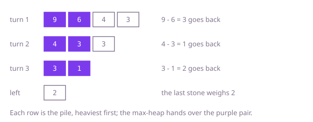

## The question

A pile of stones is played down in turns: each turn the two heaviest stones are smashed together, equal stones both vanish, and otherwise the heavier one goes back lighter by the other's weight. Return the weight of the last stone, or 0 if none is left.

What makes it harder than it looks: there is no formula, you really do have to play the game, so the whole question is the cost of a turn. With 200,000 stones there can be nearly 200,000 turns, and anything that looks at every stone each turn is tens of billions of steps. The small edge is the empty ending: when the last two stones cancel, there is no stone to read.

## How to think about it

The first idea is to play the game literally: each turn, look through the pile for the heaviest stone, then for the next heaviest, and smash them. It is correct and it is the rules restated, but each turn costs a pass over the pile, and each turn removes only one or two stones.

The next idea is to sort once so the two heaviest sit at the end. Taking them is free, but the remainder has to go back into its place in the order, and moving the stones above it along can still cost a pass per turn.

What every turn really needs is "the largest value, then the largest again" from a collection that also gets a new value after each removal. That is the job of a max-heap: the heaviest stone is on top, and taking it or adding a stone costs O(log n), so each turn is logarithmic.

Walk Example 1, `[6, 3, 9, 4]`. The heap gives 9 and then 6; they differ, so 3 goes back and the pile is 4, 3, 3. Next 4 and 3 leave 1, and the pile is 3, 1. Then 3 and 1 leave 2, and one stone is left: the answer is 2. In Example 2 the last turn smashes 2 against 2, the heap is empty, and the answer is 0.



## Brute force

Copy the stones into an array and play: each turn, scan for the heaviest, move the last stone into its place, scan again for the next heaviest, and replace it with the difference or remove it too. It comes first because it is the game exactly as described, and it fixes the answer to compare against. It is correct because each turn takes the two heaviest stones that are really there, and it stops at one stone or none.

```java
static int lastWeight(int[] stones) {
    int[] left = stones.clone();
    int size = left.length;
    while (size > 1) {
        int first = 0; // position of the heaviest
        for (int i = 1; i < size; i++) {
            if (left[i] > left[first]) first = i;
        }
        int heavier = left[first];
        left[first] = left[--size]; // remove it by moving the last stone into its place
        int second = 0;
        for (int i = 1; i < size; i++) {
            if (left[i] > left[second]) second = i;
        }
        int lighter = left[second];
        if (heavier > lighter) {
            left[second] = heavier - lighter; // the heavier stone goes back, lighter
        } else {
            left[second] = left[--size]; // equal stones both vanish
        }
    }
    return size == 0 ? 0 : left[0];
}
```

**Complexity:** time O(n²), two passes over the pile per turn and up to n - 1 turns; extra space O(n) for the copy.

## Better: sort once, insert the remainder

Sort the stones in ascending order, so the two heaviest are the last two. Take them, and if they differ, find the remainder's place by binary search and shift the heavier stones up one slot to make room.

```java
static int lastWeight(int[] stones) {
    int[] sorted = stones.clone();
    Arrays.sort(sorted); // ascending: the two heaviest are at the end
    int size = sorted.length;
    while (size > 1) {
        int heavier = sorted[--size];
        int lighter = sorted[--size];
        if (heavier > lighter) {
            int rest = heavier - lighter;
            int at = Arrays.binarySearch(sorted, 0, size, rest);
            if (at < 0) at = -at - 1; // where the remainder belongs
            System.arraycopy(sorted, at, sorted, at + 1, size - at); // make room for it
            sorted[at] = rest;
            size++;
        }
    }
    return size == 0 ? 0 : sorted[0];
}
```

**Complexity:** time O(n log n) for the sort plus O(log n) search and up to O(n) shift per turn, so O(n²) in the worst case, as when every remainder is small and goes in at the bottom; extra space O(n).

**Prefer it when:** you need the whole pile in order after every turn, for example to show a ranking as the game is played: this code keeps the array sorted at every step, which a heap does not. Each turn also does one block copy instead of two scans. It is still quadratic in the worst case, which is why it is not the answer at this size.

## Optimal: a max-heap

Put every stone in a max-heap. While it holds more than one stone, take the top two; if they differ, put the difference back. At the end, the heap holds one stone or none. This is the reference solution.

```java
static int lastWeight(int[] stones) {
    PriorityQueue<Integer> heap = new PriorityQueue<>(Collections.reverseOrder()); // heaviest on top
    for (int stone : stones) {
        heap.add(stone);
    }
    while (heap.size() > 1) {
        int heavier = heap.poll();
        int lighter = heap.poll();
        if (heavier > lighter) {
            heap.add(heavier - lighter); // equal stones both disappear
        }
    }
    return heap.isEmpty() ? 0 : heap.peek();
}
```

**Complexity:** time O(n log n), at most n - 1 turns of O(log n) each; extra space O(n) for the heap.

## Complexity

| Approach | Time | Extra space |
| --- | --- | --- |
| Brute force | O(n²) | O(n) |
| Better: sort once, insert the remainder | O(n log n) plus O(n) per turn, so O(n²) worst case | O(n) |
| Optimal: max-heap | O(n log n) | O(n) |

## Where it shows up

No coding-round problem is linked to this question. The loop "take the top two, combine them, put the result back" is the shape of several real procedures: building a Huffman code takes the two least frequent symbols and puts back their merged node, merging many sorted files of different sizes pairs the two smallest first, and an order book matches the best buy against the best sell and returns the unfilled part of the larger order to its side.

## Follow-up answers

**Can you do better than a heap when every weight is at most 1,000?** Yes: count the stones of each weight in an array of 1,001 slots and walk down from the heaviest weight. Equal heaviest stones cancel in pairs in one step, so keep only the count modulo 2. When a single stone is heaviest, find the next weight below it that has a stone, smash them, and add one to the remainder's slot. The heaviest weight drops on every such turn, so there are at most 1,000 of them with a scan of at most 1,000 slots each: O(n + W²) time for maximum weight W, and O(W) extra space.

**What if you could choose any two stones each turn and wanted the last weight as small as possible?** Then the order no longer matters, only which stones end up on which side: every final weight is the difference between the sums of two groups of stones. Find the subset whose sum is as close as possible to half the total, with a subset-sum table of reachable sums, in O(n × S) time for total weight S, which is practical only when the weights are small. A heap does not help there.

**How would you also report how many turns were played?** Add a counter to the loop of the heap version and increase it once per pass. Each turn removes at least one stone, so there are at most n - 1 turns and an `int` is enough.
