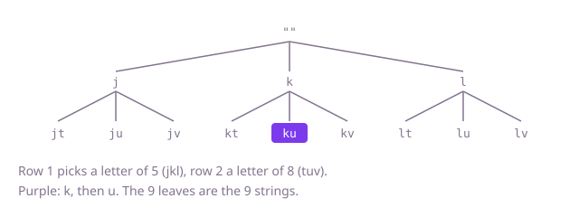

## The question

Given a string of keypad digits from 2 to 9, list every letter string they could stand for, one letter per digit from that digit's key, in order. No digits means no strings.

What makes it harder than it looks is mostly small details rather than speed, since the answer has up to 4^n strings and every one must be written. Keys 7 and 9 have four letters, so a keypad built from "three letters per key" gets 7, 8 and 9 wrong. An empty input must return an empty list, not a list holding the empty string, which is what the natural recursion produces if nothing stops it. And the number of digits is not known in advance, so the obvious nested loops do not work.

## How to think about it

The answer is every way to pick one letter per digit, so its size is the product of the key sizes. The first idea is to count through those picks like an odometer: keep one index per digit, read off a string, then advance the last index and carry into the one before when it wraps. It is correct and fixes the answer to compare against.

Since the number of digits varies, a cleaner shape is to build the answer one digit at a time: start from the strings for no digits, and for each digit extend every string so far with each of its letters. Written as a recursion, the same picks form a tree with one level per digit and one branch per letter; walking it depth-first needs one builder, appending a letter going down and removing it coming back. That is the backtracking template again, with no pruning, because every branch leads to an answer.

Walk Example 1, `digits = "58"`. Pick `j` for 5, then `t`, `u`, `v` for 8: `jt`, `ju`, `jv`. Take back `j`, pick `k`: `kt`, `ku`, `kv`. Then `l`: `lt`, `lu`, `lv`. Nine leaves, nine strings.



## Brute force

Keep one index per digit, all starting at 0, and count through every combination like an odometer. It comes first because it is the direct way to say "every pick of one letter per digit" without knowing how many digits there are, and it fixes the answer the other versions must agree with. It is correct because the odometer passes through every combination of indexes exactly once before the first index wraps.

```java
private static final String[] KEYS = {"", "", "abc", "def", "ghi", "jkl", "mno", "pqrs", "tuv", "wxyz"};

static List<String> combinations(String digits) {
    List<String> result = new ArrayList<>();
    int n = digits.length();
    if (n == 0) {
        return result;
    }
    int[] index = new int[n]; // index[i]: which letter of digit i's key is picked
    while (true) {
        StringBuilder s = new StringBuilder();
        for (int i = 0; i < n; i++) {
            s.append(KEYS[digits.charAt(i) - '0'].charAt(index[i]));
        }
        result.add(s.toString());
        int i = n - 1; // advance the last index, carrying left on a wrap
        while (i >= 0 && ++index[i] == KEYS[digits.charAt(i) - '0'].length()) {
            index[i--] = 0;
        }
        if (i < 0) {
            return result; // the first index wrapped: every combination is listed
        }
    }
}
```

**Complexity:** time O(n · 4^n), extra space O(n) for the indexes and the string being built, beyond the output.

## Better: extend the list one digit at a time

Start with a list holding the empty string. For each digit, replace the list with every string in it extended by each letter of that digit's key. After the last digit the list is the answer.

```java
private static final String[] KEYS = {"", "", "abc", "def", "ghi", "jkl", "mno", "pqrs", "tuv", "wxyz"};

static List<String> combinations(String digits) {
    if (digits.isEmpty()) {
        return new ArrayList<>();
    }
    List<String> result = List.of(""); // the strings for no digits so far
    for (char d : digits.toCharArray()) {
        List<String> next = new ArrayList<>();
        for (String prefix : result) {
            for (char letter : KEYS[d - '0'].toCharArray()) {
                next.add(prefix + letter);
            }
        }
        result = next;
    }
    return result;
}
```

**Complexity:** time O(n · 4^n), extra space O(4^n) for the previous round's list, which is at most a quarter of the output.

**Prefer it when:** you want no recursion and no carry logic; it is the shortest version to write correctly.

## Optimal: backtracking with one builder

Pick a letter for each digit in turn, append it to one `StringBuilder`, recurse, and remove it before trying the next letter. Save the builder's string at each leaf. This is the reference solution. It does the same total work as the others, because nothing can cost less than the output, but it holds only one partial string at a time.

```java
// KEYS[d] holds the letters of digit d; 0 and 1 have none
private static final String[] KEYS = {"", "", "abc", "def", "ghi", "jkl", "mno", "pqrs", "tuv", "wxyz"};

static List<String> combinations(String digits) {
    List<String> result = new ArrayList<>();
    if (digits.isEmpty()) {
        return result; // no digits stand for nothing, not for the empty string
    }
    pick(digits, 0, new StringBuilder(), result);
    return result;
}

// Picks a letter for digits[i] onward; picked holds the letters for the digits before i.
private static void pick(String digits, int i, StringBuilder picked, List<String> result) {
    if (i == digits.length()) {
        result.add(picked.toString());
        return;
    }
    for (char letter : KEYS[digits.charAt(i) - '0'].toCharArray()) {
        picked.append(letter);
        pick(digits, i + 1, picked, result);
        picked.setLength(picked.length() - 1); // take it back before trying the next letter
    }
}
```

**Complexity:** time O(n · 4^n), extra space O(n) for the builder and a recursion depth of n, beyond the output; at `n <= 5` the depth is no risk.

## Complexity

| Approach | Time | Extra space (beyond the output) |
| --- | --- | --- |
| Brute force: odometer | O(n · 4^n) | O(n) |
| Better: extend one digit at a time | O(n · 4^n) | O(4^n) |
| Optimal: backtracking with one builder | O(n · 4^n) | O(n), recursion depth n |

## Where it shows up

No coding-round problem is linked to this question. Listing every combination of one choice per slot is how a test generator builds every combination of settings for a configuration matrix, how a store lists every size and colour of a product, and how predictive text on old keypads turned digit sequences into candidate words before looking them up.

## Follow-up answers

**How would you return only the strings that are real words from a dictionary?** Put the dictionary in a trie and walk it together with the backtracking: only follow a letter if the trie has a child for it, and save the string when the last digit lands on a node that ends a word. Branches that are not a prefix of any word stop at once, so the work depends on the matching prefixes rather than on 4^n.

**How would you produce the k-th string in keypad order without listing the ones before it?** Treat k as a number in mixed radix, where each digit's base is its key size. Working from the last digit back, the letter index is k modulo that key's size and k becomes k divided by it; reading the indexes off gives the string in O(n).

**How many strings can n digits produce, and what does that mean for the running time?** Between 3^n and 4^n, the product of the key sizes. Each string has n letters, so any method spends at least O(n · 3^n) just writing the answer; the backtracking adds only constant work per letter on top of that.
