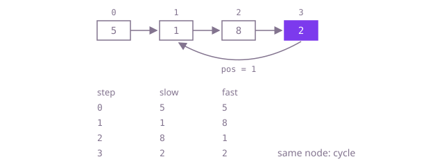

## The question

Given the head of a singly linked list, say whether following `next` from the head ever comes back to a node already visited. The method sees only the head; `pos` in the examples just describes how the test list was built.

What makes it harder than it looks: a list with a cycle never ends, so "walk until `null`" never returns, and you do not know the length to stop at. Values repeat freely, so "I have seen this value before" proves nothing; only node identity counts. The answer must not damage the list, which rules out marking nodes by overwriting their values or links. A one-node self-loop and a cycle back to the head are the edges where loop conditions slip.

## How to think about it

The first idea is to ask, at every node, "does my `next` point to a node I have already passed?" and answer it by walking from the head over the visited nodes. That is correct, but every node repeats a walk over everything before it.

What it repeats is the question "have I seen this node?", so remember the visited nodes in a hash set and ask it in constant time; the set must hold nodes (identity), not values. That costs memory proportional to the list. To use none, run two references from the head, one moving one node per step and one moving two. Without a cycle the fast one reaches `null`. With a cycle both end up going round it, and from then on the fast one closes the gap by exactly one node per step, so it lands on the slow one instead of jumping over it.

Walk Example 1, `[5,1,8,2]` with the last node linking back to index 1. Both start on 5. Step 1: slow 1, fast 8. Step 2: slow 8, fast goes 2 then back to 1. Step 3: slow 2, fast goes 8 then 2. Both are on the node holding 2, so the answer is `true`.



## Brute force

For each node in turn, check whether its `next` is one of the nodes visited so far by walking from the head. It comes first because it is what you say first, and it fixes the answer to compare against. It is correct because, without a cycle, no `next` points backwards and the walk reaches `null`; with a cycle, the last node before the loop repeats links back to a node already visited, and that check finds it. It compares references, so repeated values cannot fool it, and it never writes to the list.

```java
static boolean hasCycle(ListNode head) {
    int visited = 0;
    for (ListNode cur = head; cur != null; cur = cur.next) {
        visited++;
        ListNode probe = head;
        for (int i = 0; i < visited; i++) { // every node visited so far, cur included
            if (probe == cur.next) {
                return true; // cur links back to a node already walked
            }
            probe = probe.next;
        }
    }
    return false;
}
```

**Complexity:** time O(n²), extra space O(1).

## Better: a set of visited nodes

Walk the list once and add each node to a hash set; if a node is already there, the list loops. `ListNode` does not override `equals` or `hashCode`, so the set compares node identity, which is exactly what is needed.

```java
static boolean hasCycle(ListNode head) {
    Set<ListNode> seen = new HashSet<>(); // identity: ListNode keeps Object's equals and hashCode
    for (ListNode cur = head; cur != null; cur = cur.next) {
        if (!seen.add(cur)) {
            return true; // this node was reached before
        }
    }
    return false;
}
```

**Complexity:** time O(n) on average, O(n²) in the worst case (`ListNode` is not `Comparable`, so even a bucket `HashMap` has turned into a tree may be searched node by node when identity hashes collide), extra space O(n).

**Prefer it when:** you also need the node where the cycle starts: when `add` fails, `cur` is that node, so returning `cur` instead of `true` is the whole change. Also when the structure is not a simple list, such as a graph where each node has several links, where the two-speed trick does not apply.

## Optimal: slow and fast pointers

Move `slow` one node and `fast` two nodes per step. If `fast` reaches the end, there is no cycle; if the two land on the same node, there is. This is the reference solution.

```java
static boolean hasCycle(ListNode head) {
    ListNode slow = head;
    ListNode fast = head;
    while (fast != null && fast.next != null) { // fast reaches the end first if there is one
        slow = slow.next;
        fast = fast.next.next;
        if (slow == fast) { // compare nodes, not values: values may repeat
            return true;
        }
    }
    return false;
}
```

**Complexity:** time O(n), extra space O(1).

## Complexity

| Approach | Time | Extra space |
| --- | --- | --- |
| Brute force | O(n²) | O(1) |
| Better: a set of visited nodes | O(n) average, O(n²) worst | O(n) |
| Optimal: slow and fast pointers | O(n) | O(1) |

## Where it shows up

No coding-round problem is linked to this question. The same check catches a corrupted free list or bucket chain in a memory allocator, a redirect chain or a chain of "replaced by" references that loops, and repeated states in an iterated function; the two-speed version is how pseudo-random generators are tested for the length of their period without storing the states they produced.

## Follow-up answers

**How would you find the node where the cycle begins?** After slow and fast meet, move one of them back to the head and advance both one node per step; they meet again exactly at the first node of the cycle. The reason: if the cycle starts `a` nodes from the head and the meeting point is `b` nodes into the cycle of length `c`, then `a + b` is a multiple of `c`, so walking `a` more nodes from the meeting point lands on the cycle's start.

**How would you find the length of the cycle?** From the meeting node, keep one pointer still and move the other one node at a time, counting, until it comes back. The count is the cycle length, found in O(c) more steps.

**Why must the fast pointer meet the slow one instead of jumping over it?** Once both are on the cycle, measure the distance from fast forward to slow. Each step slow moves one node ahead and fast two, so that distance shrinks by exactly one. It counts down through every value to zero, and zero means they are on the same node; a step of two against one can never skip it.
