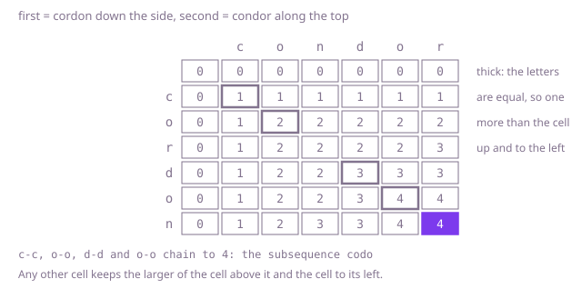

## The question

Given two strings, return the length of the longest string that is a subsequence of both: its letters appear in each of them in the same order, though not necessarily side by side.

What makes it harder than it looks is that the obvious shortcuts all miss. Pairing each letter of one string with the earliest unused copy in the other spends copies a better pairing needed: on Example 1 it pairs the `c`s and the `o`s, then the `r` of `cordon` with the `r` at the very end of `condor`, and stops at 3 where the answer is 4. It is not the longest common substring either: in Example 2 the longest run the two share side by side is `ta`, yet the answer is 4. Counting the letters the strings share ignores order, and `cordon` and `condor` share all six. And a string of 1,000 letters has 2^1000 subsequences.

## How to think about it

The first idea is to compare the two first letters. If they are equal, pair them and solve the rest of both strings. That is never worse: if a longest common subsequence used neither letter, putting the pair in front would make it longer, and if it used one of them with a later copy in the other string, pairing it with this copy instead changes nothing else. If the first letters differ, at least one of them is not in the answer, so drop each in turn and keep the better result. The recursion is correct, but every difference splits it in two, and the same pair of suffixes is reached along a huge number of paths.

The answer depends only on where each string's rest starts, so there are just (n + 1) × (m + 1) different questions. Turn it around to prefixes and fill a table: `best[i][j]` is the answer for the first `i` letters of `first` and the first `j` of `second`. When the last letters of the two prefixes are equal it is `best[i - 1][j - 1] + 1`; otherwise it is the larger of `best[i - 1][j]` and `best[i][j - 1]`. An empty prefix shares nothing, so row 0 and column 0 are 0. Each row only reads the row above it and itself, so two rows are enough.

Walk Example 1, `first = "cordon"`, `second = "condor"`. The `c`s meet at cell (1, 1), giving 1, and the `o`s at (2, 2), giving 2. The `r` of `cordon` meets the last `r` of `condor` at (3, 6) for 3, the greedy's choice, but nothing can follow it. The `d`s meet at (4, 4) for 1 + `best[3][3]` = 3, the second `o`s at (5, 5) for 1 + `best[4][4]` = 4, and the last row carries the 4 to the corner. The chain of equal letters spells `codo`.



## Brute force

Compare the first letters: pair them when equal, otherwise try dropping each one. It comes first because it is the rule above written as code, and it fixes the answers the faster versions must match. It is correct because pairing equal first letters never loses, as argued above, and when they differ the two calls cover both letters that might be left out.

```java
static int longestCommon(String first, String second) {
    return from(first, second, 0, 0);
}

/** The answer for first from position i on and second from position j on. */
private static int from(String first, String second, int i, int j) {
    if (i == first.length() || j == second.length()) {
        return 0;
    }
    if (first.charAt(i) == second.charAt(j)) {
        return 1 + from(first, second, i + 1, j + 1); // pairing equal first letters is never worse
    }
    // the two first letters differ, so at least one of them is not in the answer
    return Math.max(from(first, second, i + 1, j), from(first, second, i, j + 1));
}
```

**Complexity:** time exponential, up to about 2^(n + m) calls when the letters keep differing; extra space O(n + m) for the recursion, at most 2,000 deep, which fits in the stack.

## Better: a table over every pair of prefixes

Fill `best[i][j]` for every pair of prefixes, row by row, from the rule above. The bottom-right cell is the answer.

```java
static int longestCommon(String first, String second) {
    int n = first.length();
    int m = second.length();
    int[][] best = new int[n + 1][m + 1]; // best[i][j]: the answer for the first i letters of first and j of second
    for (int i = 1; i <= n; i++) {
        for (int j = 1; j <= m; j++) {
            if (first.charAt(i - 1) == second.charAt(j - 1)) {
                best[i][j] = best[i - 1][j - 1] + 1; // keep the two equal last letters as a pair
            } else {
                best[i][j] = Math.max(best[i - 1][j], best[i][j - 1]); // drop one of the two last letters
            }
        }
    }
    return best[n][m];
}
```

**Complexity:** time O(n × m), extra space O(n × m), about 4 MB at 1,000 by 1,000.

**Prefer it when:** you need the subsequence itself and not just its length. The full table lets you walk back from the corner and read it off, which two rows cannot.

## Optimal: two rows

The same rule, keeping only the row above and the row being filled, and swapping them after each row. This is the reference solution.

```java
static int longestCommon(String first, String second) {
    // prev[j]: the answer for the first i - 1 letters of first and the first j letters of second
    int[] prev = new int[second.length() + 1];
    int[] cur = new int[second.length() + 1]; // cur[0] stays 0: an empty prefix shares nothing
    for (int i = 1; i <= first.length(); i++) {
        for (int j = 1; j <= second.length(); j++) {
            if (first.charAt(i - 1) == second.charAt(j - 1)) {
                cur[j] = prev[j - 1] + 1; // keep the two equal last letters as a pair
            } else {
                cur[j] = Math.max(prev[j], cur[j - 1]); // drop the last letter of one string or the other
            }
        }
        int[] done = prev;
        prev = cur;
        cur = done; // reused for the next row; every entry but [0] is overwritten
    }
    return prev[second.length()];
}
```

**Complexity:** time O(n × m), extra space O(m). Passing the shorter string as `second` makes the space O(min(n, m)); the answer does not depend on the order.

## Complexity

| Approach | Time | Extra space |
| --- | --- | --- |
| Brute force | exponential, up to about 2^(n + m) calls | O(n + m) recursion, at most 2,000 deep |
| Better: a table over every pair of prefixes | O(n × m) | O(n × m) |
| Optimal: two rows | O(n × m) | O(m) |

## Where it shows up

A diff tool runs this table over lines instead of letters: the lines in the longest common subsequence are the unchanged ones, and everything else is shown as removed or added. Version control uses the same idea to merge two edits of one file. Aligning DNA or protein sequences is the same table with scores for matches, mismatches and gaps instead of plain counts, and so is the edit distance behind spelling suggestions.

## Follow-up answers

**What if you also had to return one longest common subsequence?** Keep the full table. Start at the corner: if the two letters there are equal, they are in the subsequence, so record the letter and step diagonally; otherwise step to whichever of the cell above and the cell to the left holds the larger value. Stop at row or column 0 and reverse the letters. Several different subsequences can be longest, and the choice on a tie picks one; the walk adds O(n + m) to the O(n × m) table.

**What if the strings were 100,000 letters long?** The table would have 10^10 cells, too slow and far too big. Hirschberg's method finds the subsequence itself in O(n + m) space by splitting `first` in half and finding where the best path crosses the middle row, at about twice the time. For time, Hunt and Szymanski's method runs in O((r + n) log n) for r pairs of equal letters, which wins when few letters match, and bit-parallel versions handle 64 columns per machine word. No method is known that is much faster than quadratic on every input.

**What if there were three strings instead of two?** Use a three-dimensional table: when the three last letters are equal, add 1 to the cell with all three shortened; otherwise take the best of the three cells with one string shortened. That is O(n × m × k) time and, keeping two layers, O(m × k) space. Taking the subsequence of two strings and then matching it against the third is not enough, because a different longest subsequence of the first two might share more with the third.
