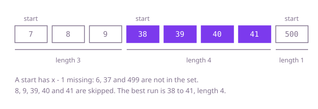

## The question

Given an unsorted array of whole numbers, find the length of the longest group of values that go up by exactly one each step, such as `38, 39, 40, 41`. The values may sit anywhere in the array, and a value that repeats counts once.

What makes it harder than it looks is that sorting is the first idea and it is more than the question needs. It also hides a trap: after sorting, repeated values sit next to each other and must be skipped, or the length comes out too big (`3, 4, 4, 5` is a run of 3, not 4). And at 100,000 numbers, any approach that re-walks a long run from each of its members is too slow.

## How to think about it

The first idea is to start from every value and walk upward, asking "is `x + 1` in the array?", then `x + 2`, and so on, keeping the longest walk. With a set for the lookups each step is cheap, but look at what it repeats: in a run of 100,000 values, the walk from the first member goes 100,000 steps, the walk from the second goes 99,999, and so on. Every member re-walks the tail of its run. Sorting avoids that, since after sorting the runs are adjacent and one scan finds them, at the price of O(n log n). The better question is which values are worth starting from at all: only the first value of a run, the one whose predecessor `x - 1` is missing. A set tells you that in constant time, and then every value is walked over only once.

Walk Example 1, `nums = [41, 7, 40, 39, 8, 38, 9, 500]`. Put the values in a set. Take 7: 6 is missing, so 7 starts a run; 8 and 9 are present and 10 is not, so the length is 3. Take 8: 7 is present, so 8 is not a start; skip it. Take 38: 37 is missing, so it starts a run; 39, 40 and 41 are present and 42 is not, so the length is 4. Take 500: 499 is missing, and 501 is not present, so the length is 1. Values 9, 39, 40 and 41 are skipped like 8. The best length is 4.



## Brute force

Put the values in a set, then for every value walk upward while the next value is present, and keep the longest walk. It is the direct reading of the question, and it is correct because every run is found from each of its members, including its first, and the set makes repeats collapse into one value, so a repeat cannot lengthen a run. (With a plain scan of the array in place of the set, each lookup would cost O(n) and the whole thing O(n³).)

```java
static int longest(int[] nums) {
    Set<Integer> values = new HashSet<>();
    for (int x : nums) {
        values.add(x); // repeats collapse into one entry
    }
    int best = 0;
    for (int x : nums) { // starts a walk from every value, even in the middle of a run
        int length = 1;
        while (values.contains(x + length)) {
            length++;
        }
        best = Math.max(best, length);
    }
    return best;
}
```

**Complexity:** time O(n²) in the worst case, since in one long run every member re-walks the tail of the run; extra space O(n).

## Better: sort, then scan

Sort a copy of the array. Then equal values are adjacent and a run is a stretch where each value is one more than the previous. Scan once, grow the current run on a step of exactly one, skip a repeat, and restart the run at 1 on a gap.

```java
static int longest(int[] nums) {
    int[] sorted = nums.clone();
    Arrays.sort(sorted);
    int best = 0;
    int run = 0;
    for (int i = 0; i < sorted.length; i++) {
        if (i > 0 && sorted[i] == sorted[i - 1]) {
            continue; // a repeat counts once
        }
        run = (i > 0 && sorted[i] - 1 == sorted[i - 1]) ? run + 1 : 1; // extend, or restart at a gap
        best = Math.max(best, run);
    }
    return best;
}
```

**Complexity:** time O(n log n), extra space O(n) for the copy (O(1) if you may sort the caller's array in place).

**Prefer it when:** you may reorder the input and want no hash set. The scan after the sort is a few lines, uses no boxed values, and its memory is the flat array alone, which is much smaller than a `HashSet<Integer>`.

## Optimal: a set, and walk only from the start of a run

Put the values in a set. For each value, skip it if its predecessor `x - 1` is in the set, because its run is counted from the start. From a start, walk upward while the next value is present. Every value is walked over at most once, from its own run's start, so the loop inside a loop is linear in total. This is the reference solution.

```java
static int longest(int[] nums) {
    Set<Integer> values = new HashSet<>();
    for (int x : nums) {
        values.add(x); // repeats collapse into one entry
    }
    int best = 0;
    for (int x : values) {
        if (values.contains(x - 1)) {
            continue; // not the start of a run: its run is counted from the start
        }
        int length = 1;
        while (values.contains(x + length)) {
            length++; // walk up from the start
        }
        best = Math.max(best, length);
    }
    return best;
}
```

**Complexity:** time O(n) on average, O(n log n) in the worst case (Java's `HashSet` turns a crowded bucket of `Integer` keys into a tree), extra space O(n).

## Complexity

| Approach | Time | Extra space |
| --- | --- | --- |
| Brute force | O(n²) worst case | O(n) |
| Better: sort, then scan | O(n log n) | O(n) with a copy, O(1) in place |
| Optimal: a set, walk from run starts | O(n) average, O(n log n) worst | O(n) |

## Where it shows up

Looking for unbroken stretches in unordered data: the longest streak of consecutive days with activity in a log, the longest run of consecutive ids or sequence numbers received (finding gaps in a stream), and merging reservations or page ranges that touch.

## Follow-up answers

**Why does the set-based solution run in linear time even though it has a loop inside a loop?** The inner walk only starts at the beginning of a run, and a run's values are walked once. Summed over all runs, the inner loop takes at most one step per value in the set, so the total is O(n), not O(n²).

**How does the answer change if you sort the array first, and what does that cost?** After sorting, runs are adjacent: scan once, add one to the length when the value is exactly one more than the previous, skip equal values, and reset on a gap. The scan is cheap but the sort makes the whole thing O(n log n).

**How would you also return the numbers of the longest run?** Keep the start value of the best run as well as its length, and return the values from the start up to start plus length minus one.
