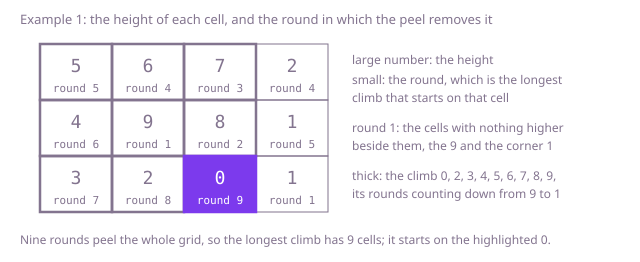

## The question

Given a grid of heights, find the longest walk that steps between side neighbours and goes strictly up at every step, and return how many cells it visits. Any cell can be the start.

What makes it harder than it looks is that the obvious search tries every climb from every cell, and the climbs explode: on a 50 by 50 grid that rises by one with every step right or down, the climbs from the top-left cell to the bottom-right one alone number C(98, 49), about 2.5 × 10^28. The shortcuts fail. Always stepping to the lowest higher neighbour finds 8 cells on Example 1 and always stepping to the highest finds 4, where the answer is 9; starting only from the lowest cell finds 2 on Example 2, where the answer is 6. Equal heights and diagonal neighbours are not steps. And the natural fix, a recursion that remembers its answers, is as deep as the climb it follows, which on a large grid is deeper than a thread's stack.

## How to think about it

The first idea is to start at every cell and try every way of climbing on, keeping the longest. It is correct, since a climb is a cell followed by a climb from one of its higher neighbours, and it needs no record of visited cells, because a strictly rising walk can never come back to a cell. But it repeats itself: every climb that reaches a cell searches everything above that cell again.

What is worth remembering is that the longest climb from a cell does not depend on how the hiker got there. It is the cell plus the longest climb from its best higher neighbour, or just the cell when nothing beside it is higher. So each cell has one number, and once it is known it never changes. Store it the first time it is worked out, and each cell is explored once, for O(m × n) work on an m by n grid.

That memoised search recurses from a cell into its higher neighbours, so it is as deep as the climb it is following, which can be every cell of the grid. Here the grid is at most 50 by 50, so the depth is at most 2,500 and fits the default stack. It does not fit much beyond that: in our runs on a test thread's default stack, the memoised search below overflowed on a climb of about 5,200 cells with the JIT off, 7,200 on a cold JVM and 18,300 once the JIT had compiled it, after fitting 4,600, 6,600 and 17,300. A 200 by 200 grid can hold a climb through all 40,000 cells, and a corridor walled on both sides forces any neighbour order about 20,000 deep, so there the recursion is not safe.

The same rule gives an order with no recursion at all. A cell's number depends only on higher cells, so there are no cycles. Cells with nothing higher beside them have the number 1. Peel them off the grid; the cells whose higher neighbours are now all gone have the number 2. Peel those, and so on: it is a topological order, the idea of Kahn's algorithm, and the number of rounds is the length of the longest climb.

Walk Example 1, `[[5, 6, 7, 2], [4, 9, 8, 1], [3, 2, 0, 1]]`. Round 1 peels the 9 in the middle and the 1 in the bottom-right corner, which have nothing higher beside them. That leaves the 8 with nothing higher, so round 2 peels it, round 3 the 7, and round 4 the 6 and the 2 in the top-right corner. Round 5 peels the 5 and the 1 below that 2, round 6 the 4, round 7 the 3, round 8 the 2 in the bottom row and round 9 the 0. Nine rounds, so the answer is 9, and the round of each cell is the longest climb that starts there.



## Brute force

From every cell, recurse into every higher neighbour and keep the longest result. It comes first because it is the definition of a climb written as code, and it fixes the answers the faster versions must match. It is correct because every climb from a cell is the cell followed by a climb from one of its higher neighbours, and the recursion tries each of them.

```java
private static final int[][] STEPS = {{1, 0}, {-1, 0}, {0, 1}, {0, -1}};

static int longestClimb(int[][] heights) {
    int best = 0;
    for (int r = 0; r < heights.length; r++) {
        for (int c = 0; c < heights[0].length; c++) {
            best = Math.max(best, climbFrom(heights, r, c)); // any cell can start the longest climb
        }
    }
    return best;
}

/** The number of cells on the longest climb that starts at (r, c), found by trying every climb. */
private static int climbFrom(int[][] heights, int r, int c) {
    int best = 1; // the cell on its own
    for (int[] step : STEPS) {
        int nr = r + step[0];
        int nc = c + step[1];
        // strictly higher, so a climb can never come back to a cell and needs no visited set
        if (nr >= 0 && nc >= 0 && nr < heights.length && nc < heights[0].length && heights[nr][nc] > heights[r][c]) {
            best = Math.max(best, 1 + climbFrom(heights, nr, nc));
        }
    }
    return best;
}
```

**Complexity:** time exponential, one call per climb, which on a grid rising towards one corner is about 10^29 calls from the top-left cell alone; extra space O(m × n) for the recursion, at most 2,500 deep here, which fits the stack.

## Better: memoised search

The same recursion, with the longest climb from each cell stored the first time it is worked out. Every climb is at least one cell, so 0 can mean "not worked out yet".

```java
private static final int[][] STEPS = {{1, 0}, {-1, 0}, {0, 1}, {0, -1}};

static int longestClimb(int[][] heights) {
    int[][] memo = new int[heights.length][heights[0].length]; // 0: not worked out yet
    int best = 0;
    for (int r = 0; r < heights.length; r++) {
        for (int c = 0; c < heights[0].length; c++) {
            best = Math.max(best, climbFrom(heights, memo, r, c));
        }
    }
    return best;
}

/** The number of cells on the longest climb that starts at (r, c). */
private static int climbFrom(int[][] heights, int[][] memo, int r, int c) {
    if (memo[r][c] == 0) {
        int best = 1; // the cell on its own
        for (int[] step : STEPS) {
            int nr = r + step[0];
            int nc = c + step[1];
            if (nr >= 0 && nc >= 0 && nr < heights.length && nc < heights[0].length && heights[nr][nc] > heights[r][c]) {
                best = Math.max(best, 1 + climbFrom(heights, memo, nr, nc)); // how it got here does not matter
            }
        }
        memo[r][c] = best;
    }
    return memo[r][c];
}
```

**Complexity:** time O(m × n), since each cell is worked out once and looks at four neighbours; extra space O(m × n) for the memo, plus a recursion as deep as the longest climb: at most m × n = 2,500 here, which fits the stack, but a default thread stack overflows somewhere between about 5,000 and 18,000 cells, depending on the JIT, so it does not fit a 200 by 200 grid.

**Prefer it when:** the grid is small enough that the longest climb fits the stack, as here. It is the rule written down directly and shorter than the peel.

## Optimal: peel the grid from the top

Count each cell's higher neighbours, and queue the cells that have none. Then work in rounds: take every cell queued in the round, and for each lower neighbour, take one off its count; a neighbour whose count reaches 0 has had its last higher neighbour removed, so it goes in the next round. The number of rounds is the answer. This is the reference solution.

```java
private static final int[][] STEPS = {{1, 0}, {-1, 0}, {0, 1}, {0, -1}};

static int longestClimb(int[][] heights) {
    int rows = heights.length;
    int cols = heights[0].length;
    int[] higher = new int[rows * cols]; // higher[cell]: its higher neighbours not peeled off yet
    int[] queue = new int[rows * cols];
    int tail = 0;
    for (int cell = 0; cell < rows * cols; cell++) {
        for (int[] step : STEPS) {
            int r = cell / cols + step[0];
            int c = cell % cols + step[1];
            if (r >= 0 && c >= 0 && r < rows && c < cols && heights[r][c] > heights[cell / cols][cell % cols]) {
                higher[cell]++;
            }
        }
        if (higher[cell] == 0) {
            queue[tail++] = cell; // nothing higher beside it: its longest climb is the cell alone
        }
    }
    int rounds = 0;
    for (int head = 0; head < tail; ) {
        rounds++; // the longest climb from each cell peeled in this round has exactly `rounds` cells
        for (int end = tail; head < end; head++) {
            int height = heights[queue[head] / cols][queue[head] % cols];
            for (int[] step : STEPS) {
                int r = queue[head] / cols + step[0];
                int c = queue[head] % cols + step[1];
                // a lower neighbour whose last higher neighbour this was is peeled in the next round
                if (r >= 0 && c >= 0 && r < rows && c < cols && heights[r][c] < height && --higher[r * cols + c] == 0) {
                    queue[tail++] = r * cols + c;
                }
            }
        }
    }
    return rounds;
}
```

**Complexity:** time O(m × n), since each cell is queued once and its four neighbours are looked at twice, once to count and once when it is peeled; extra space O(m × n) for the counts and the queue, with no recursion, so it works at any grid size.

## Complexity

| Approach | Time | Extra space |
| --- | --- | --- |
| Brute force | exponential, one call per climb | O(m × n) recursion, at most 2,500 deep here |
| Better: memoised search | O(m × n) | O(m × n) memo, recursion as deep as the longest climb: fits at 2,500, overflows from about 5,000 cells |
| Optimal: peel the grid from the top | O(m × n) | O(m × n), no recursion |

## Where it shows up

The grid is a graph whose edges all go uphill, so it has no cycles, and the question is the longest path in it. The same shape is the critical path of a project plan, where tasks wait for the tasks they depend on and the longest chain sets the shortest possible finish, and the longest chain of steps in a build that has to run one after another. Peeling the nodes with nothing left to wait for, round by round, is how schedulers and spreadsheet engines order their work; on real terrain, the same pass over a height map finds the longest run downhill for water or a ski route.

## Follow-up answers

**What if you also had to return the cells of one longest climb?** Store each cell's round, which is the longest climb starting there. Start from a cell with the largest round and keep stepping to a higher neighbour whose round is exactly one less; such a neighbour exists because the round came from it, and the walk ends at a cell of round 1. That adds O(m × n) space for the rounds and O(length) time for the walk.

**What if the grid were 1,000 by 1,000?** A million cells is still quick for O(m × n) work, and the counts and the queue are two arrays of a million `int`s, about 8 MB. But a climb can pass through every one of the million cells, and a walled corridor forces any neighbour order about half a million deep, far deeper than any default stack, so a recursive search would overflow; the peel, or the memoised search rewritten with an explicit stack, is the way.

**What if a climb could also step diagonally?** Use the eight neighbours instead of four, in the counting and in the peeling. Steps still go strictly up, so there are still no cycles and nothing else changes; the cost stays O(m × n), about twice the work per cell.
