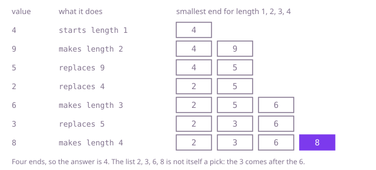

## The question

Given an array of integers, return the length of the longest subsequence whose values strictly rise: positions kept in order, not necessarily next to each other. Equal values do not count as rising.

What makes it harder than it looks is that the obvious rules are wrong. The longest run of neighbours that rise is not it: `[3,1,4,2,5]` has no rising run longer than 2, but 3, 4, 5 is a pick of 3. Taking every larger value as soon as it appears fails too: from the 2 in `[2,9,3,4,5]` it takes the 9 and is stuck, where 2, 3, 4, 5 gives 4. Equal values must not extend a pick, so `[2,2,4,4,8,8]` gives 3, not 6. And at 200,000 values the textbook O(n²) table makes about 2 × 10^10 comparisons, which is far too slow here; the tests time it out.

## How to think about it

The first idea is to try every pick. For each start, try every later, larger value as the next one and go on from there. It is correct and exponential: a rising array of n values has 2^n − 1 picks, and the search walks each one.

What it repeats is the best pick from each position, which it works out again for every way of arriving there. Store, for each position, the longest pick ending there: it is one more than the best among earlier positions with a smaller value. That is the O(n²) table, and at 200,000 values it is still too slow. Look at what the table compares, though. Among all picks of the same length, only the one that ends lowest matters, because any value that extends a pick ending at 7 also extends one of the same length ending at 5. So keep, for each length, the smallest value a pick of that length can end with. Those ends rise with the length, since a pick of length k + 1 contains a pick of length k that ends lower. A new value x extends the longest pick ending below x, and it lowers the end of the next length, or makes a new longest pick. Because the ends are sorted, finding that place is a binary search.

Walk Example 1, `nums = [4,9,5,2,6,3,8]`. 4 starts the list of ends: [4]. 9 is above every end, so it makes length 2: [4, 9]. 5 is below 9, so a pick of length 2 can now end at 5: [4, 5]. 2 lowers the end for length 1: [2, 5]. 6 makes length 3: [2, 5, 6]. 3 lowers length 2: [2, 3, 6]. 8 makes length 4: [2, 3, 6, 8]. The answer is 4. The list itself is not a pick, since the 3 comes after the 6; only its length counts.



## Brute force

From every start, try every later and strictly larger value as the next one, and keep the longest. It comes first because it says what a rising pick is, and it fixes the answers to compare against. It is correct because every rising pick has a first value and, after each value, a next one that is later and larger, so the search follows every pick there is.

```java
static int longest(int[] nums) {
    int best = 0;
    for (int i = 0; i < nums.length; i++) {
        best = Math.max(best, longestFrom(nums, i));
    }
    return best;
}

/** The longest rising pick that starts at position i. */
private static int longestFrom(int[] nums, int i) {
    int best = 1; // nums[i] on its own
    for (int j = i + 1; j < nums.length; j++) {
        if (nums[j] > nums[i]) { // strictly larger: an equal value does not rise
            best = Math.max(best, 1 + longestFrom(nums, j));
        }
    }
    return best;
}
```

**Complexity:** time exponential, up to 2^n − 1 picks walked one by one on a rising array; extra space O(answer) for the recursion, which on a rise of 100,000 values overflows the stack.

## Better: best pick ending at each position

Fill a table where `endingAt[i]` is the longest pick that ends at position `i`: one more than the largest `endingAt[j]` over earlier positions `j` with a smaller value, or 1 if there is none.

```java
static int longest(int[] nums) {
    int[] endingAt = new int[nums.length]; // endingAt[i]: longest rising pick ending at i
    int best = 0;
    for (int i = 0; i < nums.length; i++) {
        endingAt[i] = 1; // nums[i] on its own
        for (int j = 0; j < i; j++) {
            if (nums[j] < nums[i] && endingAt[j] + 1 > endingAt[i]) { // strictly smaller before it
                endingAt[i] = endingAt[j] + 1;
            }
        }
        best = Math.max(best, endingAt[i]);
    }
    return best;
}
```

**Complexity:** time O(n²), extra space O(n). At 200,000 values that is about 2 × 10^10 comparisons, and the tests time it out.

**Prefer it when:** the array holds a few thousand values at most, or you need the best length ending at every position, which this table gives and the optimal one does not, for example to count the longest picks.

## Optimal: smallest end for each length

Keep `tails`, where `tails[k]` is the smallest value that ends a rising pick of length k + 1 so far. The list rises, so for each value a binary search finds the first end that is not below it; the value replaces that end, or is appended when it is above them all. The answer is the length of the list. This is the reference solution.

```java
static int longest(int[] nums) {
    // tails[k]: the smallest value that ends a rising subsequence of length k + 1 so far;
    // tails[0..size) is strictly increasing
    int[] tails = new int[nums.length];
    int size = 0;
    for (int x : nums) {
        int lo = 0;
        int hi = size;
        while (lo < hi) { // the first tail >= x: an equal tail cannot be extended by x
            int mid = (lo + hi) >>> 1;
            if (tails[mid] < x) {
                lo = mid + 1;
            } else {
                hi = mid;
            }
        }
        tails[lo] = x; // a subsequence of length lo + 1 now ends at x: lower than before, or new
        if (lo == size) {
            size++;
        }
    }
    return size;
}
```

**Complexity:** time O(n log n), extra space O(n). Searching for the place by walking the list from either end instead costs O(n × answer), which is as slow as the table when the answer is in the tens of thousands.

## Complexity

| Approach | Time | Extra space |
| --- | --- | --- |
| Brute force | exponential, up to 2^n − 1 picks | O(answer) recursion, overflows on a long rise |
| Better: best pick ending at each position | O(n²) | O(n) |
| Optimal: smallest end for each length | O(n log n) | O(n) |

## Where it shows up

Nesting problems reduce to it: to stack the most boxes or envelopes each inside the next, sort by one side and take the longest rise in the other. So do non-crossing matches: bridges between two river banks, or the lines two versions of a file have in common, which some diff tools align by taking the longest rise of their positions. It also measures how far a list is from sorted: the values outside a longest rise are the fewest that have to be moved to sort it.

## Follow-up answers

**What if you also had to return one longest subsequence, not only its length?** Next to each end in `tails`, store the position it came from, and for each position the position of the end just before the place it took (its predecessor in the pick). After the pass, start at the position stored for the last end and follow the predecessors back; reversed, they are a longest pick. It stays O(n log n).

**What if a value could also follow an equal one?** Search for the first end that is strictly greater than the value, instead of the first that is not smaller. An equal end can then be extended, and `[2,2,4,4,8,8]` gives 6.

**What if you had to count how many longest subsequences there are?** Extend the O(n²) table: for each position keep the best length ending there and the number of picks of that length, adding the count of every earlier smaller value that gives the same best length. Sum the counts of the positions with the overall best. A tree indexed by value brings it to O(n log n). The counts can grow exponentially, for example 2^(n/2) for pairs of falling values that rise from pair to pair, so they need a `long`, a `BigInteger` or a modulus.
