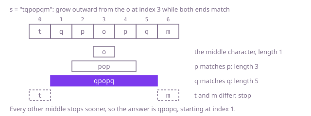

## The question

Given a string of letters and digits, return its longest substring that reads the same in both directions. When two palindromes tie for longest, return the one that starts first.

What makes it harder than it looks is that palindromes come in two shapes: odd ones around a middle character, like `qpopq`, and even ones around the gap between two equal characters, like `yzzy`. Code that only grows odd ones returns `x` for `"xyzzyw"` instead of `yzzy`. The tie rule has to survive whatever order the search runs in, case counts (`Abba` is not a palindrome), and at 5,000 characters, testing every substring from scratch costs up to about 10^10 character comparisons.

## How to think about it

The first idea is to take every substring, test it with two pointers walking inward, and keep the longest. It is correct, but look at what it repeats: testing `qpopq` compares `q` with `q` and then tests `pop`, which was already tested on its own. A stretch is a palindrome exactly when its two ends match and the stretch inside them is a palindrome. A table indexed by start and end can remember those inner answers, filled from short stretches to long ones. That is quadratic, but it spends 25 MB of booleans at 5,000 characters.

Turn the rule around and the table disappears. Every palindrome grows outward from its middle, one matching pair at a time, and growth stops for good at the first pair that differs: nothing longer around that middle can be a palindrome. So start at each of the 2n − 1 middles, the n characters and the n − 1 gaps between neighbours, step outward while the two ends match, and keep the longest result. Middles are visited from left to right, and two palindromes of the same length have the same kind of middle, so the one that starts first is found first. Replacing the best only on a strictly longer palindrome keeps it.

Walk Example 1, `s = "tqpopqm"`. Around the `o` at index 3: `p` matches `p`, giving `pop`; `q` matches `q`, giving `qpopq`; `t` and `m` differ, so the growth stops at length 5. Every other middle stops at once: no two neighbours are equal, and no other character has the same character on both sides. The answer is `qpopq`, starting at index 1.



## Brute force

Test every substring that is longer than the best found so far, and keep each one that reads the same both ways. It comes first because it is the definition written as code, and it fixes the answers the faster versions must match. It is correct because every substring that could beat the best is tested, and since only a strictly longer palindrome replaces the best while starts go from left to right, a tie keeps the one that starts first.

```java
static String longest(String s) {
    int bestStart = 0;
    int bestLength = 1; // a single character is always a palindrome
    for (int i = 0; i < s.length(); i++) {
        // only substrings longer than the best so far can replace it, so a tie keeps the first
        for (int j = i + bestLength; j < s.length(); j++) {
            if (isPalindrome(s, i, j)) {
                bestStart = i;
                bestLength = j - i + 1;
            }
        }
    }
    return s.substring(bestStart, bestStart + bestLength);
}

private static boolean isPalindrome(String s, int i, int j) {
    while (i < j) {
        if (s.charAt(i++) != s.charAt(j--)) {
            return false;
        }
    }
    return true;
}
```

**Complexity:** time O(n³): about n²/2 substrings, each tested in up to n/2 comparisons, which happens when long substrings match from both ends for a long way (two long runs of one letter split by two other letters); extra space O(1).

## Better: table of palindromic stretches

Fill `pal[i][j]`, "is `s[i..j]` a palindrome", in order of length, so the inner stretch two shorter is always ready. Each cell is one comparison of the end characters plus one lookup, and within a length the starts go from left to right, so the first palindrome of each new length is kept.

```java
static String longest(String s) {
    int n = s.length();
    boolean[][] pal = new boolean[n][n]; // pal[i][j]: s[i..j] is a palindrome
    int bestStart = 0;
    int bestLength = 1;
    for (int length = 1; length <= n; length++) {
        for (int i = 0; i + length <= n; i++) {
            int j = i + length - 1;
            // the ends match, and what lies between them (shorter by two) is a palindrome or almost empty
            pal[i][j] = s.charAt(i) == s.charAt(j) && (length <= 2 || pal[i + 1][j - 1]);
            if (pal[i][j] && length > bestLength) { // the first palindrome of each new length wins
                bestStart = i;
                bestLength = length;
            }
        }
    }
    return s.substring(bestStart, bestStart + bestLength);
}
```

**Complexity:** time O(n²), extra space O(n²): 25 million booleans, about 25 MB, at 5,000 characters.

**Prefer it when:** you will ask many more questions about the same string afterwards, such as "is the stretch from i to j a palindrome?" for arbitrary i and j while cutting it into palindromes: the table answers each in O(1).

## Optimal: grow from every middle

For each character, grow once with that character as the middle and once with the gap after it as the middle. Each growth steps outward while the ends match, and its length is known when it stops. This is the reference solution.

```java
static String longest(String s) {
    int bestStart = 0;
    int bestLength = 1; // a single character is always a palindrome
    for (int centre = 0; centre < s.length(); centre++) {
        // right == centre: odd lengths around one character; centre + 1: even lengths around a gap
        for (int right = centre; right <= centre + 1; right++) {
            int lo = centre;
            int hi = right;
            while (lo >= 0 && hi < s.length() && s.charAt(lo) == s.charAt(hi)) {
                lo--;
                hi++;
            }
            int length = hi - lo - 1; // the loop stopped one step past each end
            // strictly longer only: on a tie the earlier centre, which starts earlier, stays
            if (length > bestLength) {
                bestStart = lo + 1;
                bestLength = length;
            }
        }
    }
    return s.substring(bestStart, bestStart + bestLength);
}
```

**Complexity:** time O(n²) in the worst case, a string of one repeated character, where every middle grows to an end of the string; extra space O(1) besides the returned substring.

## Complexity

| Approach | Time | Extra space |
| --- | --- | --- |
| Brute force | O(n³) | O(1) |
| Better: table of palindromic stretches | O(n²) | O(n²) |
| Optimal: grow from every middle | O(n²) worst case | O(1) |

## Where it shows up

Sequence analysis looks for the same shape in DNA, with "match" meaning complementary bases rather than equal ones: the mirrored stretches where many restriction enzymes cut, and the ones that fold back on themselves into hairpins. More generally, "grow outward from every middle while the two sides agree" is how to find the widest symmetric window in any sequence, such as the longest stretch of a sensor trace that is mirror-symmetric around a peak.

## Follow-up answers

**Can you beat O(n²) time?** Yes, with Manacher's algorithm, which finds the longest palindrome around every middle in O(n) total. It keeps the palindrome reaching furthest right found so far; a middle inside it starts from the length of its mirror image on the other side, cut off at that palindrome's right edge, instead of from zero, so the right edge only ever moves forward. Putting a separator between all characters turns even palindromes into odd ones, so one kind of middle covers both.

**What if the characters of the palindrome did not have to be next to each other?** That is the longest palindromic subsequence, a two-dimensional table: if the ends of `s[i..j]` match, the answer is two plus the answer inside; otherwise it is the better of dropping either end. It costs O(n²) time and, keeping only two rows, O(n) space. It equals the longest common subsequence of the string and its reverse.

**What if case were ignored and digits skipped when deciding what reads the same?** Build a lowercased copy of only the letters, together with an array giving each kept letter's position in the original. Run the same growth on the copy, then map the answer's first and last letters back through the array and return that slice of the original, digits and case included.
