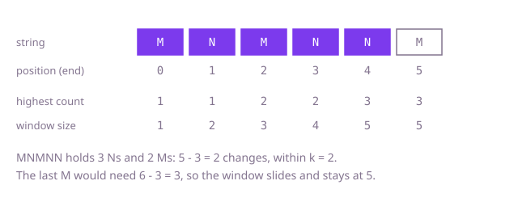

## The question

Given a string of uppercase letters and a number `k`, you may change at most `k` characters to any letters you like. Return the length of the longest stretch of one repeated letter you can end up with.

What makes it harder than it looks is that you do not choose the letter first. The best letter for a stretch is whichever one it already has most of, and that changes from stretch to stretch. A stretch needs `k` or fewer changes exactly when its length minus its highest letter count is at most `k`. And with 100,000 characters, counting every stretch from scratch is far too slow.

## How to think about it

The first idea is to take every start and extend to the right, counting letters, until the stretch needs more than `k` changes. Each start recounts a stretch that nearly matches the one before it. The stretch from the next start is the previous one with its first character removed, so the counts can be kept and updated: add the new character on the right, remove the character on the left. That is a window with a count per letter. Whenever the window needs more than `k` changes, move the left edge in until it does not. The cost of an update is the highest count, which needs a scan of 26 counters. There is a cheaper way: the answer is the largest window ever seen, and a window can only become larger when its highest count beats every earlier one. So the window never needs to shrink, only to slide along at the same size, and the highest count can be a stale record that is only ever raised.

Walk Example 1, `s = "MNMNNM"`, `k = 2`. The window grows over `M`, `MN`, `MNM`, `MNMN` and `MNMNN`, where N has the highest count 3 and the window needs 5 minus 3 = 2 changes, within `k`. The next character is the last `M`: the window would be six long with a highest count of 3, needing 3 changes. That is over `k`, so the window slides: the left edge moves one step and the size stays at 5. The string ends, and the largest window was 5.



## Brute force

From every start, extend to the right, counting letters and tracking the highest count; stop at the first end where the stretch needs more than `k` changes, and keep the longest acceptable stretch. It is what you say first, and it fixes the answer every faster version must agree with. It is correct because the cheapest way to make a stretch one letter is to keep its most common letter, so the stretch is acceptable exactly when its length minus its highest count is at most `k`, and acceptability only gets worse as the stretch grows.

```java
static int longestRun(String s, int k) {
    int best = 0;
    for (int start = 0; start < s.length(); start++) {
        int[] count = new int[26];
        int highest = 0; // most common letter in the stretch so far
        for (int end = start; end < s.length(); end++) {
            highest = Math.max(highest, ++count[s.charAt(end) - 'A']);
            if (end - start + 1 - highest > k) {
                break; // the stretch needs too many changes, and only more would be needed
            }
            best = Math.max(best, end - start + 1);
        }
    }
    return best;
}
```

**Complexity:** time O(n²), extra space O(1): 26 counters.

## Better: a window that shrinks, with the highest count recomputed

Keep letter counts for a window. After adding the character on the right, while the window needs more than `k` changes, remove the character on the left. To know the cost, scan the 26 counters for the highest one each time. The window is always acceptable when its size is recorded, so the largest size is the answer.

```java
static int longestRun(String s, int k) {
    int[] count = new int[26];
    int left = 0;
    int best = 0;
    for (int right = 0; right < s.length(); right++) {
        count[s.charAt(right) - 'A']++;
        // highest count in the window right now, found by scanning the 26 counters
        while (right - left + 1 - highestCount(count) > k) {
            count[s.charAt(left) - 'A']--;
            left++;
        }
        best = Math.max(best, right - left + 1);
    }
    return best;
}

static int highestCount(int[] count) {
    int highest = 0;
    for (int c : count) {
        highest = Math.max(highest, c);
    }
    return highest;
}
```

**Complexity:** time O(26 · n), which is O(n) (each character enters the window once and leaves once, and every check scans 26 counters), extra space O(1).

**Prefer it when:** you want the window to be exactly right at every step, with the real highest count, so the window can be inspected or extended with other rules. Each step costs a scan of 26 counters instead of one comparison.

## Optimal: a window that only slides, with a record highest count

Keep a record of the highest count seen in any window so far, and never lower it. After adding the character on the right, if the window needs more than `k` changes by that record, remove one character on the left: the window slides along at the same size rather than shrinking. The record can be stale after the left edge moves, which is safe. The window only gets larger when a letter's count passes every earlier record, and that is the moment the record is raised. A stale record can never let the window grow when it should not, and the final window size is the answer. This is the reference solution.

```java
static int longestRun(String s, int k) {
    int[] count = new int[26];
    int left = 0;
    int highest = 0; // highest count of one letter seen in any window so far
    int best = 0;
    for (int right = 0; right < s.length(); right++) {
        highest = Math.max(highest, ++count[s.charAt(right) - 'A']);
        if (right - left + 1 - highest > k) { // too many changes needed: slide the window
            count[s.charAt(left) - 'A']--;
            left++;
        }
        best = Math.max(best, right - left + 1);
    }
    return best;
}
```

**Complexity:** time O(n), extra space O(1): 26 counters.

## Complexity

| Approach | Time | Extra space |
| --- | --- | --- |
| Brute force | O(n²) | O(1) |
| Better: a shrinking window, highest count recomputed | O(26 · n) = O(n) | O(1) |
| Optimal: a sliding window, record highest count | O(n) | O(1) |

## Where it shows up

No coding-round problem is linked to this question. Choosing the longest span that can be made uniform with a few edits is how a data-cleaning tool finds the longest run of a value in a noisy sensor log if up to k readings may be treated as glitches. The same count-in-a-window idea appears in log analysis, for example the longest period in which at most k requests were not from the dominant client.

## Follow-up answers

**Can you do constant work per character, without scanning the 26 letter counts each time?** Yes: keep a record of the highest count and only raise it, as in the optimal solution. Each step is one increment, one comparison and at most one decrement.

**Why can the maximum count be left stale when the window slides, and does recomputing it each time change the answer?** A stale value can make the current window look better than it is, but the window only gets larger when a letter count passes every earlier maximum, and then the maximum is updated, so the answer stays correct. Recomputing the maximum by scanning 26 counters each step is also correct and still linear, because 26 is a constant; it is just a little more work.

**How would you also report which letter the run is made of?** Remember the letter that has the highest count when the best size is updated. With the stale-maximum version, that letter is the one whose increment set the new highest count.
