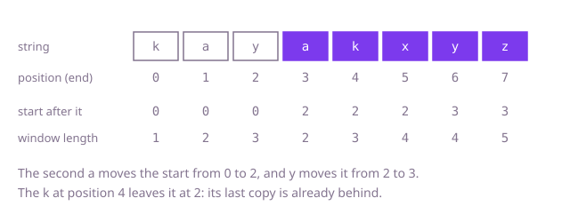

## The question

Given a string, find the length of the longest stretch of consecutive characters in which no character appears twice. Characters can be any Java `char`, and case matters.

What makes it harder than it looks is what to do when a repeat shows up. Throwing the stretch away and restarting loses good characters: in `"xyxzw"` the answer is `"yxzw"`, which starts inside the stretch that just broke. And an earlier copy of a character may lie before the current start, where it no longer matters. With 100,000 characters from any script, extending from every start can also run to a quadratic amount of work.

## How to think about it

The first idea is to try every start and extend to the right until a character repeats. It repeats the same work: starting at the next position re-reads almost the whole stretch just read. The stretch from the previous start was already valid, so the next one is the same stretch with its first character dropped. That makes it a window with a start and an end: move the end right one character at a time, and when the new character is already inside, move the start right until the repeat is gone. A set of the characters in the window answers "is it inside?". The start moves one step at a time, though, even when the earlier copy is far ahead of it. If you remember where each character was last seen, the start can jump straight to the position after that copy.

Walk Example 1, `s = "kayakxyz"`. The window grows over `k`, `a`, `y` to length 3. The second `a` arrives, and its earlier copy is at position 1, so the start jumps to position 2: the window `"ya"` has length 2. Then `k` arrives, its last copy is at position 0, which is behind the start, so the start stays: `"yak"` has length 3. Then `x` makes `"yakx"` of length 4. Then `y` arrives, its last copy is at position 2, so the start moves to 3: `"akxy"`, length 4. Finally `z` makes `"akxyz"`, length 5, the best.



## Brute force

From every start, extend to the right while the characters are all different, and keep the longest stretch found. It is what you say first, and it fixes the answer every faster version must agree with. It is correct because the longest stretch begins at some start, and from that start the loop finds the longest stretch that avoids a repeat.

```java
static int longestDistinct(String s) {
    int best = 0;
    for (int start = 0; start < s.length(); start++) {
        Set<Character> seen = new HashSet<>();
        int end = start;
        while (end < s.length() && seen.add(s.charAt(end))) { // add fails on a repeat
            end++;
        }
        best = Math.max(best, end - start);
    }
    return best;
}
```

**Complexity:** with k the length of the longest stretch with no repeat: time O(n · k) average, O(n · k · log k) worst case (Java treeifies a crowded bucket of a `HashSet`), which is O(n²) when stretches are long; extra space O(k).

## Better: a window with a set

Keep the stretch as a window `[start, end]` and a set of its characters. For each new end character, while it is already in the set, drop the character at the start from the set and move the start right. Then add it and record the window length. Every character is added once and removed at most once, so the work is linear.

```java
static int longestDistinct(String s) {
    Set<Character> window = new HashSet<>(); // the characters between start and end
    int start = 0;
    int best = 0;
    for (int end = 0; end < s.length(); end++) {
        char c = s.charAt(end);
        while (window.contains(c)) { // shrink from the left until the repeat is gone
            window.remove(s.charAt(start));
            start++;
        }
        window.add(c);
        best = Math.max(best, end - start + 1);
    }
    return best;
}
```

**Complexity:** time O(n) on average, O(n log n) in the worst case (Java treeifies a crowded bucket of a `HashSet`), extra space O(min(n, alphabet)) for the set.

**Prefer it when:** you want the window to be visible in the code: the set is exactly the characters between `start` and `end`, which makes it easy to extend with other conditions, such as a limit on the window's size. Its extra memory grows with the window and every step is a hash operation.

## Optimal: a window with a last-seen table

Instead of a set, keep for each character the position just after its last copy. When the new character arrives, the start must be at least that position, so move it there in one jump, but never backwards: if the earlier copy lies before the start already, the start stays. Because a `char` has only 65,536 values, a plain array indexed by the character is the table, with no hashing. This is the reference solution.

```java
static int longestDistinct(String s) {
    int[] after = new int[65_536]; // position just after the last copy of each character, 0 if unseen
    int start = 0;
    int best = 0;
    for (int end = 0; end < s.length(); end++) {
        char c = s.charAt(end);
        start = Math.max(start, after[c]); // never move the start back
        after[c] = end + 1;
        best = Math.max(best, end - start + 1);
    }
    return best;
}
```

**Complexity:** time O(n), extra space O(1): a fixed table of 65,536 entries, whatever the length of the string.

## Complexity

| Approach | Time | Extra space |
| --- | --- | --- |
| Brute force | O(n · k) average, k the longest stretch; O(n · k · log k) worst | O(k) |
| Better: a window with a set | O(n) average, O(n log n) worst | O(min(n, alphabet)) |
| Optimal: a window with a last-seen table | O(n) | O(1), a table of 65,536 entries |

## Where it shows up

No coding-round problem is linked to this question. Looking for the longest run of unique items is how a stream processor finds the longest span without a duplicate event, for example the longest stretch of requests with no repeated request id when checking a deduplication window. Last-seen tables with a moving start are also used to measure how long a session lasted before a user repeated an action.

## Follow-up answers

**Can you do it in O(n) time using a fixed amount of extra memory, however long the string is?** Yes: the last-seen table, as in the optimal solution. The set version is also linear in time, but its memory grows with the window; the table is the same size for any input.

**How would you return the stretch itself, not only its length?** Remember the start position whenever a new best length is found, then take the substring from that start with the best length at the end.

**What changes if up to two repeats of a character are allowed in the stretch?** Keep a count per character instead of a last position. Move the end forward, and when a count would pass the limit, move the start forward, lowering counts, until it is back within the limit.
