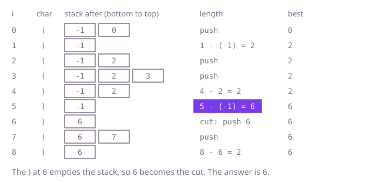

## The question

Given a string of `(` and `)`, find the length of the longest balanced stretch of consecutive characters in it, where balanced means every bracket in the stretch has its partner inside the stretch and the pairs nest properly. Return 0 when there is none.

What makes it harder than it looks: checking one whole string for balance is the easy stack exercise, but here the damage is in the middle. A `)` with nothing open, or a `(` that is never closed, cuts the string, and the best stretch can sit on either side of the cut. Counting does not decide it either: `)(` has one of each and is not balanced, because order matters. And at 100,000 characters, testing every possible stretch is too slow.

## How to think about it

The first idea is to try every start position and walk right, tracking the depth: add one for `(`, subtract one for `)`. If the depth ever goes below zero, no stretch from this start can continue, so stop; every time it returns to zero, the stretch so far is balanced. That is correct, but it re-walks the same text from every start.

What does that repeat? A balanced stretch ending at some position starts right after the last character that can never be matched. So if I remember where the last such cut was, the length is one subtraction. The cuts are the unmatched `)` (nothing open to close) and the unmatched `(` (never closed). I find them with a stack, and what goes on it is positions, not characters: that is what lets me subtract. I put a sentinel `-1` on the stack first, standing for "the cut just before the string".

Walk Example 1, `s = "()(()))()"`. Position 0 `(` is pushed. Position 1 `)` pops it, the stack is back to `[-1]`, and the length is 1 - (-1) = 2. Positions 2 and 3 are pushed, position 4 pops 3 and leaves `[-1, 2]`, giving 4 - 2 = 2. Position 5 pops 2 and leaves `[-1]`, giving 5 - (-1) = 6, the best so far. Position 6 pops the sentinel and the stack is empty: this `)` matched nothing, so it becomes the new cut and 6 is pushed. Position 7 is pushed, position 8 pops it, giving 8 - 6 = 2. The answer is 6.



## Brute force

Try every start position and walk to the right with a depth counter, stopping at the first dip below zero and recording the length each time the depth returns to zero. It comes first because it is the definition restated as a loop, and it fixes the answer the faster versions must agree with. It is correct because a stretch is balanced exactly when its depth never goes negative and ends at zero, and every start and end is tried.

```java
static int longestBalanced(String s) {
    int best = 0;
    for (int start = 0; start < s.length(); start++) {
        int depth = 0;
        for (int end = start; end < s.length(); end++) {
            depth += s.charAt(end) == '(' ? 1 : -1;
            if (depth < 0) break; // a closer with nothing open: no stretch from here goes on
            if (depth == 0) best = Math.max(best, end - start + 1); // balanced from start to end
        }
    }
    return best;
}
```

**Complexity:** time O(n²), extra space O(1).

## Better: two counting passes

The stack is really only tracking depth, and depth can be a counter. Walk left to right counting `(` and `)`. When the counts are equal, the stretch since the last reset is balanced, so record twice the count. When `)` outnumbers `(`, that `)` is a cut, so reset both counts to zero. This pass misses stretches that sit behind an unmatched `(`, because there the openers stay ahead and the counts never meet (in `(()`, the pair is never recorded). So walk again from the right with the roles swapped, resetting when `(` outnumbers `)`; there the unmatched `(` is the cut, and the pass sees the pair.

```java
static int longestBalanced(String s) {
    int best = 0;
    int open = 0, close = 0;
    for (int i = 0; i < s.length(); i++) { // left to right: an extra ) is a cut
        if (s.charAt(i) == '(') open++; else close++;
        if (open == close) best = Math.max(best, 2 * close);
        else if (close > open) { open = 0; close = 0; }
    }
    open = 0;
    close = 0;
    for (int i = s.length() - 1; i >= 0; i--) { // right to left: an extra ( is a cut
        if (s.charAt(i) == ')') close++; else open++;
        if (open == close) best = Math.max(best, 2 * open);
        else if (open > close) { open = 0; close = 0; }
    }
    return best;
}
```

**Complexity:** time O(n), extra space O(1).

**Prefer it when:** you only need the length and must stay in constant extra space. It cannot be extended to several bracket kinds, because two counters cannot tell `(]` from `()`; the stack can. That is why the stack is the Optimal one here, even though this version uses less memory.

## Optimal: a stack of positions with a sentinel

Keep a stack of positions. Start it with `-1`. A `(` pushes its position. A `)` pops. If the stack is then empty, the `)` had nothing to match, so push its own position as the new cut. Otherwise the pop matched a `(`, the position on top is the last character not covered by the matched run, and the balanced length ending here is `i` minus that position. Keep the maximum. This is the reference solution.

```java
static int longestBalanced(String s) {
    Deque<Integer> stack = new ArrayDeque<>();
    stack.push(-1); // the last cut: just before the string
    int best = 0;
    for (int i = 0; i < s.length(); i++) {
        if (s.charAt(i) == '(') {
            stack.push(i);
            continue;
        }
        stack.pop();
        if (stack.isEmpty()) {
            stack.push(i); // an unmatched ) becomes the new cut
        } else {
            best = Math.max(best, i - stack.peek()); // matched: the run reaches back to just after the top
        }
    }
    return best;
}
```

**Complexity:** time O(n), extra space O(n) for the stack.

## Complexity

| Approach | Time | Extra space |
| --- | --- | --- |
| Brute force | O(n²) | O(1) |
| Better: two counting passes | O(n) | O(1) |
| Optimal: stack of positions | O(n) | O(n) |

## Where it shows up

`build-log-bracket-checker` keeps the same device: its `firstError` pass holds a stack of the columns of the open brackets, in an int array rather than a `Deque`, and reads positions off it to report where a line first goes wrong (an unexpected closer, a mismatch, or the earliest bracket still open at the end). It checks the line and points at one error; it does not measure stretches. This question uses the stack of positions for the other half of the job, measuring how far the intact text reaches back from a match.

Outside the coding round, the same measurement helps wherever you must salvage the good part of damaged nested text: finding the longest well-formed region of a truncated or corrupted log line, or working out how much of an expression an editor can still treat as matched.

## Follow-up answers

**Can you do it in constant extra space?** Yes: the counting passes in the Better section do it in O(n) time and O(1) space. Left to right, equal counts record twice the count and an excess of `)` resets; right to left does the same with the roles swapped, to catch stretches behind an unmatched `(`.

**How would you return where the longest stretch starts, as well as its length?** In the stack version the start is `stack.peek() + 1` at the moment the maximum is set, so store it with the best length. In the counting version, the left pass starts a stretch one after the position of its last reset, and the right pass starts it at the current position `i` when the counts meet.

**How would you handle several kinds of brackets, like round and square together?** Counters no longer work, so use the stack. Push the position and keep the kind of each opener (a parallel array of chars is enough). A closer matches only if its kind agrees with the opener on top; if it does not, nothing before this closer can be part of a stretch that crosses it, so clear the stack down to the cut and push this position as the new cut. The length rule, `i` minus the top, stays the same.
