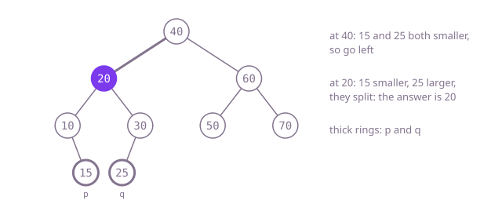

## The question

Given a binary search tree and two of its nodes, return the deepest node that has both of them in its subtree, where a node counts as part of its own subtree. The answer is a node of the tree, and the tests ask for many pairs in one large tree.

What makes it harder than it looks: the general answer for any binary tree is correct here too, but it searches the whole tree for every pair, and the tests ask for about 20,000 pairs in a tree of 100,000 nodes. The ordering lets you skip almost all of that, as long as you remember that one node may be the ancestor of the other, that `p` may be larger or smaller than `q`, and that the popular shortcut of multiplying `(node.val - p.val) * (node.val - q.val)` overflows an `int`: at a node holding 0 with `p = -65536` and `q = -131072`, the product is 2^33, which wraps to 0, so the walk stops one level too high.

## How to think about it

The first idea is the one that works in any binary tree: search both subtrees of a node for `p` and `q`; if one turns up on each side, this node is the answer, otherwise pass up whatever was found. That is correct, but it ignores the ordering and visits nearly every node for every pair.

The ordering tells you where `p` and `q` are without looking. At a node, if both values are smaller, both nodes are in the left subtree, so the answer is there too; if both are larger, it is in the right subtree. Otherwise they split here, or the node is one of them, and in both cases nothing lower contains them both, so this node is the answer. That is one step down per level: a recursion of depth at most 1,000, or a plain loop with nothing on the stack.

Walk Example 1, `p = 15` and `q = 25`. At 40, both are smaller: go left. At 20, 15 is smaller and 25 is larger: they split, so 20 is the answer. In Example 2, `p = 30` and `q = 25`: at 40 go left, at 20 both are larger so go right, and at 30 one of them is the node itself, so 30 is the answer.



## Brute force

Search both sides of every node, as for a tree with no ordering. It comes first because it is what you say first, and it fixes the answer to compare against. It is correct because a call returns `p` or `q` when it finds one, the node itself when one turns up in each subtree, and `null` when its subtree holds neither; the first node to see one on each side, or to be one of them with the other below, is the lowest common ancestor.

```java
static TreeNode lca(TreeNode root, TreeNode p, TreeNode q) {
    if (root == null || root == p || root == q) {
        return root; // found one of them, or nothing here
    }
    TreeNode left = lca(root.left, p, q);
    TreeNode right = lca(root.right, p, q);
    if (left != null && right != null) {
        return root; // one on each side: they split here
    }
    return left != null ? left : right;
}
```

**Complexity:** time O(n) per pair, since it may visit every node; extra space O(h) for the call stack, at most 1,000 frames here.

## Better: recursion that follows the values

Use the ordering to choose one side and recurse only there.

```java
static TreeNode lca(TreeNode root, TreeNode p, TreeNode q) {
    if (p.val < root.val && q.val < root.val) {
        return lca(root.left, p, q); // both in the left subtree
    }
    if (p.val > root.val && q.val > root.val) {
        return lca(root.right, p, q);
    }
    return root; // they split here, or root is one of them
}
```

**Complexity:** time O(h) per pair; extra space O(h) for the call stack, at most 1,000 frames here, but a lopsided tree of tens of thousands of levels would overflow Java's default stack.

**Prefer it when:** you find the recursive form easier to read and the depth is known to be small, as it is here.

## Optimal: walk down from the root

The same decision in a loop: move left while both values are smaller, right while both are larger, and stop at the first node where that fails. Comparing each value separately avoids the overflow of the product shortcut. This is the reference solution.

```java
static TreeNode lca(TreeNode root, TreeNode p, TreeNode q) {
    TreeNode node = root;
    while (true) {
        if (p.val < node.val && q.val < node.val) {
            node = node.left; // both smaller: both live in the left subtree
        } else if (p.val > node.val && q.val > node.val) {
            node = node.right;
        } else {
            return node; // they split here, or node is one of them
        }
    }
}
```

**Complexity:** time O(h) per pair, where h is the depth (at most 1,000 here, about 17 for a balanced tree of 100,000 nodes); extra space O(1).

## Complexity

| Approach | Time | Extra space |
| --- | --- | --- |
| Brute force | O(n) per pair | O(h) call stack, at most 1,000 frames here |
| Better: recursion that follows the values | O(h) per pair | O(h) call stack, safe for depth up to 1,000, overflows on paths of tens of thousands |
| Optimal: walk down from the root | O(h) per pair | O(1) |

## Where it shows up

No coding-round problem is linked to this question. The same walk answers "which is the narrowest range that contains both of these keys" in an ordered index, finds the most specific common prefix block in a sorted key space, and finds the closest shared folder of two paths when a directory tree is stored sorted by name. Anywhere a tree is ordered, a question about two keys can be answered by walking down once instead of searching.

## Follow-up answers

**Why is the walk from the root O(h) and not O(n)?** Each step moves one level down and never comes back, and it stops at the latest on reaching `p` or `q`. So it visits at most one node per level: h nodes, which is about 17 for a balanced tree of 100,000 nodes and 1,000 at the depth limit here. The rest of the tree is never touched.

**What changes if the tree is an ordinary binary tree with no ordering?** The values no longer say which side a node is on, so you have to search: the brute force above, O(n) per pair. With many pairs on one fixed tree, precompute instead: record every node's parent and depth once, then lift the deeper node to the other's depth and climb both together, O(h) per pair; binary lifting tables bring that to O(log n) per pair after O(n log n) preparation.

**What if p or q might not be in the tree at all?** The walk can then step past a leaf: `node` becomes `null` and the next comparison throws a `NullPointerException`. So the loop must also stop at `null` and report that there is no common ancestor. When it does return a node, that node only looks like an answer: search for each value from it, which is O(h) each in a search tree, and confirm you reach the very node you were given. If either search fails, report that there is no common ancestor.
