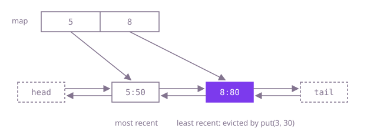

## The question

Build a cache with a fixed number of slots: `get` returns a key's value or -1, `put` stores a value, and when a new key does not fit, the key used least recently is evicted. Both operations should take constant time.

What makes it harder than it looks: every `get` hit changes the eviction order, so the order is updated far more often than anything is evicted, and a hash map alone keeps no order at all. Two rules are easy to miss: updating an existing key refreshes it but evicts nothing, and a `get` that misses must not disturb the order.

## How to think about it

The first idea is a hash map for the values plus a list of keys in order of use, oldest first. A hit removes the key from the list and appends it at the end; eviction removes the first key. That is correct, but finding the key in an array list is a scan, so every hit costs time proportional to the capacity.

What the scan searches for, the map could hand you directly. Keep the order in a doubly linked list of entries, most recent at the front, and let the map go from key to that entry. A hit looks up the entry, unlinks it from its neighbours in O(1) and puts it at the front; eviction takes the entry at the back, and the entry carries its key so the map can drop it too. Sentinel nodes at both ends mean unlinking and inserting never check for an empty list or an edge.

The JDK packages exactly this structure as `LinkedHashMap` in access order, which is the short version; writing the list yourself is what the question is really asking about.

Walk Example 1 with capacity 2. `put(5, 50)`: list 5. `put(8, 80)`: list 8, 5 (front first). `get(8)` returns 80; 8 is already at the front. `get(5)` returns 50 and moves 5 to the front: 5, 8. `put(3, 30)` finds the cache full and evicts the back, 8; list 3, 5. `get(8)` misses, -1.



## Brute force

A hash map for the values and an array list of keys from least to most recently used. It comes first because it is what you say first, and it fixes the answer to compare against. It is correct because the list holds every cached key exactly once, in order of last use, so its first element is always the one to evict.

```java
public class LRUCache {
    private final int capacity;
    private final Map<Integer, Integer> values = new HashMap<>();
    private final List<Integer> order = new ArrayList<>(); // least recently used first

    LRUCache(int capacity) {
        this.capacity = capacity;
    }

    int get(int key) {
        Integer value = values.get(key);
        if (value == null) {
            return -1;
        }
        order.remove(Integer.valueOf(key)); // a scan of the whole order list
        order.add(key);
        return value;
    }

    void put(int key, int value) {
        if (values.containsKey(key)) {
            order.remove(Integer.valueOf(key));
        } else if (values.size() == capacity) {
            values.remove(order.remove(0));
        }
        values.put(key, value);
        order.add(key);
    }
}
```

**Complexity:** time O(capacity) per call for the list scan and shift, extra space O(capacity).

## Better: LinkedHashMap in access order

`LinkedHashMap` built with `accessOrder = true` moves an entry to the end of its internal list on every `get` and `put`, and calls `removeEldestEntry` after each insertion, so returning `true` when the map is over capacity evicts the least recently used entry.

```java
public class LRUCache {
    private final Map<Integer, Integer> cache;

    LRUCache(int capacity) {
        cache = new LinkedHashMap<>(16, 0.75f, true) { // true: order by access, not by insertion
            @Override
            protected boolean removeEldestEntry(Map.Entry<Integer, Integer> eldest) {
                return size() > capacity;
            }
        };
    }

    int get(int key) {
        return cache.getOrDefault(key, -1); // a hit moves the key to the most recent end
    }

    void put(int key, int value) {
        cache.put(key, value);
    }
}
```

**Complexity:** time O(1) average per call, O(log capacity) worst case (crowded buckets are treeified, and `Integer` keys are comparable), extra space O(capacity).

**Prefer it when:** you are writing production code rather than showing the mechanism; it is a few lines and well tested.

## Optimal: hash map plus a doubly linked list

The map goes from key to a list entry; the list, between two sentinels, holds entries from most to least recently used. This is the reference solution.

```java
public class LRUCache {

    private static final class Entry {
        final int key;
        int value;
        Entry prev;
        Entry next;

        Entry(int key, int value) {
            this.key = key;
            this.value = value;
        }
    }

    private final int capacity;
    private final Map<Integer, Entry> byKey = new HashMap<>();
    // sentinels: the most recently used entry follows head, the least recently used precedes tail
    private final Entry head = new Entry(0, 0);
    private final Entry tail = new Entry(0, 0);

    LRUCache(int capacity) {
        this.capacity = capacity;
        head.next = tail;
        tail.prev = head;
    }

    int get(int key) {
        Entry entry = byKey.get(key);
        if (entry == null) {
            return -1;
        }
        unlink(entry);
        pushFront(entry);
        return entry.value;
    }

    void put(int key, int value) {
        Entry entry = byKey.get(key);
        if (entry != null) {
            entry.value = value; // an update never evicts
            unlink(entry);
            pushFront(entry);
            return;
        }
        if (byKey.size() == capacity) {
            Entry oldest = tail.prev;
            unlink(oldest);
            byKey.remove(oldest.key); // the entry keeps its key so the map can drop it
        }
        entry = new Entry(key, value);
        byKey.put(key, entry);
        pushFront(entry);
    }

    private void unlink(Entry entry) {
        entry.prev.next = entry.next;
        entry.next.prev = entry.prev;
    }

    private void pushFront(Entry entry) {
        entry.prev = head;
        entry.next = head.next;
        head.next.prev = entry;
        head.next = entry;
    }
}
```

**Complexity:** time O(1) average per call, O(log capacity) worst case (crowded buckets are treeified, and `Integer` keys are comparable), extra space O(capacity).

## Complexity

| Approach | Time per call | Extra space |
| --- | --- | --- |
| Brute force | O(capacity) | O(capacity) |
| Better: LinkedHashMap in access order | O(1) average, O(log capacity) worst case | O(capacity) |
| Optimal: hash map plus a doubly linked list | O(1) average, O(log capacity) worst case | O(capacity) |

## Where it shows up

No coding-round problem is linked to this question. Least-recently-used eviction is the default policy of in-process caches (Guava and Caffeine caches build on the same idea, Caffeine with refinements), of database buffer pools that decide which disk page to drop from memory, of operating-system page caches (as approximations such as the clock algorithm), and of CDN and DNS resolver caches.

## Follow-up answers

**Why use sentinel nodes at both ends of the list?** Without them, unlinking the first or last entry and inserting into an empty list are special cases that update `head` or `tail` fields and check for `null`. With a fixed `head` and `tail` that are never removed, every real entry always has a `prev` and a `next`, so `unlink` and `pushFront` are four plain assignments each and cannot go wrong at the edges.

**How would you make the cache safe to use from several threads?** Even `get` changes the list, so a read-write lock does not help; the simple answer is one lock around every `get` and `put` (`synchronized` methods). That serializes all access, so caches built for heavy concurrency split the keys into several independently locked segments, or record accesses in a buffer and replay them on the order list in batches, as Caffeine does.

**How would you evict the least frequently used key instead?** Keep a use count per key and, for each count, a list of keys with that count in recency order, plus the smallest count currently present. A use moves the key from its count's list to the next count's list; eviction takes the least recent key from the list of the smallest count. Every step is still O(1) with the same hash-map-to-node trick.
