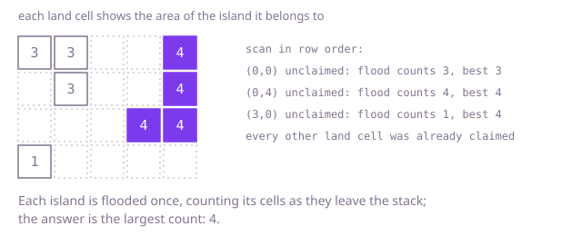

## The question

Given a map drawn as rows of land and water, return the number of cells in the largest island, where land cells belong to the same island when they share a side. A map with no land has a largest area of 0.

What makes it harder than it looks is measuring each island once. The obvious "measure the island around this cell" is correct from any of its cells, so a version that does it for every land cell gives the right number while doing the same work once per cell, which on a single island of half a million cells is hopeless. Size bites a second time: an island that snakes through the map makes a recursive search go one level deeper per cell and overflow the call stack.

## How to think about it

The first idea is to take each land cell, measure its island with a fresh search and keep the largest result. It is correct, since every island is measured from at least one of its cells, and it is what you say first, but every island of k cells is measured k times, so a big island costs its area squared.

The fix is the one from counting islands: scan the map, and when the scan meets land that no earlier search has claimed, flood that island once, marking every cell it reaches so the scan passes over them later. Counting the cells during that flood gives the island's area for free, and the answer is the largest count. Every cell is marked once.

The flood can recurse, which is short to write but goes as deep as the island is long; a serpentine island of 500,500 cells overflows the stack. An explicit stack of cells to visit does the same work in a loop. Mark a cell when it is pushed, not when it is popped, so no cell is pushed twice, and count a cell when it is popped.

Walk Example 1, `{"##..#", ".#..#", "...##", "#...."}`. The scan meets unclaimed land at (0,0): the flood claims (0,0), (0,1) and (1,1), area 3, best 3. The scan passes (0,1) because it is claimed. At (0,4) the flood claims (0,4), (1,4), (2,4) and (2,3), area 4, best 4. The scan passes (1,1), (1,4), (2,3) and (2,4). At (3,0) the flood claims one cell. The answer is 4.



## Brute force

For every land cell, run a breadth-first search with its own visited grid and count the cells it reaches; keep the largest count. It comes first because it is the definition of the answer written as code, and it fixes the answer the faster versions must agree with. It is correct because each island is measured from at least one of its cells, and each measurement is a complete search of that island.

```java
static int largest(String[] rows) {
    int best = 0;
    for (int r = 0; r < rows.length; r++) {
        for (int c = 0; c < rows[r].length(); c++) {
            if (rows[r].charAt(c) == '#') {
                best = Math.max(best, measure(rows, r, c)); // every land cell measures its own island again
            }
        }
    }
    return best;
}

// Counts the cells of the island holding (r, c) with a fresh breadth-first search.
private static int measure(String[] rows, int r, int c) {
    int width = rows[0].length();
    boolean[][] seen = new boolean[rows.length][width];
    ArrayDeque<int[]> queue = new ArrayDeque<>();
    queue.add(new int[] {r, c});
    seen[r][c] = true;
    int area = 0;
    int[][] steps = {{1, 0}, {-1, 0}, {0, 1}, {0, -1}};
    while (!queue.isEmpty()) {
        int[] cell = queue.poll();
        area++;
        for (int[] step : steps) {
            int nr = cell[0] + step[0];
            int nc = cell[1] + step[1];
            if (nr >= 0 && nr < rows.length && nc >= 0 && nc < width && !seen[nr][nc] && rows[nr].charAt(nc) == '#') {
                seen[nr][nc] = true;
                queue.add(new int[] {nr, nc});
            }
        }
    }
    return area;
}
```

**Complexity:** time O((R × C)²) in the worst case for R rows and C columns: every land cell searches its whole island and clears a fresh R × C visited grid; extra space O(R × C).

## Better: one scan, recursive flood fill

Scan once and keep one visited grid for the whole map. At unclaimed land, a recursive search marks the cell, adds one and adds the areas returned by its four neighbours; the result is the island's area.

```java
static int largest(String[] rows) {
    boolean[][] seen = new boolean[rows.length][];
    for (int r = 0; r < rows.length; r++) {
        seen[r] = new boolean[rows[r].length()];
    }
    int best = 0;
    for (int r = 0; r < rows.length; r++) {
        for (int c = 0; c < rows[r].length(); c++) {
            best = Math.max(best, area(rows, seen, r, c)); // 0 for water or claimed land
        }
    }
    return best;
}

/** Marks the island holding (r, c) and returns its area; 0 if the cell is water or already claimed. */
private static int area(String[] rows, boolean[][] seen, int r, int c) {
    if (r < 0 || r >= rows.length || c < 0 || c >= rows[r].length() || seen[r][c] || rows[r].charAt(c) != '#') {
        return 0;
    }
    seen[r][c] = true;
    return 1 + area(rows, seen, r - 1, c) + area(rows, seen, r + 1, c)
            + area(rows, seen, r, c - 1) + area(rows, seen, r, c + 1);
}
```

**Complexity:** time O(R × C), extra space O(R × C), because the recursion can be as deep as the island is long; on a snake-shaped island through half of a 1,000 by 1,000 map it overflows the call stack.

**Prefer it when:** the maps are small, such as game boards or puzzle grids; it is the shortest correct code and reads like the definition.

## Optimal: one scan, flood fill with an explicit stack

Scan once. At unclaimed land, push it on a stack of cells to visit, marking it; pop cells, count each one, and push its unmarked land neighbours, marking them as they are pushed. When the stack is empty the count is the island's area. This is the reference solution.

```java
static int largest(String[] rows) {
    int height = rows.length;
    if (height == 0) {
        return 0;
    }
    int width = rows[0].length();
    boolean[] seen = new boolean[height * width];
    int[] stack = new int[height * width];
    int best = 0;
    for (int start = 0; start < height * width; start++) {
        if (rows[start / width].charAt(start % width) != '#' || seen[start]) {
            continue;
        }
        int area = 0; // a new island: count the cells as they come off the stack
        int top = 0;
        stack[top++] = start;
        seen[start] = true;
        while (top > 0) {
            int cell = stack[--top];
            area++;
            int r = cell / width;
            int c = cell % width;
            if (r > 0) top = visit(rows, seen, stack, top, (r - 1) * width + c, width);
            if (r + 1 < height) top = visit(rows, seen, stack, top, (r + 1) * width + c, width);
            if (c > 0) top = visit(rows, seen, stack, top, r * width + c - 1, width);
            if (c + 1 < width) top = visit(rows, seen, stack, top, r * width + c + 1, width);
        }
        best = Math.max(best, area);
    }
    return best;
}

/** Pushes the cell and marks it when it is unvisited land; returns the new stack size. */
private static int visit(String[] rows, boolean[] seen, int[] stack, int top, int cell, int width) {
    if (!seen[cell] && rows[cell / width].charAt(cell % width) == '#') {
        seen[cell] = true; // mark on push so a cell is never stacked twice
        stack[top++] = cell;
    }
    return top;
}
```

**Complexity:** time O(R × C), since every cell is marked once and looked at from at most four neighbours; extra space O(R × C) for the marks and the stack, with no recursion.

## Complexity

| Approach | Time | Extra space |
| --- | --- | --- |
| Brute force: measure from every land cell | O((R × C)²) worst case | O(R × C) |
| Better: one scan, recursive flood fill | O(R × C) | O(R × C) call stack, which overflows on a long snake-shaped island |
| Optimal: one scan, explicit stack | O(R × C) | O(R × C) |

R is the number of rows and C the number of columns. Every cell must be looked at, so no approach beats O(R × C).

## Where it shows up

No coding-round problem is linked to this question. The same measured flood fill finds the largest connected region in an image mask (the biggest blob a camera sees), the largest area cut off by a flood on a terrain map, and the size of the biggest cluster of failed machines in a rack layout where neighbours affect each other.

## Follow-up answers

**How would you report the largest island after each cell of land is added?** Use union-find with a size per group. A new land cell starts a group of size 1 and merges with each land neighbour, adding the sizes; the largest group can only grow, so keep a running maximum and update it after each merge. Each addition costs close to constant time.

**What is the largest island you could make by turning one water cell into land?** Label every island with an id and record its area in one pass. Then, for each water cell, add 1 to the areas of the distinct islands among its four neighbours, using a small set of ids so an island touching the cell on two sides is counted once. The best over all water cells, or the whole map's area if there is no water, is the answer.

**How would you also count the coastline, the land edges that touch water or the map border, of the largest island?** During the flood, for each popped cell count the sides that lead off the map or onto water, and add them up per island. Keep the coastline of the island whose area is largest. It is the same pass with one more counter.
