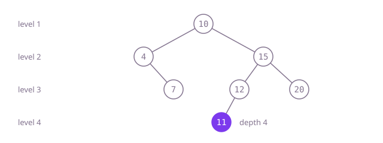

## The question

Given the root of a binary tree, return how many nodes lie on its longest root-to-leaf path; one node is depth 1 and an empty tree is depth 0. The tree may have any shape, up to 1,000 levels deep.

What makes it harder than it looks: very little, once the count is pinned down. The slip is counting edges instead of nodes, which makes a single node come out as 0 and every other answer one short. The other thing worth knowing is what the short recursive answer costs: one stack frame per level, which is fine at 1,000 levels and would not be at 100,000.

## How to think about it

The first idea is to try every path from the root down and keep the longest. Walking every path is a depth-first walk, and if each node carries its own depth (its parent's plus one) there is nothing to recompute: the answer is the largest depth any node carries. Keeping the pending nodes on an explicit stack works, but it means managing two stacks by hand.

Depth can also be seen as the number of levels: process the tree a level at a time with a queue, and count how many levels there are. That needs no bookkeeping per node, only the size of the current level.

The shortest way to say it uses the shape of the tree directly: the depth of a tree is one more than the deeper of its two subtrees, and an empty tree has depth 0. That is the same question on smaller trees, so recursion answers it in one line, with one frame per level on the call stack; with depth capped at 1,000 that is small and safe.

Walk Example 1, `[10,4,15,null,7,12,20,null,null,11]`. The leaves 7, 11 and 20 have depth 1. 12 sits over 11, so it has 2. 15 has 12 (2) and 20 (1), so it has 3. 4 has only 7, so it has 2. The root 10 takes the deeper of 2 and 3 and adds one: 4. Counted as levels it is the same: 10, then 4 and 15, then 7, 12 and 20, then 11 alone.



## Brute force

Walk every path with an explicit stack, each entry carrying its node's depth, and keep the largest. It comes first because "try every path, keep the longest" is what you say first, and it fixes the answer to compare against. It is correct because every node is pushed once, by its parent, with the parent's depth plus one, so it carries its true depth; the deepest leaf is among them.

```java
static int maxDepth(TreeNode root) {
    if (root == null) {
        return 0;
    }
    ArrayDeque<TreeNode> nodes = new ArrayDeque<>();
    ArrayDeque<Integer> depths = new ArrayDeque<>(); // depths.peek() belongs to nodes.peek()
    nodes.push(root);
    depths.push(1); // a lone root already has depth 1: nodes, not edges
    int best = 0;
    while (!nodes.isEmpty()) {
        TreeNode n = nodes.pop();
        int d = depths.pop();
        best = Math.max(best, d);
        if (n.left != null) { nodes.push(n.left); depths.push(d + 1); }
        if (n.right != null) { nodes.push(n.right); depths.push(d + 1); }
    }
    return best;
}
```

**Complexity:** time O(n), extra space O(h) for the stacks, where h is the depth, all on the heap.

## Better: count levels with a queue

Keep a queue holding exactly one level. While it is not empty, add one to the depth, then take off as many nodes as the level has and queue their children.

```java
static int maxDepth(TreeNode root) {
    if (root == null) {
        return 0;
    }
    ArrayDeque<TreeNode> level = new ArrayDeque<>();
    level.add(root);
    int depth = 0;
    while (!level.isEmpty()) {
        depth++; // the queue holds exactly one whole level here
        for (int i = level.size(); i > 0; i--) {
            TreeNode n = level.poll();
            if (n.left != null) level.add(n.left);
            if (n.right != null) level.add(n.right);
        }
    }
    return depth;
}
```

**Complexity:** time O(n), extra space O(w) for the queue, where w is the widest level (one node on a path, about n/2 in a complete tree), all on the heap.

**Prefer it when:** the depth is not capped. The queue lives on the heap and a path of 100,000 nodes holds one node in it at a time, while one call per level would overflow Java's stack.

## Optimal: recursion

The depth of an empty tree is 0; otherwise it is one more than the deeper subtree. This is the reference solution.

```java
static int maxDepth(TreeNode root) {
    if (root == null) {
        return 0;
    }
    return 1 + Math.max(maxDepth(root.left), maxDepth(root.right)); // one level more than the deeper side
}
```

**Complexity:** time O(n), extra space O(h) for the call stack, at most 1,000 frames here; a path of tens of thousands of nodes would overflow Java's default stack.

## Complexity

| Approach | Time | Extra space |
| --- | --- | --- |
| Brute force | O(n) | O(h) on the heap |
| Better: count levels with a queue | O(n) | O(w) on the heap, the widest level |
| Optimal: recursion | O(n) | O(h) call stack, safe for depth up to 1,000, overflows on paths of tens of thousands |

## Where it shows up

No coding-round problem is linked to this question. Measuring the depth of a tree shows up when a file-system scan reports how deeply folders are nested, when a parser or JSON validator rejects documents nested beyond a limit, and when a self-balancing tree checks that its height has stayed logarithmic.

## Follow-up answers

**When would the one-line recursive answer fail, and what would make it safe?** Each level adds a stack frame, and Java's default thread stack holds roughly ten thousand small frames (fewer while the code still runs interpreted), so it is safe at this question's 1,000 levels but a lopsided tree of 100,000 nodes would overflow it. Moving the pending work to the heap fixes it: the level queue above, or the explicit stack of the brute force. Running the recursion on a thread created with a larger stack size also works, but only moves the limit.

**How would you find the minimum depth instead?** Count levels the same way, but stop at the first node that has no children and return the current level: breadth-first order reaches the shallowest leaf first, so the walk can end early. A node with one child is not a leaf, so a root with only a right subtree has the depth of that subtree's shallowest leaf, not 1.

**How would you return the nodes on one deepest path, not just its length?** Remember each node's parent while walking (a map from child to parent, or a parent field). The last node taken off the queue lies on the deepest level, so follow the parent links from it back to the root and reverse the list. That is still O(n) time and O(n) extra space for the parent map.
