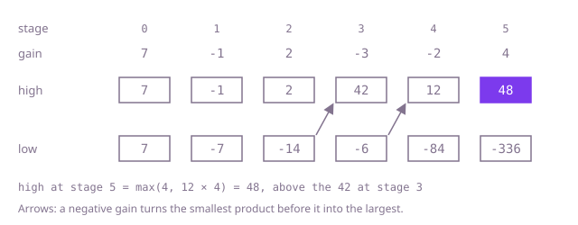

## The question

Given a chain of whole-number gains, return the largest product of any run of one or more consecutive gains. Gains run from -10 to 10, so a run can be negative, zero or very large.

What makes it harder than it looks is that the idea that works for sums, keep the best run ending here and extend it, fails for products. A negative gain turns the worst product so far into the best: in Example 2 the best run ending at the 2 is the 2 alone, yet the run that wins is the one whose product there is -30. A zero wipes out every run through it, but a 0 can still be the answer, as in `[-5,0,-3,0,-7]`. The answer can be negative, so starting the best at 0 is wrong for `[-7]`. Products can come close to 2^63 here, far past an `int`, and past the 2^53 up to which a `double` holds whole numbers exactly. And at 100,000 gains, multiplying out every run is about 5 × 10^9 steps.

## How to think about it

The first idea is to try every run: for each start, extend to the right, keep a running product and remember the largest. Each run's product is one multiplication from the one before, so this is O(n²). What it repeats is the work for the runs that end at a stage: they are all a run ending one stage earlier with this stage added, or this stage alone.

For sums you would keep only the largest run ending at the previous stage. For products, multiplying by a negative gain reverses the order: the most negative product before becomes the largest after. So carry two numbers per stage, the largest and the smallest product of a run that ends there. For the next gain, the new largest is the gain alone or the gain times one of the two, the largest when the gain is positive, the smallest when it is negative; the new smallest is the other way round. A 0 makes both 0; at the next stage one of the two is the gain alone and the other is 0, so runs start afresh after it.

Walk Example 1, `gains = [7,-1,2,-3,-2,4]`. At 7 both are 7. At -1 they become -1 and -7. At 2 they are 2 and -14. At -3 they swap: the smallest, -14, becomes the largest, 42, the whole chain so far, and the smallest is -6. At -2, -6 becomes 12 and 42 becomes -84. At 4 the largest is 12 × 4 = 48, which beats the 42 seen at stage 3 and is the answer.



## Brute force

Fix the start of the run, extend the end one stage at a time and multiply the running product by each new gain. It comes first because it is the definition written as code, and it fixes the answers the faster versions must match. It is correct because every run is some start and some end, and each product is computed exactly; the constraints keep every product inside a `long`.

```java
static long bestGain(int[] gains) {
    long best = gains[0];
    for (int start = 0; start < gains.length; start++) {
        long product = 1;
        for (int end = start; end < gains.length; end++) {
            product *= gains[end]; // the run start..end, built from the run start..end-1
            best = Math.max(best, product);
        }
    }
    return best;
}
```

**Complexity:** time O(n²), extra space O(1). Stopping a start once its product hits 0 does not help a chain with no zeros.

## Better: prefix and suffix products

Look at a stretch between zeros. Every non-zero gain is at least 1 in size, so a longer run never has a smaller product in absolute value. If the stretch has an even number of negative gains, the whole stretch is its best run. If the number is odd, the best run leaves out the first negative gain and everything before it, or the last one and everything after it: both are a prefix or a suffix of the stretch. (A stretch that is one negative gain on its own is its own best run, and a prefix too.) So one running product from the left and one from the right, each starting again after a zero, meet every candidate. The zero itself is a candidate too, which the running product picks up as 0.

```java
static long bestGain(int[] gains) {
    int n = gains.length;
    long best = gains[0];
    long fromLeft = 1; // product since the last zero, reading left to right
    long fromRight = 1; // the same, reading right to left
    for (int i = 0; i < n; i++) {
        fromLeft = (fromLeft == 0 ? 1 : fromLeft) * gains[i]; // after a zero, start again
        fromRight = (fromRight == 0 ? 1 : fromRight) * gains[n - 1 - i];
        best = Math.max(best, Math.max(fromLeft, fromRight));
    }
    return best;
}
```

**Complexity:** time O(n), extra space O(1).

**Prefer it when:** you want the loop that is easiest to check: each pass is a plain running product that starts again after a zero, and nothing has to be swapped. It depends on every non-zero gain being at least 1 in size, so it does not carry over to fractional gains.

## Optimal: largest and smallest product ending here

Walk the chain once, carrying the largest and the smallest product of a run that ends at the current stage. A negative gain swaps their roles; then each is the gain alone or the gain times the old value, and the best answer is the largest of the largest. This is the reference solution.

```java
static long bestGain(int[] gains) {
    long high = gains[0]; // largest product of a run that ends at the current stage
    long low = gains[0]; // smallest product of a run that ends at the current stage
    long best = gains[0];
    for (int i = 1; i < gains.length; i++) {
        long gain = gains[i];
        if (gain < 0) { // a negative gain turns the smallest product into the largest
            long swap = high;
            high = low;
            low = swap;
        }
        high = Math.max(gain, high * gain); // start a new run here, or extend the one before
        low = Math.min(gain, low * gain);
        best = Math.max(best, high);
    }
    return best;
}
```

**Complexity:** time O(n), extra space O(1). Every value it multiplies is the product of a real run, so the constraint keeps it inside a `long`.

## Complexity

| Approach | Time | Extra space |
| --- | --- | --- |
| Brute force | O(n²) | O(1) |
| Better: prefix and suffix products | O(n) | O(1) |
| Optimal: largest and smallest product ending here | O(n) | O(1) |

## Where it shows up

Anything that compounds has this shape. Daily price ratios multiply, so the best holding period is the run of days with the largest product; with only positive ratios, taking logarithms turns it into a largest-sum run. In a chain of amplifiers or filters, gains multiply and inverting stages flip the sign. The trick of carrying both extremes, because one operation can swap them, also appears whenever a running value is multiplied by numbers that can be negative.

## Follow-up answers

**What if you also had to say where the best run starts and ends?** Carry a start position with each of the two running products: when a product restarts at the current gain, its start is the current stage; when the two swap, their starts swap too. When `best` improves, record the start of `high` and the current stage as the end.

**What if the gains could be fractions, such as 0.5, rather than whole numbers?** The optimal pass still works, because the best run ending here is still this gain alone or this gain times the largest or smallest run before it; with gains between -1 and 1, choosing the gain alone matters more often. The prefix and suffix pass breaks, because a longer run can now have a smaller product, so the best run need not be a prefix or a suffix of a stretch.

**What if the products could grow past 64 bits?** Then the two running products need `BigInteger`. The method is unchanged, but each multiplication costs time that grows with the length of the number, so the pass is no longer linear. If only the position of the best run matters, sizes can be compared as sums of logarithms, with the exact product worked out once at the end; nearly equal products then need care, because rounding in those sums can put them in the wrong order.
