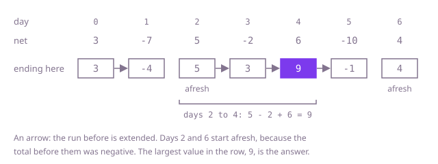

## The question

Given a ledger of daily gains and losses, return the largest total of any run of one or more consecutive days. The run cannot be empty, so the answer is negative when every day lost money.

What makes it harder than it looks is that the quick rules are wrong. A losing day can sit inside the best run: in Example 1 the best run crosses the -2, so cutting the ledger at every loss gives 6 instead of 9. Adding up all the gains ignores that the days must be consecutive (18 on Example 1). Starting the best at 0 quietly allows an empty run, so `[-6,-2,-8]` comes out as 0 instead of -2. And at 100,000 days, trying every run is about 5 × 10^9 sums.

## How to think about it

The first idea is to try every run: fix the first day, extend to the right with a running total, and remember the largest. That is O(n²), and what it repeats is the work for runs that end on the same day. Every run that ends on day `i` is either day `i` on its own or a run that ends on day `i - 1` with day `i` added.

A running balance gives the first improvement. Let the balance after day `j` be the total of days 0 to `j`. A run from day `i` to day `j` totals the balance after `j` minus the balance before `i`, so for a fixed last day the best run starts just after the lowest balance seen before it. One pass that keeps the lowest balance so far finds the best run for every last day: O(n).

The greedy view says the same thing more directly. Carry one number, the best total of a run that ends on the current day. For the next day there are only two candidates: the day on its own, or the day added to that best run. If the best run ending yesterday has a negative total, adding it only lowers today's total, so start afresh; otherwise extend it. The choice is safe because every run ending today that starts earlier is some run ending yesterday plus today, and the carried total is the largest of those, so nothing that is dropped could have won. Cutting at every losing day is the wrong version of this rule: the rule looks at the total of the run so far, not at today's entry, and in Example 1 the -2 comes after a run worth 5.

Walk Example 1, `net = [3,-7,5,-2,6,-10,4]`. The best run ending on each day is 3; then -4 (3 - 7 beats -7 alone); then 5 (the -4 is negative, so start afresh); then 3; then 9; then -1; then 4 (afresh again). The largest of these is 9, the run of days 2 to 4.



## Brute force

Fix the first day of the run, extend the last day one at a time and add each new entry to a running total. It comes first because it is the definition written as code, and it fixes the answers the faster versions must match. It is correct because every run is some first day and some last day, and each total is computed exactly; the constraints keep every run's total inside an `int`.

```java
static int bestRun(int[] net) {
    int best = net[0];
    for (int start = 0; start < net.length; start++) {
        int total = 0;
        for (int end = start; end < net.length; end++) {
            total += net[end]; // the run start..end, built from the run start..end-1
            best = Math.max(best, total);
        }
    }
    return best;
}
```

**Complexity:** time O(n²), extra space O(1).

## Better: the lowest balance so far

Walk the ledger keeping the balance, the total of every day so far, and the lowest balance seen before the current day, counting the balance of 0 before day 0. The best run that ends today is today's balance minus that lowest balance. Updating the lowest balance only after using it keeps the run from being empty, which is what makes `[-6,-2,-8]` give -2.

```java
static int bestRun(int[] net) {
    int balance = 0; // total of every day so far
    int lowest = 0; // lowest balance before the current day, counting the 0 before day 0
    int best = net[0];
    for (int amount : net) {
        balance += amount;
        best = Math.max(best, balance - lowest); // the best run ending today starts after the low
        lowest = Math.min(lowest, balance); // updated after use, so the run is never empty
    }
    return best;
}
```

**Complexity:** time O(n), extra space O(1). The balance is the total of days 0 to today, and `balance - lowest` is the total of a run, so both stay inside an `int`.

**Prefer it when:** you think of the ledger as a running balance: the answer is the largest rise of the balance above an earlier low, the same pass as buying low and selling high on a price chart.

## Optimal: the best run ending today

Walk the ledger once, carrying the best total of a run that ends on the current day. Each day it is the day on its own or the day added to yesterday's best run, whichever is larger, which drops yesterday's run exactly when its total is negative. The answer is the largest value it takes. This is the reference solution, often called Kadane's algorithm.

```java
static int bestRun(int[] net) {
    int endingHere = net[0]; // best total of a run that ends on the current day
    int best = net[0];
    for (int i = 1; i < net.length; i++) {
        // a run before today with a negative total only lowers today's, so start afresh
        endingHere = Math.max(net[i], endingHere + net[i]);
        best = Math.max(best, endingHere);
    }
    return best;
}
```

**Complexity:** time O(n), extra space O(1). `endingHere` is always the total of a real run, so it stays inside an `int`.

## Complexity

| Approach | Time | Extra space |
| --- | --- | --- |
| Brute force | O(n²) | O(1) |
| Better: the lowest balance so far | O(n) | O(1) |
| Optimal: the best run ending today | O(n) | O(1) |

## Where it shows up

Any series of gains and losses asks it: the best stretch of a profit-and-loss record, or the best time to have held a stock when the series is daily price changes. In signal processing, subtracting a baseline and finding the largest-sum run finds the stretch of a signal that stands highest above it. In sequence analysis, scoring each position plus or minus and taking the best run finds the most enriched segment of a genome or a text.

## Follow-up answers

**What if you also had to say which days the best run covers?** Remember where the current run started: when it starts afresh, that is today. When `best` improves, record that start and today as the end. In the lowest-balance version, the run starts the day after the lowest balance, so remember the day each new low was set.

**What if the ledger were split across several machines?** Let each machine summarise its part in four numbers: its total, its best run, its best run that starts on its first day and its best run that ends on its last day. Two neighbouring parts combine in constant time. The best run of the two is the best of either, or the first's best run to its last day joined to the second's best run from its first day. The joined part's best run from its first day is the first's, or the whole first part followed by the second's best run from its first day; its best run to its last day is found the same way from the other end; the totals add. Combining the summaries in order gives the answer, and each part is summarised in one pass.

**What if the run had to be at least k days long?** Use the running balance. A run ending today may start at day `today - k + 1` or earlier, so the low it subtracts may only use balances from at least `k` days back. Keep the balances in an array and let the lowest balance trail `k` days behind the current day; it is still one pass, O(n) time, with O(n) space for the balances.
