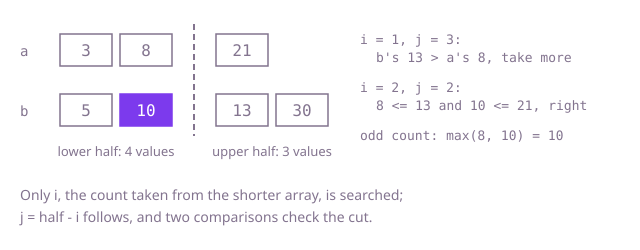

## The question

Given two sorted arrays, return the median of all their values together: the middle value for an odd count, the average of the two middle values for an even one. The tests call it thousands of times on million-value arrays, so the answer must come without reading most of the values.

What makes it harder than it looks: merging is the obvious move, and it reads half the values on every call. The fast version searches for a cut, not a value, and its edges are many: one array may be empty, the cut may take nothing or everything from an array, and the values repeat. The arithmetic has its own traps: the average of two `int`s near the limit overflows if added as `int`s, and integer division drops the `.5`.

## How to think about it

The first idea is to put all the values in one array, sort it and read the middle. That works and throws away the fact that both arrays are already sorted. Merging them, as in merge sort, uses that fact and stops at the middle, which is one pass over half the values. Still too slow for thousands of calls.

The better question is: which values form the lower half? The lower half has `half = (m + n + 1) / 2` values, and since both arrays are sorted, it is some prefix of `a` plus some prefix of `b`. If it takes `i` values from `a`, it takes `j = half - i` from `b`. So there is a single number to find, `i`. A choice of `i` is right when the largest value taken is at most the smallest value left, and since each array is sorted, that comes down to two checks: `a[i - 1] <= b[j]` and `b[j - 1] <= a[i]`. If the first fails, `i` is too big; if the second fails, it is too small. That is a sorted yes/no structure over `i`, so binary search finds it in O(log m). Searching the shorter array keeps `j` inside `b`. A cut that takes nothing from an array, or everything, reads the missing neighbour as minus or plus infinity.

Then the median comes from the four values around the cut: the largest of the lower half for an odd count, and the average of that and the smallest of the upper half for an even one, added as `long`s and divided by `2.0`.

Walk Example 1, `a = [3, 8, 21]`, `b = [5, 10, 13, 30]`. Seven values, so `half = 4`, and `i` runs from 0 to 3. Try `i = 1`, `j = 3`: the lower half would be 3 and 5, 10, 13, but 13 is larger than 8, which was left behind in `a`, so take more from `a`. Try `i = 2`, `j = 2`: the lower half is 3, 8 and 5, 10, and 8 is at most 13 and 10 is at most 21, so the cut is right. The count is odd, so the median is the largest of the lower half, 10.



## Brute force

Copy both arrays into one, sort it and read the middle. It comes first because it is the definition of the median applied directly, and it fixes the answer to compare against. It is correct because the sorted copy holds every value in order.

```java
static double median(int[] a, int[] b) {
    int[] all = new int[a.length + b.length];
    System.arraycopy(a, 0, all, 0, a.length);
    System.arraycopy(b, 0, all, a.length, b.length);
    Arrays.sort(all);
    int k = all.length;
    if (k % 2 == 1) {
        return all[k / 2];
    }
    return ((long) all[k / 2 - 1] + all[k / 2]) / 2.0; // long sum, then a real division
}
```

**Complexity:** time O((m + n) log(m + n)), extra space O(m + n).

## Better: merge up to the middle

Walk both arrays as a merge does, taking the smaller front value each step, and stop once the middle is reached. Keep the last two values taken: the last is the median for an odd count, and the average of both is the median for an even one.

```java
static double median(int[] a, int[] b) {
    int total = a.length + b.length;
    int i = 0;
    int j = 0;
    long previous = 0;
    long current = 0;
    for (int step = 0; step <= total / 2; step++) { // walk the merge up to the middle
        previous = current;
        if (j == b.length || (i < a.length && a[i] <= b[j])) {
            current = a[i++];
        } else {
            current = b[j++];
        }
    }
    return total % 2 == 1 ? current : (previous + current) / 2.0; // long sum: no overflow
}
```

**Complexity:** time O(m + n), extra space O(1).

**Prefer it when:** the arrays are small, or are being read as streams anyway, so the pass costs little and the code is much easier to get right. It also extends directly to finding any k-th value by stopping at step k.

## Optimal: binary search on the cut

Binary search `i`, the number of values the lower half takes from the shorter array. Compare the values on each side of the cut, move `i` up or down, and read the median from the four neighbours once the cut is right. This is the reference solution.

```java
static double median(int[] a, int[] b) {
    if (a.length > b.length) {
        return median(b, a); // search the shorter array, so the cut in the longer one always exists
    }
    int m = a.length;
    int n = b.length;
    int half = (m + n + 1) / 2; // the left side holds the middle value when the total is odd
    int low = 0;
    int high = m;
    while (low <= high) {
        int i = (low + high) >>> 1; // values taken from a for the left side
        int j = half - i; // the rest come from b
        // an empty side of a cut reads as minus or plus infinity; long, so the sum below cannot overflow
        long aLeft = i == 0 ? Long.MIN_VALUE : a[i - 1];
        long aRight = i == m ? Long.MAX_VALUE : a[i];
        long bLeft = j == 0 ? Long.MIN_VALUE : b[j - 1];
        long bRight = j == n ? Long.MAX_VALUE : b[j];
        if (aLeft > bRight) {
            high = i - 1; // too many from a
        } else if (bLeft > aRight) {
            low = i + 1; // too few from a
        } else {
            long leftMax = Math.max(aLeft, bLeft);
            if ((m + n) % 2 == 1) {
                return leftMax;
            }
            long rightMin = Math.min(aRight, bRight);
            return (leftMax + rightMin) / 2.0; // a long sum: two large ints would overflow an int
        }
    }
    throw new IllegalArgumentException("the arrays are not sorted");
}
```

**Complexity:** time O(log(min(m, n))), extra space O(1).

## Complexity

| Approach | Time | Extra space |
| --- | --- | --- |
| Brute force | O((m + n) log(m + n)) | O(m + n) |
| Better: merge up to the middle | O(m + n) | O(1) |
| Optimal: binary search on the cut | O(log(min(m, n))) | O(1) |

## Where it shows up

Combining sorted shards: a database or search engine that holds a sorted column split across two partitions can answer a median or percentile query without merging them. The same cut search finds the k-th smallest value across two sorted lists, which is how quantiles over two sorted files of latencies or prices are read without loading both.

## Follow-up answers

**Can you do it in O(log(min(m, n))) time, where m and n are the two lengths?** Yes: binary search the number of values the lower half takes from the shorter array. The rest come from the longer one, two cross comparisons say whether the cut is right or which way to move it, and the median is read from the values next to the cut.

**How would you find the k-th smallest value of the two arrays instead of the median?** Use the same cut with `k` values on the left instead of `half`: `i` from `a` and `k - i` from `b`, with `i` limited so that both counts are within their arrays. The answer is the largest value on the left side of the right cut.

**What if there were many sorted arrays instead of two?** The cut idea does not extend neatly. Binary search on the value instead: for a guessed value, count how many values are at most it with one binary search per array, and adjust the guess until the count reaches the middle. That is O(k log n log R) for k arrays of length up to n and a value range R.
