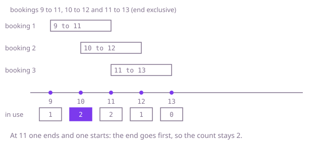

## The question

Given bookings that each occupy a room from a start minute up to, but not including, an end minute, find the fewest rooms that can hold them all with no two overlapping in one room. The bookings come in no particular order.

What makes it harder than it looks: it is not a question about which booking goes where, only about how many are in progress at once. The end is exclusive, so a booking ending at minute 11 frees its room for one starting at 11; process the two in the wrong order and the count is one too high. Comparing every booking with every other is 10 billion pairs at 100,000 bookings.

## How to think about it

The first idea is to count, for each booking, how many bookings are in progress when it starts, and take the largest count. That is right, because the busiest moment can always be taken at some booking's start, but it is a scan of every booking for every booking. I do not need to assign rooms at all: the number of rooms I must own is the largest number of bookings active together. That number only changes at a start or an end, so I only have to visit those moments in order. One way is to hand out rooms as I go: sort by start, and keep a min-heap of the end times of the rooms in use; if the earliest-ending room is free by this start, reuse it, otherwise open a new one. A lighter way drops the pairing altogether: sort the starts and the ends as two separate lists. At each start, the number of bookings in progress is the number started so far minus the number already ended, and "already ended" only needs a pointer moving through the sorted ends.

Walk Example 1, `[[9, 11], [10, 12], [11, 13]]`. Starts: 9, 10, 11. Ends: 11, 12, 13. At start 9, no end is at or before 9, so 1 is in progress. At start 10, no end is at or before 10, so 2 are in progress, the peak. At start 11, the end at 11 is at or before it, so one booking is released first and then the new one is counted: still 2. The answer is 2.



## Brute force

For each booking, count the bookings that are in progress at its start (including itself), and keep the largest count. It is what you say first, and it fixes the answer every faster version must agree with. It is correct because the busiest moment is always the start of some booking: moving back from any busy moment to the latest start at or before it never loses a booking from the count.

```java
static int minRooms(int[][] bookings) {
    int peak = 0;
    for (int[] mine : bookings) {
        int active = 0; // bookings in use at the minute this one starts
        for (int[] other : bookings) {
            if (other[0] <= mine[0] && mine[0] < other[1]) { // end is exclusive
                active++;
            }
        }
        peak = Math.max(peak, active);
    }
    return peak;
}
```

**Complexity:** time O(n²), extra space O(1).

## Better: sort by start, with a heap of end times

This is a different tool at the same cost as the optimal sweep: both are O(n log n). Sort the bookings by start and keep a min-heap of the end times of the rooms in use. For each booking, if the room that frees earliest is free by this start, reuse it: take its end time out. Then put this booking's end time in. The heap holds one entry per room in use, and since a room is only added when none is free, the heap size at the end is the number of rooms.

```java
static int minRooms(int[][] bookings) {
    int[][] sorted = bookings.clone();
    Arrays.sort(sorted, (a, b) -> Integer.compare(a[0], b[0]));
    PriorityQueue<Integer> ends = new PriorityQueue<>(); // end time of each room in use
    for (int[] booking : sorted) {
        if (!ends.isEmpty() && ends.peek() <= booking[0]) { // exclusive end: free at this minute
            ends.poll(); // reuse that room
        }
        ends.add(booking[1]);
    }
    return ends.size();
}
```

**Complexity:** time O(n log n), extra space O(n).

**Prefer it when:** you may later need to say which room each booking gets: the heap is the natural base for that if a room number is stored beside each end time (as written it holds only end times and cannot say). If you only need the count, it spends heap operations the two sorted arrays do not need.

## Optimal: sort starts and ends separately, sweep once

Sort the start times and the end times as two independent arrays. Walk through the starts in order. Before counting a booking as in progress, release every booking whose end is at or before this start, because the end is exclusive. Then add one for the new booking and remember the highest count. The ends are only consumed in order, so one pointer into the sorted ends is enough. This is the reference solution.

```java
static int minRooms(int[][] bookings) {
    int n = bookings.length;
    int[] starts = new int[n];
    int[] ends = new int[n];
    for (int i = 0; i < n; i++) {
        starts[i] = bookings[i][0];
        ends[i] = bookings[i][1];
    }
    Arrays.sort(starts);
    Arrays.sort(ends);
    int busy = 0;
    int peak = 0;
    int released = 0; // how many bookings have already ended
    for (int start : starts) {
        while (ends[released] <= start) { // an end at this minute frees a room first
            released++;
            busy--;
        }
        busy++;
        peak = Math.max(peak, busy);
    }
    return peak;
}
```

The pointer never runs off the array: a booking cannot end before it starts, so when the k-th start is handled at most k - 1 ends are at or before it.

**Complexity:** time O(n log n), extra space O(n).

## Complexity

| Approach | Time | Extra space |
| --- | --- | --- |
| Brute force: count the bookings active at each start | O(n²) | O(1) |
| Better: sort by start, heap of end times | O(n log n) | O(n) |
| Optimal: sort starts and ends separately, sweep | O(n log n) | O(n) |

## Where it shows up

`hold-exposure` is this question with amounts. In `ExposureCalculator`, `peak` turns every hold into two events, an amount added at the start and subtracted at the end, sorts all the events together, and keeps a running total, remembering the largest. Counting bookings is the same sweep with every amount equal to one. The tie rule is shared too: its sort puts an end before a start at the same minute, because an end is exclusive. The difference is that it sorts one array of events where the reference here keeps two sorted arrays.

In practice the same sweep sizes anything that is reserved for an interval: how many servers a set of jobs needs, how many tables a dining room needs for its reservations, and the peak number of concurrent connections in a session log.

## Follow-up answers

**How would you also say which room each booking gets?** Use the heap version, with the room number stored next to each end time. For each booking in order of start, take the room that frees earliest; if it is free by this start, give the booking that room, otherwise open a new room with the next number. Record the room number for the booking.

**What if every room is only available for part of the day?** The count no longer settles it, because a booking can only go to a room that is open for its whole duration. It becomes a matching problem; a greedy over bookings sorted by start, with a structure of rooms ordered by closing time, is the usual start, and you would check with the interviewer how general the room windows are.

**How would you find the busiest moment, not just the count?** Record the minute when `peak` is raised, which is the start of the booking that made the count higher. The busiest period then runs until the next end.
