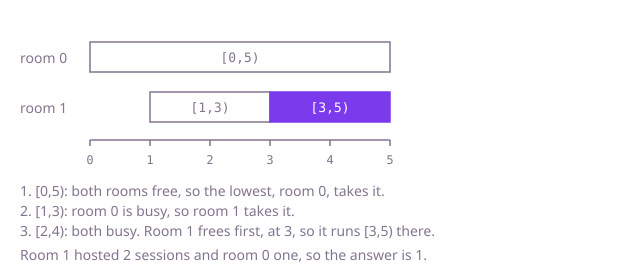

## The question

Given a number of rooms and a list of booking requests, place each request, in order of start minute, into the lowest-numbered free room, or delay it until the first room frees up if none is free, and report the room that ended up hosting the most sessions. A tie goes to the lower number.

What makes it harder than it looks: a delayed session keeps its length, so it runs later than it asked and ends later than its own `end`, and with sessions up to a billion minutes long the chain of delays passes the `int` range. The two choices at each request also need two different orderings over the rooms: "lowest number among the free" and "earliest to finish among the busy". And with 100,000 rooms and 100,000 requests, looking at every room for every request is about ten billion steps.

## How to think about it

The first idea is to simulate it directly. Sort the requests by start, keep for each room the minute it becomes free, and for each request scan the rooms: the first one free at the start wins, and if none is free, take the one that frees earliest (lowest number on a tie). That is correct and plainly follows the rules, but the scan costs one pass over all rooms per request.

What does the scan repeat? It answers the same two questions every time, and each answer is the smallest item of an ordering. The first is the smallest room number among the free rooms. The second is the smallest `(finish minute, room number)` among the busy rooms. A structure that keeps the smallest item at hand and updates in logarithmic time fits both: a min-heap of free room numbers and a min-heap of busy rooms. Before each request I move every busy room that has finished at or before the start into the free heap, then choose.

Walk Example 1, `rooms = 2`, `bookings = {{0,5},{1,3},{2,4}}`. Request `[0,5)`: both rooms are free, so room 0 takes it and becomes busy until 5. Request `[1,3)`: room 0 is busy, so room 1 takes it, busy until 3. Request `[2,4)`: nothing has finished by minute 2 and no room is free, so I take the busy room that finishes first, room 1 at minute 3. The session starts at 3 and lasts 4 - 2 = 2 minutes, so room 1 is busy until 5. Room 1 hosted two sessions and room 0 one, so the answer is 1.



## Brute force

Sort the requests by start and keep one `long` per room, the minute it becomes free. For each request scan the rooms in order: the first room that is free by the start takes it; if there is none, the room with the smallest free minute takes it (the scan keeps the lowest number on ties) and the session is pushed back to start then. It comes first because it is the rules restated as code, and it fixes the answer the faster versions must agree with. It is correct because it applies the two rules literally, one request at a time, in start order.

```java
static int busiest(int rooms, int[][] bookings) {
    int[][] byStart = bookings.clone();
    Arrays.sort(byStart, (a, b) -> Integer.compare(a[0], b[0]));
    long[] freeAt = new long[rooms]; // long: delayed sessions can end past the int range
    int[] hosted = new int[rooms];
    for (int[] booking : byStart) {
        int room = -1;
        int earliest = 0; // the room that frees first, lowest number on ties
        for (int i = 0; i < rooms; i++) {
            if (freeAt[i] <= booking[0]) {
                room = i; // the first free room is the lowest-numbered one
                break;
            }
            if (freeAt[i] < freeAt[earliest]) {
                earliest = i;
            }
        }
        if (room >= 0) {
            freeAt[room] = booking[1];
        } else {
            room = earliest;
            freeAt[room] += booking[1] - booking[0]; // starts when the room frees, keeps its length
        }
        hosted[room]++;
    }
    int best = 0;
    for (int room = 1; room < rooms; room++) {
        if (hosted[room] > hosted[best]) best = room; // strictly greater keeps the lower number on ties
    }
    return best;
}
```

**Complexity:** time O(n log n + n × r) for n requests and r rooms, extra space O(r).

## Better: ordered sets instead of heaps

This is a different tool at the same cost. A `TreeSet` keeps its items sorted, so `pollFirst()` gives the smallest just as a heap's `poll()` does. The free set holds room numbers and the busy set holds `{finish minute, room}` ordered by finish, then room. Everything else is the Optimal loop below.

```java
static int busiest(int rooms, int[][] bookings) {
    int[][] byStart = bookings.clone();
    Arrays.sort(byStart, (a, b) -> Integer.compare(a[0], b[0]));
    TreeSet<Integer> free = new TreeSet<>();
    for (int room = 0; room < rooms; room++) {
        free.add(room);
    }
    TreeSet<long[]> busy = new TreeSet<>(
            (a, b) -> a[0] != b[0] ? Long.compare(a[0], b[0]) : Long.compare(a[1], b[1])); // rooms differ, so no two entries compare equal
    int[] hosted = new int[rooms];
    for (int[] booking : byStart) {
        while (!busy.isEmpty() && busy.first()[0] <= booking[0]) {
            free.add((int) busy.pollFirst()[1]); // finished by this start
        }
        int room;
        long finish;
        if (!free.isEmpty()) {
            room = free.pollFirst();
            finish = booking[1];
        } else {
            long[] first = busy.pollFirst(); // wait for the room that frees first
            room = (int) first[1];
            finish = first[0] + (booking[1] - booking[0]);
        }
        hosted[room]++;
        busy.add(new long[] {finish, room});
    }
    int best = 0;
    for (int room = 1; room < rooms; room++) {
        if (hosted[room] > hosted[best]) best = room;
    }
    return best;
}
```

**Complexity:** time O(n log n + (n + r) log r), extra space O(r); a balanced tree guarantees the logarithm in the worst case.

**Prefer it when:** you also need to take a specific item out. If a room can be taken out of service while free, that is one added line, `free.remove(room)`, in O(log r), where a heap would search for it in O(r). The code as shown does not do that, so it would be the one change. For the question as asked, the heaps do the same work with less memory per item.

## Optimal: a heap of free rooms and a heap of busy rooms

Sort by start. Keep a min-heap of free room numbers and a min-heap of busy rooms as `{finish minute, room}`, earliest finish first and lower room on ties. For each request, move every busy room whose finish is at or before the start into the free heap. If a free room exists, take the smallest number; the session runs as asked. Otherwise take the top of the busy heap; the session starts at that room's finish, so its new finish is that minute plus the request's length. Count one session for the room and put it back in the busy heap. The finishes are `long`. At the end return the first room with the highest count. This is the reference solution.

```java
static int busiest(int rooms, int[][] bookings) {
    int[][] byStart = bookings.clone();
    Arrays.sort(byStart, (a, b) -> Integer.compare(a[0], b[0]));
    PriorityQueue<Integer> free = new PriorityQueue<>();
    for (int room = 0; room < rooms; room++) {
        free.add(room);
    }
    // busy rooms as {finish minute, room}: earliest finish first, lower room on ties
    PriorityQueue<long[]> busy = new PriorityQueue<>(
            (a, b) -> a[0] != b[0] ? Long.compare(a[0], b[0]) : Long.compare(a[1], b[1]));
    int[] hosted = new int[rooms];
    for (int[] booking : byStart) {
        while (!busy.isEmpty() && busy.peek()[0] <= booking[0]) {
            free.add((int) busy.poll()[1]); // finished by this start
        }
        int room;
        long finish;
        if (!free.isEmpty()) {
            room = free.poll();
            finish = booking[1];
        } else {
            long[] first = busy.poll(); // wait for the room that frees first
            room = (int) first[1];
            finish = first[0] + (booking[1] - booking[0]);
        }
        hosted[room]++;
        busy.add(new long[] {finish, room});
    }
    int best = 0;
    for (int room = 1; room < rooms; room++) {
        if (hosted[room] > hosted[best]) best = room; // strictly greater keeps the lower number on ties
    }
    return best;
}
```

**Complexity:** time O(n log n + (n + r) log r), extra space O(r). Each room enters and leaves each heap at most once per session it hosts, and every heap operation is logarithmic.

## Complexity

| Approach | Time | Extra space |
| --- | --- | --- |
| Brute force | O(n log n + n × r) | O(r) |
| Better: ordered sets | O(n log n + (n + r) log r) | O(r) |
| Optimal: two heaps | O(n log n + (n + r) log r) | O(r) |

## Where it shows up

`courier-load-balancer` is the same shape in a different costume. Its `plan` keeps a min-heap of `{load, courier index}` with a comparator that orders by load and then by index, so the lightest courier is on top and ties go to the one listed first; it peeks at the top, then takes the courier out, adds the parcel's weight and puts it back. Here the heap key is the finish minute with the room number as tie-break, and I keep two heaps because the free rooms are ordered by number alone while the busy ones are ordered by finish. The tie-break has to live in the comparator in both places, because a heap keeps only the order it is given.

Outside the coding round, the same pair of heaps shows up in any scheduler that hands work to numbered resources: a conference-room booking system, a thread pool giving tasks to the lowest-numbered idle worker, or a build farm assigning jobs to agents.

## Follow-up answers

**What if a delayed booking should be dropped instead of waiting?** Then the busy-heap branch for waiting goes away: if the free heap is empty after moving finished rooms, skip the request and do not count it. The rest is unchanged.

**How would you report the total waiting time as well?** In the delayed branch the wait is `first[0] - booking[0]`; add it to a running total. Use a `long`, since many requests can each wait a long time.

**What changes if bookings arrive live, one at a time, with no sorted list up front?** The heaps already work online as long as requests arrive in order of start, because nothing in the loop looks ahead. If they can arrive out of order, an earlier-start request could need a room that a later-start one already took, so you would have to buffer and reorder them first.
