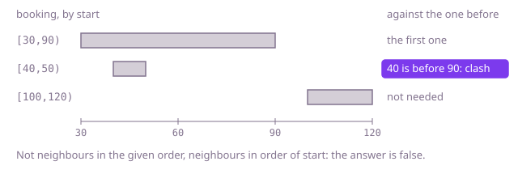

## The question

Given the bookings for a single room, each needing it from a start minute up to, but not including, an end minute, say whether the room can hold them all: no two bookings may clash. A booking that ends at the minute another starts does not clash with it.

What makes it harder than it looks is that the list is in no particular order, so two clashing bookings can sit far apart in it: in Example 1, `[40,50]` lies inside `[30,90]`, but neither pair of neighbours in the list clashes. A booking can also lie wholly inside a longer one, and touching is allowed, so the comparison must be strict in exactly the right place. Comparing every pair is about 5 billion comparisons at 100,000 bookings.

## How to think about it

The first idea is to compare every booking with every other: two clash when each starts before the other ends. It is right, but it looks at every pair, and almost all pairs are nowhere near each other in time. Putting the bookings in order of start fixes that. In that order, if some booking clashes with an earlier one, then it also clashes with the booking just before it, or two neighbours between them clash. Suppose instead that every booking ended by the time the next one started: then the earlier booking would end before the later one starts, and they could not clash. So one pass over neighbours in order of start finds a clash if there is one.

There is a second way to see the same thing, the one Meeting Rooms II uses to count rooms: sort the starts and the ends as two separate columns. If the i-th start (counting from 0) comes before the (i-1)-th end, then at that minute i + 1 bookings have started and at most i - 1 have ended, so two are in the room at once.

Walk Example 1, `[[30,90],[100,120],[40,50]]`. In order of start: `[30,90]`, `[40,50]`, `[100,120]`. The second starts at 40, before the first ends at 90: a clash, so the answer is `false`. In the given order the neighbours are `[30,90]` with `[100,120]` and `[100,120]` with `[40,50]`, and neither pair clashes, which is why the list has to be sorted first.



## Brute force

Compare every pair of bookings and stop at the first clash. It is what you say first, and it fixes the answer the faster versions must agree with. It is correct because it looks at every pair, and the test for one pair, each booking starting before the other ends, is exactly what a clash means; with ends excluded, `<` lets bookings that only touch share the room.

```java
static boolean fitInOneRoom(int[][] bookings) {
    for (int i = 0; i < bookings.length; i++) {
        for (int j = i + 1; j < bookings.length; j++) {
            int[] a = bookings[i];
            int[] b = bookings[j];
            if (a[0] < b[1] && b[0] < a[1]) { // each starts before the other ends: a clash
                return false;
            }
        }
    }
    return true;
}
```

**Complexity:** time O(n²), extra space O(1).

## Better: sort the starts and the ends separately

Copy the starts and the ends into two plain arrays and sort each. Walk them together: if the start at position i comes before the end at position i - 1, two bookings are in the room at that minute, as above. If that never happens, no two bookings clash: a clash would put two bookings in the room at the latest start that falls inside both of them, and at that start the check fires. Starts and ends no longer belong to the same booking, which does not matter, because only the count in the room does.

```java
static boolean fitInOneRoom(int[][] bookings) {
    int n = bookings.length;
    int[] starts = new int[n];
    int[] ends = new int[n];
    for (int i = 0; i < n; i++) {
        starts[i] = bookings[i][0];
        ends[i] = bookings[i][1];
    }
    Arrays.sort(starts);
    Arrays.sort(ends);
    for (int i = 1; i < n; i++) {
        if (starts[i] < ends[i - 1]) { // i + 1 bookings have started, at most i - 1 have ended
            return false;
        }
    }
    return true;
}
```

**Complexity:** time O(n log n), extra space O(n) for the two arrays.

**Prefer it when:** the question may grow into how many rooms the bookings need. Walk the same two sorted columns with a count of bookings in the room instead of stopping at two, and it is the Meeting Rooms II answer. It is also the faster of the two in practice: two sorts of plain `int` arrays, with no comparator and no row objects.

## Optimal: sort by start and compare neighbours

Sort a copy of the bookings by start and compare each booking with the one before it: a clash exists exactly when some booking starts before the previous booking ends. This is the reference solution. It is the Optimal although the Better is faster by a constant factor at the same O(n log n), because it keeps each booking whole: when the check fires it can say which two bookings clash (the first follow-up), and the online check in the last follow-up works on the same whole bookings.

```java
static boolean fitInOneRoom(int[][] bookings) {
    int[][] byStart = bookings.clone();
    Arrays.sort(byStart, (a, b) -> Integer.compare(a[0], b[0]));
    for (int i = 1; i < byStart.length; i++) {
        if (byStart[i][0] < byStart[i - 1][1]) { // starts before the previous one ends
            return false;
        }
    }
    return true;
}
```

**Complexity:** time O(n log n), extra space O(n) for the sorted copy of the references.

## Complexity

| Approach | Time | Extra space |
| --- | --- | --- |
| Brute force: compare every pair | O(n²) | O(1) |
| Better: sort the starts and the ends separately | O(n log n) | O(n) |
| Optimal: sort by start and compare neighbours | O(n log n) | O(n) |

## Where it shows up

No coding-round problem is linked to this question. It is the clash check behind any single resource with fixed bookings: a calendar warning that two of your meetings overlap, a single-track section of railway that can hold one train at a time, or a machine that runs one job at a time. It is also the first step towards Meeting Rooms II: one room is enough exactly when the fewest rooms that question asks for is at most 1, and once a clash appears, the next question is how many rooms you need.

## Follow-up answers

**What if you must also say which two bookings clash?** Use the neighbour check on the sorted rows. When it fires, the two clashing bookings are `byStart[i - 1]` and `byStart[i]`, so return them instead of `false`. The two-column version cannot tell, because its starts and ends no longer belong to the same booking.

**How many rooms would the bookings need when one is not enough?** That is Meeting Rooms II. Walk the sorted starts and ends together, releasing every booking whose end is at or before the next start, adding one for each start, and keeping the largest count seen. The count is the number of rooms; the check here is that walk stopped as soon as the count reaches two.

**What if the bookings arrive one at a time, and each must be accepted or refused as it comes in?** Keep the accepted bookings in a sorted map from start to end. For a new booking, look at the accepted booking with the latest start at or before it and the one with the earliest start after it: it fits when the first ends by its start and the second starts no earlier than its end. Both lookups and the insert cost O(log n).
