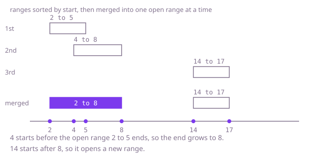

## The question

You get ranges in no particular order. Combine every group of ranges that overlap or touch into a single range, and return the combined ranges sorted by start.

What makes it harder than it looks: groups chain. Range A can touch B and B can touch C while A and C are far apart, so comparing a range only with its neighbours in the input finds nothing, and one pass over unsorted data is not enough. A long range can swallow several later ones whole, so the end of a group must never move backwards. Touching counts, so the join test is non-strict. And comparing every pair, again and again until nothing changes, is hopeless at 100,000 ranges.

## How to think about it

The first idea is to take any two ranges that overlap, replace them with their union, and repeat until no pair overlaps. It is correct, but each merge can expose a new pair, and finding a pair means scanning pairs, so the work piles up. The chains are the problem: I keep having to look back. Sorting by start removes the looking back. Once the ranges are ordered by start, a range can only join the group that is currently open, never one closed earlier, because everything closed ends before this range starts. So I keep one open range and compare each next range with it only. There is a second route to the same order of work: sort the starts and the ends as two separate lists. A group closes after the i-th end exactly when the next start is later than that end, because then the i+1 ranges that have ended are the same i+1 that started first, and nothing crosses the cut.

Walk Example 1, `[[14, 17], [2, 5], [4, 8]]`. Sorted by start: `[2, 5]`, `[4, 8]`, `[14, 17]`. The open range is `[2, 5]`. Next, `[4, 8]` starts at 4, no later than 5, so it joins and the end grows to 8. Next, `[14, 17]` starts at 14, later than 8, so I close `[2, 8]` and open `[14, 17]`. At the end I close that one too: `[[2, 8], [14, 17]]`.



## Brute force

Copy the ranges. Find any two that overlap or touch, replace them with their union, and start the search again; stop when no pair overlaps, then sort the survivors. It is what you say first, and it fixes the answer every faster version must agree with. It is correct because it only stops when no two ranges overlap or touch, and every step keeps the union of all covered minutes unchanged, so what is left is the same coverage in separate ranges.

```java
static int[][] mergeRanges(int[][] ranges) {
    List<int[]> groups = new ArrayList<>();
    for (int[] range : ranges) {
        groups.add(new int[] {range[0], range[1]}); // copies, so the input is never changed
    }
    boolean merged = true;
    while (merged) {
        merged = false;
        for (int i = 0; i < groups.size() && !merged; i++) {
            for (int j = i + 1; j < groups.size() && !merged; j++) {
                int[] a = groups.get(i);
                int[] b = groups.get(j);
                if (a[0] <= b[1] && b[0] <= a[1]) { // overlap or touch
                    a[0] = Math.min(a[0], b[0]);
                    a[1] = Math.max(a[1], b[1]);
                    groups.remove(j);
                    merged = true; // a changed, so look again from the start
                }
            }
        }
    }
    groups.sort((a, b) -> Integer.compare(a[0], b[0]));
    return groups.toArray(new int[0][]);
}
```

**Complexity:** time O(n³) in the worst case (up to n merges, each found by a scan of up to n² pairs), extra space O(n) for the copies.

## Better: sort starts and ends separately

The ranges do not have to stay paired. Sort all the starts into one array and all the ends into another, both as plain `int` arrays. Then a group closes after position `i` exactly when there is no next start or the next start is later than `ends[i]`. The group began at the start remembered when the previous group closed. Sorting primitives is cheaper than sorting row objects with a comparator, and no range object is created until the output.

```java
static int[][] mergeRanges(int[][] ranges) {
    int n = ranges.length;
    int[] starts = new int[n];
    int[] ends = new int[n];
    for (int i = 0; i < n; i++) {
        starts[i] = ranges[i][0];
        ends[i] = ranges[i][1];
    }
    Arrays.sort(starts);
    Arrays.sort(ends);
    List<int[]> merged = new ArrayList<>();
    int groupStart = n == 0 ? 0 : starts[0];
    for (int i = 0; i < n; i++) {
        if (i == n - 1 || starts[i + 1] > ends[i]) { // nothing crosses the cut after i
            merged.add(new int[] {groupStart, ends[i]});
            if (i < n - 1) {
                groupStart = starts[i + 1];
            }
        }
    }
    return merged.toArray(new int[0][]);
}
```

**Complexity:** time O(n log n), extra space O(n) for the two arrays and the output.

**Prefer it when:** the input is large and you want the cheaper primitive sorts, or when ranges are only a pair of columns you already hold as two arrays. It is harder to see correct at a glance than the sweep, so I would only reach for it after the simple version works.

## Optimal: sort by start, then one sweep

Sort a copy of the ranges by start and keep one open range. If the next range starts no later than the open one ends, they belong together and the end becomes the larger of the two ends. Otherwise the open range is final, and the next range becomes the open one. This is the reference solution.

```java
static int[][] mergeRanges(int[][] ranges) {
    int[][] sorted = ranges.clone();
    Arrays.sort(sorted, (a, b) -> Integer.compare(a[0], b[0]));
    List<int[]> merged = new ArrayList<>();
    for (int[] range : sorted) {
        int[] open = merged.isEmpty() ? null : merged.get(merged.size() - 1);
        if (open != null && range[0] <= open[1]) {
            open[1] = Math.max(open[1], range[1]); // joins the open range; never shrinks the end
        } else {
            merged.add(new int[] {range[0], range[1]}); // a copy, so the input is never changed
        }
    }
    return merged.toArray(new int[0][]);
}
```

**Complexity:** time O(n log n), extra space O(n).

## Complexity

| Approach | Time | Extra space |
| --- | --- | --- |
| Brute force: merge any overlapping pair, repeat | O(n³) worst case | O(n) |
| Better: sort starts and ends separately | O(n log n) | O(n) |
| Optimal: sort by start, then one sweep | O(n log n) | O(n) |

## Where it shows up

`hold-exposure` turns each hold into two events, a start that adds its amount and an end that removes it, sorts all the events together and walks them with a running total. That is the same idea of ordering endpoints so one left-to-right walk can see every group. The difference worth saying aloud is how touching ends are treated. There an end is exclusive, and `events` sorts an end before a start at the same minute, so a hold ending at minute 10 and another starting at minute 10 never count together. Here the ranges are closed, so ranges that touch are one group. Which rule applies is the first thing to settle with the interviewer in any intervals question.

In practice the same merge shows up when coalescing busy time from several calendars into one availability view, combining overlapping time spans in a log before computing total active time, and collapsing adjacent address blocks in a routing table.

## Follow-up answers

**What if the ranges arrive one at a time and you must keep the merged list up to date?** Keep the merged ranges in a sorted structure, a balanced tree keyed by start. For each new range, find the neighbours it touches, remove them, widen the new range over them and insert it. Each range is removed at most once, so the amortised cost per arrival is O(log n).

**How would you list the gaps between the merged ranges instead?** Merge first. The gaps are then the stretches between the end of one merged range and the start of the next. There is no gap when ranges touch, because they were merged.

**What changes if ranges that only touch must stay separate?** Make the join test strict: a range joins the open one only when it starts before the open one ends. Everything else in the sweep stays the same.
