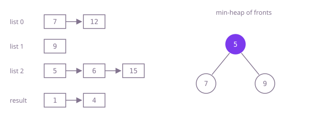

## The question

Given `k` sorted linked lists, relink all their nodes into one sorted list and return its head. Some lists, or the whole array, can be empty.

What makes it harder than it looks: the obvious ways are all correct and all too slow when `k` is large. Picking the smallest front by scanning, or merging the lists into one growing result one by one, both cost about N times k steps; with 50,000 lists that is billions. Empty lists are `null` heads, which a careless heap insertion turns into a `NullPointerException`.

## How to think about it

The first idea extends two-list merging directly: at every step, look at the front of each list, take the smallest, and advance that list. It is right, but each of the N picks scans all `k` fronts. Merging the lists into an accumulated result one at a time is no better: the result keeps growing, and walking it again for each new list adds up to about N times k as well.

Between two picks only one front changes: the one just taken is replaced by its successor. That is the job of a min-heap: the smallest of a set in O(1), removal and insertion in O(log k). Put every non-empty head in a heap ordered by value; repeatedly poll the smallest, append it to the result, and push its `next` if there is one. The heap never holds more than `k` nodes. Another way to reach O(N log k) is to merge in rounds of pairs, like merge sort: `k` lists become `k/2`, then `k/4`, and every node takes part in about log k two-list merges.

Walk Example 1, `[[4,7,12],[1,9],[5,6,15]]`. The heap starts with 4, 1, 5. Poll 1, push 9: heap 4, 5, 9. Poll 4, push 7. Poll 5, push 6. Poll 6, push 15. Poll 7, push 12. Poll 9; its list is done. Poll 12, then 15. The result is `[1,4,5,6,7,9,12,15]`.



## Brute force

Scan all fronts for the smallest at every step. It comes first because it is what you say first, and it fixes the answer to compare against. It is correct because the smallest remaining node is always at the front of its list, so the smallest front is the smallest remaining node.

```java
static ListNode merge(ListNode[] lists) {
    ListNode[] fronts = lists.clone(); // the caller's array stays as it was
    ListNode dummy = new ListNode();
    ListNode tail = dummy;
    while (true) {
        int best = -1;
        for (int i = 0; i < fronts.length; i++) { // scan every front for the smallest
            if (fronts[i] != null && (best < 0 || fronts[i].val < fronts[best].val)) {
                best = i;
            }
        }
        if (best < 0) {
            return dummy.next; // every list is used up
        }
        tail.next = fronts[best];
        tail = tail.next;
        fronts[best] = fronts[best].next;
    }
}
```

**Complexity:** time O(N k), extra space O(k) for the copy of the fronts.

## Better: merge in rounds of pairs

Merge list 0 with 1, 2 with 3, and so on; then merge the results in pairs again, until one list is left. Each round reads every node once, and there are about log k rounds.

```java
static ListNode merge(ListNode[] lists) {
    if (lists.length == 0) {
        return null;
    }
    // each round merges lists step apart into the left slot of the pair
    for (int step = 1; step < lists.length; step *= 2) {
        for (int i = 0; i + step < lists.length; i += 2 * step) {
            lists[i] = mergeTwo(lists[i], lists[i + step]);
        }
    }
    return lists[0];
}

private static ListNode mergeTwo(ListNode a, ListNode b) {
    ListNode dummy = new ListNode();
    ListNode tail = dummy;
    while (a != null && b != null) {
        if (a.val <= b.val) {
            tail.next = a;
            a = a.next;
        } else {
            tail.next = b;
            b = b.next;
        }
        tail = tail.next;
    }
    tail.next = a != null ? a : b; // one list is used up; the rest of the other is already sorted
    return dummy.next;
}
```

**Complexity:** time O(N log k), extra space O(1) (it reuses the slots of the given array).

**Prefer it when:** you may overwrite the input array and want no extra memory and no heap; it also keeps equal values in list order, because `mergeTwo` takes from the left list on ties.

## Optimal: a min-heap of the fronts

Keep the front node of every non-empty list in a priority queue ordered by value; poll the smallest, append it, and push its successor. This is the reference solution.

```java
static ListNode merge(ListNode[] lists) {
    // the heap holds the front node of every list that still has nodes
    PriorityQueue<ListNode> fronts = new PriorityQueue<>((a, b) -> Integer.compare(a.val, b.val));
    for (ListNode head : lists) {
        if (head != null) { // empty lists have no front to compare
            fronts.add(head);
        }
    }
    ListNode dummy = new ListNode();
    ListNode tail = dummy;
    while (!fronts.isEmpty()) {
        ListNode smallest = fronts.poll();
        tail.next = smallest;
        tail = smallest;
        if (smallest.next != null) {
            fronts.add(smallest.next);
        }
    }
    return dummy.next;
}
```

**Complexity:** time O(N log k + k), extra space O(k) for the heap.

## Complexity

| Approach | Time | Extra space |
| --- | --- | --- |
| Brute force | O(N k) | O(k) |
| Better: merge in rounds of pairs | O(N log k) | O(1) |
| Optimal: a min-heap of the fronts | O(N log k + k) | O(k) |

## Where it shows up

No coding-round problem is linked to this question. The k-way merge is the second half of external sorting: sorted runs written to disk are merged through a heap of their front records. Databases merge sorted index segments the same way (LSM-tree compaction in stores such as RocksDB and Cassandra), search engines merge posting lists, and log tools merge per-server log files by timestamp.

## Follow-up answers

**Why is merging the lists one after another into a growing result slow?** Each new list is merged with everything merged so far, so early nodes are walked again in every later merge. With `k` lists of `N/k` nodes, the merges walk about N/k, 2N/k, 3N/k, ... nodes, which sums to about N k / 2: the same order as scanning all fronts.

**How would you merge k sorted files that are too large to fit in memory?** Open all `k` files, read a buffered block from each and put each file's current record in a min-heap; poll the smallest, write it to the output, and refill from the file it came from. Memory is k buffers plus the heap. If `k` is too large to keep that many files open, merge in several passes, say 100 files at a time.

**When would you choose the pairwise rounds over the heap?** When the lists live in an array you may overwrite and you want O(1) extra memory, when equal values should keep the order of their lists (the rounds are stable, a heap is not), or when the merges can run in parallel, since the merges within one round are independent.
