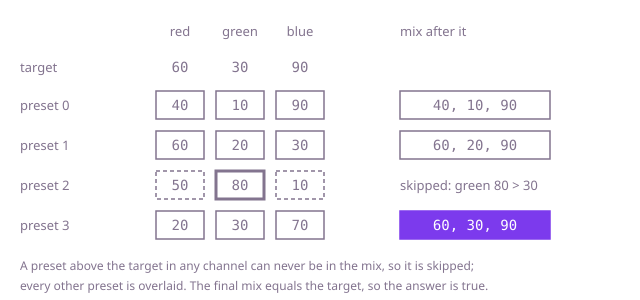

## The question

Each preset is a triplet of channel levels, and overlaying presets keeps the highest level in each channel. Return whether some set of the presets overlays to exactly the target.

What makes it harder than it looks is that the two obvious checks are wrong. Overlaying every preset overshoots: in Example 1, preset 2 drags green up to 80. Finding each target level somewhere in its channel is not enough either, because the preset that has it may bring a level that is too high in another channel: in Example 2 the only red 35 comes with blue 50. Trying every set of presets is correct, but the number of sets doubles with every preset, and there can be 100,000 of them.

## How to think about it

The first idea is to try every non-empty set of presets and overlay it. It is correct, but 2^n sets is hopeless beyond a few dozen presets, and most of those sets differ only in presets that change nothing.

The first saving is that at most three presets are ever needed. In a set that works, each channel's target level comes from some member, and no member is above the target in any channel, or the overlay would be too. The members that supply the three levels, at most three of them, overlay to the target on their own. So trying every choice of up to three presets is enough, but that is O(n³): polynomial, and still far too slow for 100,000 presets.

The next question is which presets can be in a working set at all. Overlaying never lowers a level, so a preset above the target in any channel can never be part of one. Call the others the fitting presets. That makes choosing the suppliers easy: for each channel, any fitting preset with the target level there will do, because an overlay of fitting presets never goes above the target anywhere. One pass that remembers such a preset for each channel decides the question.

The greedy goes one step further and does not choose at all. A fitting preset never hurts: adding it to a mix of fitting presets keeps every channel at or below the target and can only raise a channel towards it. So the strongest mix to try is all the fitting presets at once. If their overlay misses the target in some channel, every smaller set of fitting presets misses it too, since its levels are no higher, and a working set holds fitting presets only. One pass decides it: skip every preset that goes above the target anywhere, overlay the rest, and compare. Taking every fitting preset is the greedy choice, and that argument is why it is safe.

Walk Example 1, `target = [60,30,90]`. Preset 0, `[40,10,90]`, fits, so the mix is `[40,10,90]`. Preset 1, `[60,20,30]`, fits: `[60,20,90]`. Preset 2, `[50,80,10]`, has green 80, above 30, and is skipped. Preset 3, `[20,30,70]`, fits: `[60,30,90]`, the target, so the answer is true. In Example 2, `target = [35,40,25]`, presets 1 and 2 both go above blue 25 and are skipped, and the mix stays at preset 0's `[15,40,25]`: false.



## Brute force

Try every non-empty set of presets, overlay its members and compare the result with the target. It comes first because it is the rule written as code, and it fixes the answers to compare against. It is correct because the overlay of a set depends only on which presets are in it, and every set is tried. The sets are counted off by a binary counter kept as a flag per preset, so it needs no recursion and works for any number of presets, however long it takes.

```java
static boolean canMix(int[][] presets, int[] target) {
    int n = presets.length;
    boolean[] in = new boolean[n]; // the set being tried, as a binary counter
    while (true) {
        int i = 0;
        while (i < n && in[i]) { // add one to the counter
            in[i++] = false;
        }
        if (i == n) {
            return false; // the counter wrapped round: every non-empty set has been tried
        }
        in[i] = true;
        int[] mix = new int[3];
        for (int p = 0; p < n; p++) {
            if (in[p]) {
                for (int c = 0; c < 3; c++) {
                    mix[c] = Math.max(mix[c], presets[p][c]);
                }
            }
        }
        if (Arrays.equals(mix, target)) {
            return true;
        }
    }
}
```

**Complexity:** time O(2^n × n): up to 2^n - 1 sets, each overlaid in O(n). Extra space O(n) for the flags.

## Better: one fitting preset per channel

Walk the presets once, skip every preset that is above the target in some channel, and for each channel remember a fitting preset that has the target level there. The answer is true when all three channels have one: those suppliers, at most three presets, overlay to the target, and a channel with no fitting supplier can never reach its level.

```java
static boolean canMix(int[][] presets, int[] target) {
    int[] supplier = {-1, -1, -1}; // a fitting preset with the target level in each channel
    for (int i = 0; i < presets.length; i++) {
        int[] preset = presets[i];
        if (preset[0] > target[0] || preset[1] > target[1] || preset[2] > target[2]) {
            continue; // above the target somewhere: never part of a working mix
        }
        for (int c = 0; c < 3; c++) {
            if (preset[c] == target[c]) {
                supplier[c] = i;
            }
        }
    }
    return supplier[0] >= 0 && supplier[1] >= 0 && supplier[2] >= 0;
}
```

**Complexity:** time O(n), extra space O(1).

**Prefer it when:** you need a short recipe: `supplier` names at most three presets that overlay to the target, while the Optimal's mix is every fitting preset, which can be tens of thousands.

## Optimal: overlay every preset that fits

Skip every preset that is above the target in some channel, overlay all the others, and compare the overlay with the target. This is the reference solution.

```java
static boolean canMix(int[][] presets, int[] target) {
    int[] mix = new int[3]; // the overlay of every preset that fits under the target
    for (int[] preset : presets) {
        if (preset[0] <= target[0] && preset[1] <= target[1] && preset[2] <= target[2]) {
            for (int c = 0; c < 3; c++) {
                mix[c] = Math.max(mix[c], preset[c]);
            }
        }
    }
    return Arrays.equals(mix, target); // levels start at 1, so an empty mix never matches
}
```

**Complexity:** time O(n), extra space O(1).

## Complexity

| Approach | Time | Extra space |
| --- | --- | --- |
| Brute force | O(2^n × n) | O(n) |
| Better: one fitting preset per channel | O(n) | O(1) |
| Optimal: overlay every preset that fits | O(n) | O(1) |

## Where it shows up

Any combination that keeps the largest value per component, and has to land exactly on a goal, has this shape. A build tool that resolves each library to the highest version any module asks for, asked whether some modules combine to exactly a given set of versions; a scheduler that sizes a job by the largest CPU, memory and disk request among its steps; image or lighting layers blended in a lighten mode, which keeps the brighter value in each channel. The filter-then-take-everything pass works whenever combining can only raise values: whatever would overshoot is out, and everything else is free to add.

## Follow-up answers

**What if you also had to say which presets to overlay?** The set of all fitting presets is itself an answer, since their overlay is what the Optimal checks; for a short one, use the Better approach. It remembers, for each channel, one fitting preset with the target level there. If all three channels have one, those presets, at most three and fewer when the same preset is recorded for two channels, overlay to the target by the argument above; if a channel has none, there is no mix. It is still one O(n) pass.

**What if each preset had k channels instead of three?** Only the loops over channels change: skip presets above the target in any of the k channels, overlay the rest and compare. That is O(n × k) time and O(k) extra space, and a working mix then needs at most k presets.

**What if many targets were asked about the same presets?** A target works when, for each channel, some preset has the target level in that channel and is at or below the target in the other two. For each channel, group the presets by their level in it; inside a group, sort by one of the other channels and keep a running minimum of the third, so a binary search tells whether some preset in the group is at or below the target in both. That is O(n log n) to prepare and three binary searches, O(log n), per target.
