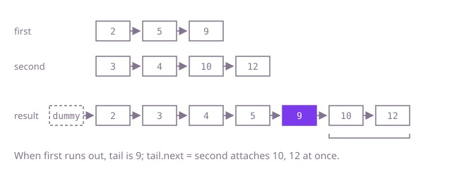

## The question

Given two linked lists that are each sorted, splice their nodes into one sorted list and return its head. No node is created or dropped; only `next` fields change.

What makes it harder than it looks: the first node of the result is a special case (there is no tail to attach it to yet), and when one list runs out the rest of the other must still be attached, which loop-only code tends to forget. Either list, or both, can be empty. And with 200,000 nodes in all, the short recursive version overflows the stack.

## How to think about it

The first idea ignores the order: gather every node, sort them by value and link them up. It is correct, but it throws away the one thing you were given, that each list is already sorted, and pays for a sort.

Because both lists are sorted, the smallest remaining value is always at the front of one of them. So compare the two fronts, move the smaller node to the end of the result and advance that list. When one list is empty, everything left in the other is already sorted and larger than or equal to what you took, so attach it in one step. A dummy node in front of the result removes the first-node special case: the tail always exists. Recursion expresses the same choice ("the smaller front, followed by the merge of the rest") but nests one call per node.

Walk Example 1, `first = [2,5,9]`, `second = [3,4,10,12]`. Take 2 (2 < 3), then 3, then 4 (4 < 5), then 5, then 9 (9 < 10). `first` is now empty and the tail is 9, so `tail.next = second` attaches `[10,12]`. The result is `[2,3,4,5,9,10,12]`.



## Brute force

Collect every node of both lists, sort them by value and relink them. It comes first because it is what you say first, and it fixes the answer to compare against. It is correct because a sort puts every node in non-decreasing order no matter where it came from, and the last node's link is cleared so the result ends.

```java
static ListNode merge(ListNode first, ListNode second) {
    List<ListNode> nodes = new ArrayList<>();
    for (ListNode n = first; n != null; n = n.next) {
        nodes.add(n);
    }
    for (ListNode n = second; n != null; n = n.next) {
        nodes.add(n);
    }
    nodes.sort(Comparator.comparingInt(n -> n.val)); // ignores that each list was sorted
    ListNode dummy = new ListNode();
    ListNode tail = dummy;
    for (ListNode n : nodes) {
        tail.next = n;
        tail = n;
    }
    tail.next = null; // the last node may still point into its old list
    return dummy.next;
}
```

**Complexity:** time O((m + n) log(m + n)), extra space O(m + n) for the array.

## Better: recursion

The merged list is the smaller of the two fronts followed by the merge of everything else. That is three lines of logic and handles the empty lists in its base cases.

```java
static ListNode merge(ListNode first, ListNode second) {
    if (first == null) {
        return second; // the rest of a sorted list is already merged
    }
    if (second == null) {
        return first;
    }
    if (first.val <= second.val) {
        first.next = merge(first.next, second);
        return first;
    }
    second.next = merge(first, second.next);
    return second;
}
```

**Complexity:** time O(m + n), extra space O(m + n) for the call stack, one frame per node taken; at 200,000 nodes that overflows Java's default stack and the long test fails with `StackOverflowError`.

**Prefer it when:** the lists are known to be short, for example when merging small runs inside a recursive merge sort of a linked list whose depth you control.

## Optimal: dummy head and a tail pointer

Keep a dummy node and a `tail` reference to the last node of the result. While both lists have nodes, attach the smaller front to `tail` and advance; then attach whatever is left. This is the reference solution.

```java
static ListNode merge(ListNode first, ListNode second) {
    ListNode dummy = new ListNode(); // a fixed node before the head, so the first append is not special
    ListNode tail = dummy;
    while (first != null && second != null) {
        if (first.val <= second.val) { // <= takes ties from the first list: stable
            tail.next = first;
            first = first.next;
        } else {
            tail.next = second;
            second = second.next;
        }
        tail = tail.next;
    }
    tail.next = first != null ? first : second; // the rest of one list is already sorted
    return dummy.next;
}
```

**Complexity:** time O(m + n), extra space O(1).

## Complexity

| Approach | Time | Extra space |
| --- | --- | --- |
| Brute force | O((m + n) log(m + n)) | O(m + n) |
| Better: recursion | O(m + n) | O(m + n) call stack, overflows at 200,000 nodes |
| Optimal: dummy head and a tail pointer | O(m + n) | O(1) |

## Where it shows up

No coding-round problem is linked to this question. The two-front merge is the core of merge sort, and it is how sorted runs are combined in external sorting, how a database joins two inputs already sorted on the key, and how two time-ordered event streams (two log files, two price feeds) become one ordered stream without sorting again.

## Follow-up answers

**How would you merge k sorted lists instead of two?** Put the k fronts in a min-heap keyed on value; repeatedly take the smallest, attach it, and push its successor. That is O(N log k) for N nodes in all. Merging the lists in pairs, round by round, gives the same bound without a heap.

**What changes if the lists are sorted in decreasing order?** Only the comparison: take the larger front each time (`first.val >= second.val`). The dummy node, the tail pointer and attaching the leftover all stay the same.

**Is your merge stable, and when would that matter?** Yes, with `<=` a tie takes the node from `first`, so equal values keep the order "all of `first`'s, then `second`'s" and each list's own order. It matters when the nodes carry more than the key, for example records sorted by date where an earlier pass sorted them by name: a stable merge keeps the name order within each date.
