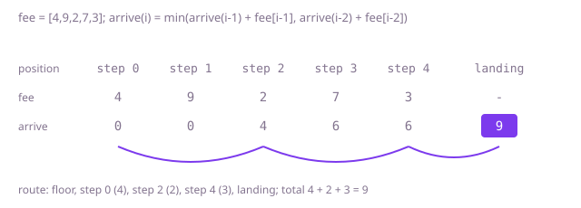

## The question

Each step of a staircase charges a fee when you stand on it; moves climb one or two steps, and you go from the free floor below step 0 to the free landing above the last step. Return the smallest total fee.

What makes it harder than it looks is that the obvious greedy, stepping to the cheaper of the next two steps, is wrong: on `[1,2,100,1,1]` it pays 1, 2 and 1 for 4, while standing only on steps 1 and 3 pays 3. Two edges catch quick code too: the first move may skip step 0, and the landing is above the last step, so the last step need not be paid for.

## How to think about it

The first idea is to try every route: from each position, either climb one or climb two, and take the cheaper total. That is correct, and the routes double with every step, so 1,000 steps is hopeless. The waste is plain once you see it: the cheapest way on from step 5 is worked out again for every route that lands on step 5.

Turn it around and ask how you arrive. You arrive at position `i` from `i - 1`, paying `fee[i - 1]`, or from `i - 2`, paying `fee[i - 2]`. So the cheapest arrival at `i` is the smaller of those two sums, and arriving at positions 0 and 1 is free because the first move can go to either. The landing is position `n`, and its arrival cost is the answer.

Each arrival cost needs only the two before it, so two variables carry the whole computation. For Example 1, `fee = [4,9,2,7,3]`: arriving at steps 0 and 1 costs 0; step 2 costs min(0 + 9, 0 + 4) = 4; step 3 costs min(4 + 2, 0 + 9) = 6; step 4 costs min(6 + 7, 4 + 2) = 6; the landing costs min(6 + 3, 6 + 7) = 9.



## Brute force

Try both moves from every position and keep the cheaper total. It comes first because it says exactly what is asked, and it fixes the answers the faster versions must match. It is correct because every route starts with a first move to step 0 or step 1 and then, from each step, makes one of two moves, and the recursion tries both every time.

```java
static int minCost(int[] fee) {
    return Math.min(from(fee, 0), from(fee, 1)); // the first move lands on step 0 or step 1
}

/** Cheapest total from landing on the given step to the top, that step's fee included. */
private static int from(int[] fee, int step) {
    if (step >= fee.length) {
        return 0; // reached the landing
    }
    return fee[step] + Math.min(from(fee, step + 1), from(fee, step + 2));
}
```

**Complexity:** time O(φ^n) with φ ≈ 1.618, since the calls branch in two at every step; extra space O(n) for the recursion, which is at most 1,000 deep and does not overflow the stack: it simply never finishes on a long staircase.

## Better: memoised recursion

Keep the recursion and remember the answer for each step the first time it is worked out. Each step's cheapest total is then computed once, and later calls read it back.

```java
static int minCost(int[] fee) {
    int[] memo = new int[fee.length];
    Arrays.fill(memo, -1); // -1 means not worked out yet; real totals are never negative
    return Math.min(from(fee, 0, memo), from(fee, 1, memo));
}

private static int from(int[] fee, int step, int[] memo) {
    if (step >= fee.length) {
        return 0;
    }
    if (memo[step] < 0) {
        memo[step] = fee[step] + Math.min(from(fee, step + 1, memo), from(fee, step + 2, memo));
    }
    return memo[step];
}
```

**Complexity:** time O(n), extra space O(n) for the array and the recursion; the recursion is at most 1,000 deep, which fits in the stack, but the same code on a staircase of a few hundred thousand steps would overflow it.

**Prefer it when:** you already have the recursion and want it fast with the least change, or the rule is complicated enough that the top-down form is easier to get right.

## Optimal: arrival costs, bottom-up

Compute the cheapest arrival cost at each position from the floor upwards and keep only the last two. The loop runs up to position `n`, the landing.

```java
static int minCost(int[] fee) {
    // cost to arrive at positions i - 2 and i - 1, their own fees not yet paid; 0 and 1 are free to reach
    int twoBack = 0;
    int oneBack = 0;
    for (int i = 2; i <= fee.length; i++) { // position fee.length is the landing
        int here = Math.min(oneBack + fee[i - 1], twoBack + fee[i - 2]);
        twoBack = oneBack;
        oneBack = here;
    }
    return oneBack;
}
```

**Complexity:** time O(n), extra space O(1). The largest total is under 10^6, so `int` is enough.

## Complexity

| Approach | Time | Extra space |
| --- | --- | --- |
| Brute force | O(φ^n), φ ≈ 1.618 | O(n) recursion, at most 1,000 deep |
| Better: memoised recursion | O(n) | O(n), recursion at most 1,000 deep |
| Optimal: arrival costs, bottom-up | O(n) | O(1) |

## Where it shows up

The same shape is any cheapest walk along a line where you may skip ahead a little: choosing which days to service a machine when it may run at most one day unserviced, choosing which checkpoints to stop at on a route with a maximum gap, or picking which frames of a video to keep when no more than one in a row may be dropped. The cost of a position depends on a fixed number of positions before it, so a single pass with a few variables does it.

## Follow-up answers

**What if you also had to return which steps to stand on?** Keep the whole arrival-cost array instead of two variables, and for each position remember whether its cost came from one or two below. Walk back from the landing along those choices and reverse the list. That costs O(n) space, which the bare total did not need.

**What if a move could climb up to k steps?** The arrival cost at `i` is the minimum over the last k positions of their cost plus their fee. Done directly that is O(n × k); a monotonic deque of the last k sums gives the minimum in O(1) amortized per position, so O(n) overall.

**Why does picking the cheaper of the next two steps each time not work?** A choice changes which steps you can reach next. On `[1,2,100,1,1]` the greedy takes step 0 (1 over 2), then step 1 (2 over 100), then step 3: 4 in total. Skipping step 0 costs nothing extra and the best route, steps 1 and 3, costs 3. Only comparing whole routes, which the arrival costs do, gets it right.
