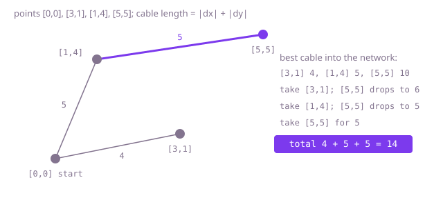

## The question

Sensors sit at grid points, and a cable between two of them costs the grid distance `|dx| + |dy|`. Return the least total cable that joins them all into one network.

What makes it harder than it looks: every pair of sensors is a possible cable, so 2,000 sensors give about two million cables, and the familiar method of sorting all cables costs real time and memory. The distance is along the grid, not a straight line. And the cheap-looking shortcuts, such as joining every sensor to the first one or to its nearest neighbour listed before it, give a connected network that is not the shortest.

## How to think about it

The best plan has no loop, because dropping any cable from a loop keeps everyone joined and saves length, so the answer is a minimum spanning tree over the sensors. The rule that builds one: grow the network from any sensor, and at every step add the shortest cable that joins a sensor inside to one outside. That cable is always safe, because any plan must cross from inside to outside somewhere, and swapping its crossing for the shortest one never makes it longer.

The first way to apply the rule rescans every pair for the shortest crossing cable at each of the `n - 1` steps, which is cubic. Sorting all cables once and taking them shortest first, skipping any that would close a loop, is Kruskal's algorithm and costs O(n² log n). But the rescan is wasteful in a simpler way: between two steps only one sensor joined, so the shortest cable from each outside sensor into the network can only have changed through that one sensor. Keep, for every outside sensor, the shortest cable into the network so far; each step picks the smallest of those and updates the rest against the newcomer. That is Prim's algorithm on a complete graph, O(n²) with no edge list at all.

Walk Example 1: start with `[0, 0]`. Best cables into the network: `[3, 1]` 4, `[1, 4]` 5, `[5, 5]` 10. Take `[3, 1]` for 4; update `[5, 5]` to 6 through it, while `[1, 4]` stays at 5. Take `[1, 4]` for 5; update `[5, 5]` to 5 through it. Take `[5, 5]` for 5. Total 4 + 5 + 5 = 14.



## Brute force

Start with sensor 0 in the network. At each step, scan every pair with one end inside and one outside, take the shortest, and pull its outside end in. It is what you say first, and it fixes the answer to compare against. It is correct because it applies the safe-cable rule literally at every step.

```java
static int minCable(int[][] points) {
    int n = points.length;
    boolean[] joined = new boolean[n];
    joined[0] = true;
    int total = 0;
    for (int added = 1; added < n; added++) {
        int bestCost = Integer.MAX_VALUE;
        int bestPoint = -1;
        for (int i = 0; i < n; i++) {
            for (int j = 0; j < n; j++) {
                if (joined[i] && !joined[j]) { // a cable crossing from inside to outside
                    int d = Math.abs(points[i][0] - points[j][0]) + Math.abs(points[i][1] - points[j][1]);
                    if (d < bestCost) {
                        bestCost = d;
                        bestPoint = j;
                    }
                }
            }
        }
        joined[bestPoint] = true;
        total += bestCost;
    }
    return total;
}
```

**Complexity:** time O(n³), a scan of all pairs at each of the n - 1 steps; extra space O(n).

## Better: Kruskal over every pair, sorted

List every pair once as a cable, sort them by length, and take them shortest first with union-find, skipping a cable whose ends are already joined. Packing the length and the two sensor numbers into one `long` (length in the high bits) lets a primitive sort order them without creating two million objects. Stop after `n - 1` cables.

```java
static int minCable(int[][] points) {
    int n = points.length;
    long[] cables = new long[n * (n - 1) / 2];
    int k = 0;
    for (int i = 0; i < n; i++) {
        for (int j = i + 1; j < n; j++) {
            long d = Math.abs(points[i][0] - points[j][0]) + Math.abs(points[i][1] - points[j][1]);
            cables[k++] = d << 22 | (long) i << 11 | j; // length first, so sorting orders by length
        }
    }
    Arrays.sort(cables);
    int[] parent = new int[n];
    for (int i = 0; i < n; i++) {
        parent[i] = i;
    }
    int total = 0;
    int taken = 0;
    for (int c = 0; c < cables.length && taken < n - 1; c++) {
        int a = find(parent, (int) (cables[c] >> 11 & 2047));
        int b = find(parent, (int) (cables[c] & 2047));
        if (a != b) { // skip cables that would close a loop
            parent[a] = b;
            total += (int) (cables[c] >> 22);
            taken++;
        }
    }
    return total;
}

private static int find(int[] parent, int x) {
    while (parent[x] != x) {
        parent[x] = parent[parent[x]]; // path halving
        x = parent[x];
    }
    return x;
}
```

**Complexity:** time O(n² log n) for the sort, extra space O(n²) for the list of cables, about 16 MB at 2,000 sensors.

**Prefer it when:** the cables come as a given list rather than every pair (see the first follow-up): then the sort and union-find part of this code applies unchanged to that list. As written here, listing every pair costs O(n²) memory just to sort it.

## Optimal: Prim on the complete graph, no edge list

Keep `best[i]`, the shortest cable from sensor `i` to anything already in the network, starting with 0 for sensor 0 and infinity for the rest. Each round, take the outside sensor with the smallest `best`, add that cable to the total, and lower `best` for every other outside sensor through the newcomer. A binary heap would not help here: every sensor is a neighbour of every other, so the plain O(n) scan per round is already the cheapest. This is the reference solution.

```java
static int minCable(int[][] points) {
    int n = points.length;
    int[] best = new int[n]; // shortest cable from each sensor into the network so far
    boolean[] joined = new boolean[n];
    Arrays.fill(best, Integer.MAX_VALUE);
    best[0] = 0;
    int total = 0;
    for (int round = 0; round < n; round++) {
        int pick = -1;
        for (int i = 0; i < n; i++) {
            if (!joined[i] && (pick == -1 || best[i] < best[pick])) {
                pick = i;
            }
        }
        joined[pick] = true;
        total += best[pick];
        for (int i = 0; i < n; i++) { // only the newcomer can shorten someone's best cable
            if (!joined[i]) {
                int d = Math.abs(points[i][0] - points[pick][0]) + Math.abs(points[i][1] - points[pick][1]);
                if (d < best[i]) {
                    best[i] = d;
                }
            }
        }
    }
    return total;
}
```

**Complexity:** time O(n²), extra space O(n).

## Complexity

| Approach | Time | Extra space |
| --- | --- | --- |
| Brute force: rescan every pair at each step | O(n³) | O(n) |
| Better: Kruskal over every pair, sorted | O(n² log n) | O(n²) |
| Optimal: Prim with a best-cable array | O(n²) | O(n) |

## Where it shows up

Minimum spanning trees plan the cheapest layout of cable, pipe or road that joins a set of sites, such as fibre between buildings or irrigation lines across a field, where every pair could in principle be joined. Grid distance is the right measure when the cable must follow streets or trenches at right angles. The same tree is a starting point for clustering: remove its longest cables and the pieces left are clusters of nearby points.

## Follow-up answers

**What if some pairs could not be joined at all, so only a list of allowed cables is given?** Then the graph is sparse and the list is all there is. Kruskal with union-find over that list, or Prim with a binary heap over neighbour lists, runs in O(m log m) for m cables, and if the plan cannot join everyone, the count of cables taken stays below `n - 1`.

**How would you return the cables themselves, not just the total?** In Prim, remember for each sensor which network sensor gave it its current `best`; when the sensor is picked, that pair is a cable of the plan. In Kruskal, the cables taken are the plan.

**Can you beat O(n²) for points on a plane with grid distance?** Yes. For each point, only the nearest neighbour in each of eight angular sectors can be in the tree, and those candidates can be found with a sweep and a Fenwick tree in O(n log n). Kruskal over at most 4n candidate cables then gives O(n log n) overall.
