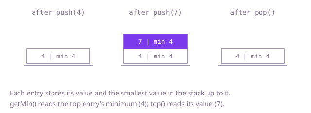

## The question

Design a stack of integers with the usual push, pop and top, plus an operation that returns the smallest value now in the stack. Every operation must take constant time.

What makes it harder than it looks: a single running minimum is not enough, because the smallest value can be popped, and then you need the next smallest, which you did not keep. Equal values complicate it: pushing the minimum twice and popping once must leave the minimum in place. And scanning for the minimum on each call is quadratic when the stack holds 100,000 values and `getMin` is called after every step.

## How to think about it

The first design stores the values and scans them whenever the minimum is asked for. It is correct and trivial, and it makes `getMin` linear. A first improvement is to remember the minimum in a field, since pushes can update it in one comparison; only a pop of the current minimum breaks it, and then you rescan what is left. That is fast until someone pops minimums one after another. What the rescan rebuilds is something that was true earlier: the minimum of the stack just before the popped value arrived. The stack only changes at the top, so every entry can carry the answer for itself. When a value is pushed, store with it the smaller of that value and the minimum stored with the entry below. The minimum of the whole stack is then the one stored with the top entry, and a pop throws away the value and its answer together.

Walk Example 1. `push(4)` stores the entry (value 4, minimum 4). `push(7)` stores (value 7, minimum 4), since 4 is smaller than 7. `getMin()` reads the minimum of the top entry, 4. `top()` reads its value, 7. `pop()` removes that entry and the top is (4, 4), so `top()` returns 4. In Example 3, `push(3)`, `push(1)`, `push(1)` store (3, 3), (1, 1), (1, 1); after one `pop()` the top is (1, 1), so the minimum is still 1.



## Brute force

Store the values in a list. `push`, `pop` and `top` work at the end of the list; `getMin` scans the whole list. It is what you say first, and it fixes the answer every faster version must agree with. It is correct because `getMin` looks at every value in the stack, so the stack holds nothing it can miss, equal values included.

```java
class MinStack {
    private final List<Integer> values = new ArrayList<>();

    void push(int value) {
        values.add(value);
    }

    void pop() {
        values.remove(values.size() - 1); // the last element, by index
    }

    int top() {
        return values.get(values.size() - 1);
    }

    int getMin() {
        int min = values.get(0);
        for (int value : values) { // look at everything, every time
            min = Math.min(min, value);
        }
        return min;
    }
}
```

**Complexity:** `push`, `pop` and `top` O(1) (`push` amortized), `getMin` O(n) for a stack of n values; extra space O(1) beyond the stored values.

## Better: a stored minimum, rescan after popping it

Keep the minimum in a field. A push updates it with one comparison. A pop rescans the remaining values only when the value that left was equal to the minimum: if it was larger, the minimum is untouched, and if another copy of the minimum remains, the rescan finds it.

```java
class MinStack {
    private final List<Integer> values = new ArrayList<>();
    private int min; // valid whenever the list is not empty

    void push(int value) {
        if (values.isEmpty() || value < min) {
            min = value;
        }
        values.add(value);
    }

    void pop() {
        int removed = values.remove(values.size() - 1);
        if (!values.isEmpty() && removed == min) { // the minimum may have just left: find the next
            min = values.get(0);
            for (int value : values) {
                min = Math.min(min, value);
            }
        }
    }

    int top() {
        return values.get(values.size() - 1);
    }

    int getMin() {
        return min;
    }
}
```

**Complexity:** `push`, `top` and `getMin` O(1) (`push` amortized), `pop` O(1) unless it removes the minimum and then O(n), so n pops of successive minimums cost O(n²) in total. Extra space O(1).

**Prefer it when:** pops of the minimum are rare, for example a stack that mostly grows or whose small values stay near the bottom. It spends no memory beyond the values and a single field. It is not constant time in the worst case, which the question asks for: a stack filled from large to small and then popped to empty rescans every time.

## Optimal: a minimum stored beside each value

Keep two arrays of the same length: the values, and for each position the smallest value in the stack up to and including it. On push, the new entry's minimum is the smaller of the value and the minimum stored just below it (or the value itself on an empty stack). `getMin` reads the minimum at the top, `pop` drops both entries, and nothing is ever recomputed. This is the reference solution.

```java
class MinStack {
    private int[] values = new int[16];
    private int[] minimums = new int[16]; // minimums[i] is the smallest of values[0..i]
    private int size = 0;

    void push(int value) {
        if (size == values.length) {
            values = Arrays.copyOf(values, size * 2);
            minimums = Arrays.copyOf(minimums, size * 2);
        }
        values[size] = value;
        minimums[size] = size == 0 ? value : Math.min(value, minimums[size - 1]);
        size++;
    }

    void pop() {
        size--;
    }

    int top() {
        return values[size - 1];
    }

    int getMin() {
        return minimums[size - 1];
    }
}
```

**Complexity:** every operation O(1), `push` amortized because the arrays double when full; extra space O(n), one stored minimum per value.

## Complexity

| Approach | Time per operation | Extra space |
| --- | --- | --- |
| Brute force | O(1) push, pop, top; O(n) getMin | O(1) |
| Better: stored minimum, rescan after popping it | O(1) push, top, getMin; O(n) pop in the worst case | O(1) |
| Optimal: a minimum beside each value | O(1) for all, push amortized | O(n) |

## Where it shows up

No coding-round problem is linked to this question. The idea is a stack whose entries carry a summary of everything below them, so the summary survives the pops. A depth-first search that walks a path with a stack of edge capacities uses it to know the bottleneck along the current path: push the capacity entering an edge, read the minimum, and pop on backtracking. A server where each nested call carries its own deadline uses it to know the tightest deadline among the calls that are still open: a call pushes its deadline, and the minimum is the one the innermost work must respect.

## Follow-up answers

**How would you keep only one extra stack and push to it less often?** Keep a second stack of minimums, and push onto it only when a value is less than or equal to the current minimum; pop from it when the popped value equals its top. It must be less than or equal, not strictly less: with `3, 1, 1` a strict version records one 1, the first pop of 1 removes it, and the minimum wrongly goes back to 3. The extra space is the number of times the minimum was matched or beaten, which is one entry for a rising sequence and still n for a falling or all-equal one.

**How would you add a `getMax` with the same cost?** Store the maximum beside each value in a third array, built the same way with `Math.max`. Every operation stays O(1) and the extra space doubles.

**How would you make it safe to use from several threads?** Put one lock around each method: `push` writes two arrays and the size, so another thread must not see them half updated. A caller who needs two calls to be one step, such as "pop if the top is x", needs a lock around the pair, or a method that does both. Lock-free versions exist but are much harder to get right, so reach for them only when the lock is measured to be a bottleneck.
