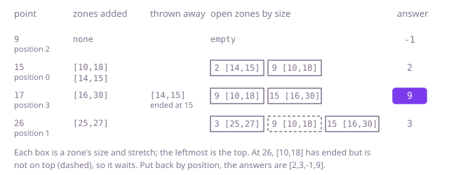

## The question

Radio zones cover closed stretches of kilometre posts, a zone's size being the number of posts it covers, both ends included. For each phone's post, return the size of the smallest zone that covers it, or -1 if none does, in the order the points were given.

What makes it harder than it looks is the size: 100,000 zones and 100,000 points make 10 billion zone-point checks, far too slow. The smallest zone is not the one that starts nearest the point (in Example 1, the zone that starts nearest post 17 is `[16,30]`, but `[10,18]` is smaller), and a small zone that has just ended must not answer for the next post (`[[10,11],[5,40]]` at post 12). Both ends count, in the cover test and in the size: `[14,15]` covers post 15 and has size 2. And the answers must go back in the original order even if you visit the points in another.

## How to think about it

The first idea is to check every zone for every point and keep the smallest that covers it. That is right, at n times q checks. A first improvement is to sort the zones by size once: then, for each point, the first zone that covers it is the answer and the scan can stop there. That helps when small zones cover most points, but a point that only a large zone covers, or none, still scans every zone.

The real saving comes from answering the points in order of post instead of the order given. As the post increases, two things only ever happen to a zone: it starts (its `from` is now at or below the post), and later it ends (its `to` is below the post). A zone that has ended is useless for every later point too, so it never has to come back. So I want a structure holding the zones that have started, which tells me the smallest one quickly: a min-heap ordered by size. For each point, I first add every zone that starts at or before it, taking the zones in order of `from`. Then I look at the top: if it has ended, I throw it away and look again, and the first top that has not ended is the answer. Ended zones that are not on top can stay, because a smaller open zone sits above them; they are thrown away if they ever reach the top. Every zone is added once and removed at most once.

Walk Example 1. Zones by `from`: `[10,18]`, `[14,15]`, `[16,30]`, `[25,27]`. Points by post: 9 (position 2), 15 (position 0), 17 (position 3), 26 (position 1). At 9, no zone has started: -1. At 15, add `[10,18]` (size 9) and `[14,15]` (size 2); the top, `[14,15]`, ends at 15, so it covers 15: answer 2. At 17, add `[16,30]` (size 15); the top, `[14,15]`, ended at 15, so it is thrown away, and the new top, `[10,18]`, covers 17: answer 9. At 26, add `[25,27]` (size 3); it is the new top and covers 26: answer 3. `[10,18]` has ended too, but it is not on top, so it waits. Put back in place: `[2,3,-1,9]`.



## Brute force

For each point, check every zone, and keep the smallest size among the zones that cover it. It is what you say first, and it fixes the answers every faster version must agree with. It is correct because it looks at every zone for every point, and the test `from <= point <= to` and the size `to - from + 1` both count the end posts.

```java
static int[] smallestZone(int[][] zones, int[] points) {
    int[] answer = new int[points.length];
    for (int j = 0; j < points.length; j++) {
        int best = -1;
        for (int[] zone : zones) {
            if (zone[0] <= points[j] && points[j] <= zone[1]) { // both ends are covered
                int size = zone[1] - zone[0] + 1;
                if (best == -1 || size < best) {
                    best = size;
                }
            }
        }
        answer[j] = best;
    }
    return answer;
}
```

**Complexity:** time O(n × q) for n zones and q points, extra space O(1) besides the answer.

## Better: zones by size, the first that covers wins

Sort a copy of the zones by size, smallest first. For each point, walk the sorted zones and stop at the first one that covers it: no later zone can be smaller. A point that no zone covers walks the whole list and gets -1.

```java
static int[] smallestZone(int[][] zones, int[] points) {
    int[][] bySize = zones.clone();
    Arrays.sort(bySize, Comparator.comparingInt(z -> z[1] - z[0]));
    int[] answer = new int[points.length];
    for (int j = 0; j < points.length; j++) {
        answer[j] = -1;
        for (int[] zone : bySize) {
            if (zone[0] <= points[j] && points[j] <= zone[1]) {
                answer[j] = zone[1] - zone[0] + 1; // the first zone that covers is the smallest
                break;
            }
        }
    }
    return answer;
}
```

**Complexity:** time O(n log n + n × q) in the worst case, when points are covered only by large zones or by none; extra space O(n) for the sorted copy.

**Prefer it when:** the points come one at a time and each must be answered before the next is known, so they cannot be sorted first, and most points lie in one of the smallest zones, so each scan stops early. The sweep below needs every point up front. For heavy use of that kind, the first follow-up answer does better still.

## Optimal: sweep the points in order with a heap of open zones

Sort the zones by `from` and the positions of the points by post. Walk the points in that order with a min-heap of the zones that have started, ordered by size. Before answering a point, add the zones that start at or before it, then throw away tops that have ended. The top that remains is the smallest open zone, and its size goes into the answer at the point's own position. This is the reference solution.

```java
static int[] smallestZone(int[][] zones, int[] points) {
    int[][] byFrom = zones.clone();
    Arrays.sort(byFrom, Comparator.comparingInt(z -> z[0]));
    Integer[] order = new Integer[points.length];
    for (int j = 0; j < order.length; j++) {
        order[j] = j;
    }
    Arrays.sort(order, Comparator.comparingInt(j -> points[j])); // answer the points from the lowest up
    PriorityQueue<int[]> open = new PriorityQueue<>(Comparator.comparingInt(z -> z[1] - z[0])); // smallest on top
    int[] answer = new int[points.length];
    int next = 0; // the next zone, by from, not yet in the heap
    for (int j : order) {
        int point = points[j];
        while (next < byFrom.length && byFrom[next][0] <= point) {
            open.add(byFrom[next++]);
        }
        while (!open.isEmpty() && open.peek()[1] < point) {
            open.poll(); // ended before this point, so before every later point too
        }
        answer[j] = open.isEmpty() ? -1 : open.peek()[1] - open.peek()[0] + 1;
    }
    return answer;
}
```

**Complexity:** time O(n log n + q log q): the two sorts, then every zone added to and removed from the heap at most once, at O(log n) each; extra space O(n + q) for the copies, the order and the heap.

## Complexity

| Approach | Time | Extra space |
| --- | --- | --- |
| Brute force: every zone for every point | O(n × q) | O(1) |
| Better: zones by size, the first that covers wins | O(n log n + n × q) worst case | O(n) |
| Optimal: sweep the points in order with a heap of open zones | O(n log n + q log q) | O(n + q) |

## Where it shows up

No coding-round problem is linked to this question. The same question, "the narrowest range that contains this value", is how a router picks a route: of the address blocks that contain an address, the most specific one, the smallest, wins. It is also how a pricing engine picks the most specific promotion whose date range covers an order date, and how a map finds the smallest administrative area around a point along a road. When the lookups come in a batch, as in a nightly job, sorting them and sweeping once is the usual way.

## Follow-up answers

**What if each point had to be answered as it arrives, before the next one is known?** Do the sweep once over the zones' own boundaries instead of the points. The answer can only change at a zone's `from` or just after its `to`, so sweep those at most 2n posts in order with the same heap, recording the smallest open zone at each one. That splits the highway into at most 2n stretches, each with one answer. Each arriving point is then a binary search for its stretch: O(n log n) once, then O(log n) per point.

**How would you also say which zone serves each point?** Keep the zone's position in the heap entry next to its ends, and read it off the top along with the size. If two zones of the same size can both cover a point, say which one you return, for example the lower position, and break ties that way in the heap's ordering.

**What changes if the zones are half-open, so that a zone covers the posts from its start up to but not including its end?** The size becomes `to - from`, and a zone stops covering at `to`, so a top is thrown away when `to <= point` instead of `to < point`. The rest of the sweep is unchanged.
