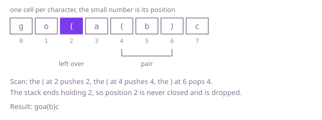

## The question

Given a text of letters and round brackets, remove as few brackets as possible so that the rest is balanced, and return the text with everything else untouched. A fixed pairing rule decides which brackets go: each `)` pairs with the nearest earlier unpaired `(`, and whatever stays unpaired is removed.

What makes it harder than it looks: counting tells you how many brackets must go but not which ones, and the answer depends on which. In `(a(b)` the `)` takes the nearest `(`, so the first `(` is the one removed, not the second. The text can also be 400,000 characters of deeply nested brackets, where hunting backwards for a partner at every `)` is far too slow.

## How to think about it

The first idea follows the rule word for word: at each `)`, look back for the nearest `(` that is not yet paired. That is correct, but on a text like 150,000 openers followed by 150,000 closers each `)` walks back over all the pairs already made.

A bracket is doomed in exactly two cases: a `)` that arrives when nothing is waiting to be closed, and a `(` still waiting when the text ends. Everything else is paired and stays. What a `)` needs is the nearest waiting `(`, and the waiting openers are exactly the ones that are not yet paired, with the most recent on top. That is a stack, and it removes the backward search.

Two observations settle the details. The stack holds positions rather than characters, because two brackets can look identical and the answer must say which one goes. And the stack alone does not leave a clean answer: stray closers are known at once, but stray openers are only known at the end, so I mark positions and build the result in a last pass.

Walk Example 1, `text = "go(a(b)c"`. The `(` at 2 is pushed, the `(` at 4 is pushed, and the `)` at 6 pops 4, so 4 and 6 are a pair. The scan ends with 2 still on the stack: never closed, so it is dropped. The kept text is `goa(b)c`.



## Brute force

Walk the text, and at each `)` look back for the nearest `(` that is not yet paired; if there is one, mark both to keep. Unmarked brackets are dropped. It comes first because it is the rule written as code, and it fixes the answer the faster versions must agree with. It is correct because it applies the pairing rule literally, in left-to-right order, so each `)` takes exactly the opener the rule names.

```java
static String tidy(String text) {
    int n = text.length();
    boolean[] keep = new boolean[n];
    boolean[] paired = new boolean[n];
    for (int i = 0; i < n; i++) {
        if (text.charAt(i) != ')') continue;
        int j = i - 1; // look back for the nearest opener that is still unpaired
        while (j >= 0 && !(text.charAt(j) == '(' && !paired[j])) {
            j--;
        }
        if (j >= 0) {
            paired[j] = true;
            keep[j] = true;
            keep[i] = true;
        }
    }
    StringBuilder kept = new StringBuilder(n);
    for (int i = 0; i < n; i++) {
        char c = text.charAt(i);
        if ((c != '(' && c != ')') || keep[i]) kept.append(c); // letters always stay
    }
    return kept.toString();
}
```

**Complexity:** time O(n²) in the worst case (nested brackets), extra space O(n).

## Better: two passes with counters

This is a different tool at the same cost. The stack only ever answers one question, "is any opener waiting?", and a counter answers it. Walk left to right with a count of waiting openers: a `(` adds one, a `)` is dropped if the count is zero and otherwise takes one off. That removes every stray closer. What is left may still have stray openers. Walk it again from the right with a count of waiting closers: a `)` adds one, a `(` is dropped if the count is zero and otherwise takes one off. The pairs found are the same as the stack finds, because both match each closer with the nearest opener on its left.

```java
static String tidy(String text) {
    StringBuilder strays = new StringBuilder(text.length());
    int waiting = 0; // openers not yet closed
    for (int i = 0; i < text.length(); i++) {
        char c = text.charAt(i);
        if (c == ')') {
            if (waiting == 0) continue; // nothing to close: drop it
            waiting--;
        } else if (c == '(') {
            waiting++;
        }
        strays.append(c);
    }
    StringBuilder kept = new StringBuilder(strays.length());
    int closers = 0; // closers seen from the right, not yet taken by an opener
    for (int i = strays.length() - 1; i >= 0; i--) {
        char c = strays.charAt(i);
        if (c == '(') {
            if (closers == 0) continue; // never closed: drop it
            closers--;
        } else if (c == ')') {
            closers++;
        }
        kept.append(c);
    }
    return kept.reverse().toString(); // built right to left
}
```

**Complexity:** time O(n), extra space O(n) for the two builders.

**Prefer it when:** you want no position arrays and no mark array, only counters and the output text. It makes two passes and builds an intermediate string, so the stack version is the one to read first.

## Optimal: a stack of opener positions

Keep a stack of the positions of openers that are still waiting. A `)` with an empty stack is marked for removal. A `)` with something on the stack pops it, and the pair stays. When the scan ends, whatever is still on the stack was never closed, so those positions are marked too. A last pass builds the answer from the unmarked positions. This is the reference solution; the stack is an `int` array with a top index because the text can be 400,000 characters long.

```java
static String tidy(String text) {
    int n = text.length();
    boolean[] drop = new boolean[n];
    int[] open = new int[n]; // positions of the openers still waiting, latest on top
    int top = 0;
    for (int i = 0; i < n; i++) {
        char c = text.charAt(i);
        if (c == '(') {
            open[top++] = i;
        } else if (c == ')') {
            if (top == 0) {
                drop[i] = true; // nothing to close
            } else {
                top--; // paired with the nearest waiting opener
            }
        }
    }
    while (top > 0) {
        drop[open[--top]] = true; // never closed
    }
    StringBuilder kept = new StringBuilder(n);
    for (int i = 0; i < n; i++) {
        if (!drop[i]) kept.append(text.charAt(i));
    }
    return kept.toString();
}
```

**Complexity:** time O(n), extra space O(n).

## Complexity

| Approach | Time | Extra space |
| --- | --- | --- |
| Brute force | O(n²) worst case | O(n) |
| Better: two passes with counters | O(n) | O(n) |
| Optimal: stack of opener positions | O(n) | O(n) |

## Where it shows up

`build-log-bracket-checker` uses the same stack of positions. Its `firstError` keeps the columns of the open brackets in an `int` array, reports a closer met with an empty stack as unexpected, and reports a bracket still open at the end at the earliest column left in the array. There it reports the mistake rather than repairing the text, but finding the doomed brackets is the same scan. Its third phase, huge lines, is exactly the move from the brute force here to the stack: a search backwards from every closer on a two-million-character line is too slow.

Outside the coding round, the same repair shows up when a tool must auto-close or clean up damaged input: a text editor fixing brackets in pasted code, a formatter stripping dangling parentheses from a generated expression before evaluating it, or a log cleaner that has to keep every letter and only drop the unpaired brackets.

## Follow-up answers

**How would you return the number of removed brackets instead of the text?** Run the same scan without building anything: the removed `)` are those met with an empty stack, and the removed `(` are the ones left on the stack at the end, so the answer is the count of the first plus the final stack size. A counter replaces the stack, since only its size matters, and no rebuild pass is needed.

**What changes if square and curly brackets are in the text too?** The stack must also check kinds: a closer pairs only with the nearest waiting opener of its own kind. With crossed kinds the fixed rule no longer names a single answer, since in `([)` either the `(` or the `[` can stay, so the statement needs a stated choice before the tests can check one. With the choice made, the stack can be one per kind, or one stack that holds the kind with each position.

**Can you do it without a stack, in two passes with counters?** Yes, that is the Better section: left to right with a count of waiting openers drops every `)` met at zero, and right to left over what is left drops every `(` met with no `)` waiting. It keeps the same brackets as the stack version, because both pair each closer with the nearest opener on its left.
