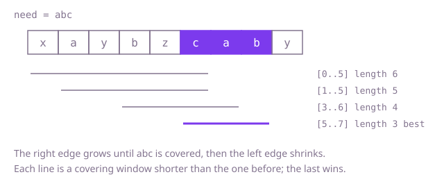

## The question

Given a text and a list of needed characters, find the shortest run of consecutive characters in the text that contains all of them, counting repeats. If several runs tie for shortest, return the leftmost; if none exists, return the empty string.

What makes it harder than it looks: "contains every letter" is not enough, because repeats count. A need of `"aab"` is not met by a stretch with one `a`. Other characters inside the stretch are allowed, so you cannot compare against a fixed length the way an anagram search does. A tie must go to the leftmost stretch, which a non-strict length comparison gets wrong. And with 100,000 characters on each side, trying every start and end is far too slow.

## How to think about it

The first idea is to try each start and grow the stretch to the right until it covers the need; the first end that works is the shortest for that start. It repeats a lot: the stretch from start 3 re-reads almost everything the stretch from start 2 just read. Two facts remove the repeats. Extending a covering stretch to the right keeps it covering, so for a fixed right end the best left end is as far right as the stretch still covers. And that best left end never moves backwards as the right end advances. So one stretch with two edges that only move right can find every best candidate.

Walk Example 1, `text = "xaybzcaby"`, `need = "abc"`, keeping what is still missing: one each of `a`, `b`, `c`. The right edge reads `x` (not needed), `a`, `y`, `b`, `z`, `c`: now nothing is missing, and the stretch is `"xaybzc"` of length 6. Shrink from the left: drop `x`, still covered, length 5; drop `a`, an `a` is missing again, so stop. The right edge reads `a`: covered again as `"ybzca"`, shrink: drop `y`, then `b` leaves a gap, so the best here is `"bzca"` of length 4. The right edge reads `b`: covered as `"zcab"`, shrink: drop `z`, covered as `"cab"` of length 3, drop `c`, a gap. Reading `y` changes nothing. The shortest is `"cab"`.



## Brute force

For every start, grow the end to the right counting what the stretch still lacks, and stop at the first end where nothing is lacking. It is what you say first, and it fixes the answer every faster version must agree with. It is correct because every stretch is considered through its start, the first covering end is the shortest for that start, and keeping a stretch only when it is strictly shorter keeps the leftmost on ties.

```java
static String smallest(String text, String need) {
    int bestStart = 0;
    int bestLength = Integer.MAX_VALUE;
    for (int start = 0; start < text.length(); start++) {
        int[] missing = new int[128]; // copies of each character this start still lacks
        for (int i = 0; i < need.length(); i++) {
            missing[need.charAt(i)]++;
        }
        int totalMissing = need.length();
        for (int end = start; end < text.length() && totalMissing > 0; end++) {
            if (missing[text.charAt(end)]-- > 0) {
                totalMissing--; // this character was really needed
            }
            if (totalMissing == 0 && end - start + 1 < bestLength) { // strictly shorter: leftmost on ties
                bestLength = end - start + 1;
                bestStart = start;
            }
        }
    }
    return bestLength == Integer.MAX_VALUE ? "" : text.substring(bestStart, bestStart + bestLength);
}
```

**Complexity:** time O(n * (n + m)) for a text of length n and a need of length m (each start rebuilds the counts in m steps and then walks up to n characters), extra space O(1) (the counter array has a fixed size).

## Better: two edges, check every letter

Keep one stretch with a left and a right edge and counts of what it holds. Move the right edge one character at a time. After each move, while the stretch covers the need, record it if it is shorter and then move the left edge in. Whether the stretch covers the need is checked by comparing the counts of every character with the need's.

```java
static String smallest(String text, String need) {
    int[] want = new int[128];
    for (int i = 0; i < need.length(); i++) {
        want[need.charAt(i)]++;
    }
    int[] have = new int[128]; // what the current stretch holds
    int bestStart = 0;
    int bestLength = Integer.MAX_VALUE;
    int left = 0;
    for (int right = 0; right < text.length(); right++) {
        have[text.charAt(right)]++;
        while (covers(have, want)) { // 128 comparisons per check
            if (right - left + 1 < bestLength) { // strictly shorter keeps the leftmost
                bestLength = right - left + 1;
                bestStart = left;
            }
            have[text.charAt(left)]--;
            left++;
        }
    }
    return bestLength == Integer.MAX_VALUE ? "" : text.substring(bestStart, bestStart + bestLength);
}

private static boolean covers(int[] have, int[] want) {
    for (int c = 0; c < want.length; c++) {
        if (have[c] < want[c]) {
            return false;
        }
    }
    return true;
}
```

**Complexity:** time O(n * s) where s is the size of the counter array (128 here, so O(n)), extra space O(s). Each edge moves at most n times and each move is followed by at most one check.

**Prefer it when:** you want the clearest code and the alphabet is small: `covers` states the rule directly, and it is easy to see that it is right. The price is that every move of either edge pays for a pass over all the counters, which gets expensive for a large alphabet.

## Optimal: two edges, count what is still missing

Replace the pass over the counters with one number. Keep `missing[c]`, how many copies of character `c` the stretch still lacks (negative when it holds extras), and `totalMissing`, how many needed characters are still lacking in total. When the right edge reads a character that was lacking, `totalMissing` drops by one; when the left edge drops a character that leaves a gap, it rises by one. The stretch covers the need exactly when `totalMissing` is zero, and the check costs nothing. This is the reference solution.

```java
static String smallest(String text, String need) {
    int[] missing = new int[128]; // how many copies of each character the window still lacks
    for (int i = 0; i < need.length(); i++) {
        missing[need.charAt(i)]++;
    }
    int totalMissing = need.length();
    int bestStart = 0;
    int bestLength = Integer.MAX_VALUE;
    int left = 0;
    for (int right = 0; right < text.length(); right++) {
        if (missing[text.charAt(right)]-- > 0) {
            totalMissing--; // this character was really needed
        }
        while (totalMissing == 0) {
            if (right - left + 1 < bestLength) { // strictly shorter keeps the leftmost
                bestLength = right - left + 1;
                bestStart = left;
            }
            if (++missing[text.charAt(left)] > 0) {
                totalMissing++; // dropping this character leaves a gap
            }
            left++;
        }
    }
    return bestLength == Integer.MAX_VALUE ? "" : text.substring(bestStart, bestStart + bestLength);
}
```

**Complexity:** time O(n + m), extra space O(s) for the counter array (a fixed 128 here).

## Complexity

| Approach | Time | Extra space |
| --- | --- | --- |
| Brute force | O(n * (n + m)) | O(1) |
| Better: two edges, check every letter | O(n * s), O(n) for a fixed alphabet | O(s) |
| Optimal: two edges, count what is missing | O(n + m) | O(s) |

## Where it shows up

No coding-round problem is linked to this question. The pattern, "the smallest span that contains everything required", appears in search: finding the shortest passage of a document that contains all the query terms is how a result snippet is chosen. It also appears in monitoring, where you ask for the shortest stretch of an event log that contains at least one event of each required kind.

## Follow-up answers

**How would you avoid checking all letters every time the window changes?** Keep one counter of how many needed characters are still lacking, and change it only when an edge crosses a character whose count moves between lacking and not lacking. That is the optimal solution above: the covering test becomes `totalMissing == 0`, which is constant time.

**What changes if the answer must be the shortest stretch that contains the letters in the given order?** Counting no longer works, because order matters: the need must appear as a subsequence of the stretch. Scan for the end of a match by walking through `need` in order, then walk back from that end to the latest start that still matches, and take the shortest such pair; restart the scan just after that start. That is O(n * m) in the worst case, since each restart can walk most of `need` again.

**How would you return every shortest stretch, not only the leftmost?** Record every start whose length equals the best so far, and clear the list when a strictly shorter stretch is found. Use a non-strict comparison for equal length and a strict one for shorter. The cost stays O(n + m) plus the size of the output.
