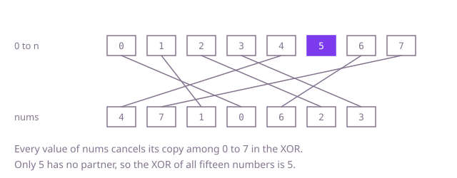

## The question

The array holds every number from 0 to n but one, in no particular order; return the one that is not there. It can be 0 or n as well as anything in between, and n is also the length of the array.

What makes it harder than it looks: the range has n + 1 numbers but the array only n positions. A table of flags, one per number, needs n + 1 entries, not n, or the value n falls off its end; and code that sorts and looks for the first position whose value is not its index finds no such position when n itself is missing, and has to return n on its own. Checking every number with a fresh scan costs about n²/4 comparisons when the missing number is in the middle, 2.5 × 10^9 at n = 10^5. And the arithmetic shortcut, the sum of 0 to n minus the sum of the array, meets the `int` limit at this size: the sum of 0 to 10^5 is 5,000,050,000.

## How to think about it

The first idea is to check each number: for 0, 1, 2 and so on, scan the array for it, and return the first number the scan does not find. That reads the array once per number. Sorting first helps: in sorted order every number below the missing one sits at the position equal to itself, so one pass finds the first position whose value is not its index, for O(n log n) in all. A table of n + 1 flags does better still: one pass marks every value seen and a second finds the flag still clear, O(n) time but O(n) memory.

To drop the table, pair the numbers up. Write the numbers 0 to n next to the values of the array: each number that is present now appears twice, once in the range and once in the array, and the missing one appears once. That is Single Number again, and the XOR of all of them leaves exactly the missing number, since `x ^ x` is 0, `x ^ 0` is `x` and the order does not matter. The loop's own indices, 0 to n - 1, supply the range; only n, which is no index, has to be put in by hand.

Walk Example 1, `nums = [4, 7, 1, 0, 6, 2, 3]`, so n = 7 and the range is 0 to 7. The 4 of the array cancels the 4 of the range, the 7 cancels the 7, and so on through 1, 0, 6, 2 and 3. The one number of the range with no partner in the array is 5, so the XOR of all fifteen numbers is 5.



## Brute force

For each number from 0 to n, scan the array for it, and return the first number the scan does not find. It comes first because it is the question read literally, and it fixes the answer every faster version must agree with. It is correct because it tries every number of the range, and exactly one of them is absent.

```java
static int find(int[] nums) {
    int n = nums.length;
    for (int candidate = 0; candidate <= n; candidate++) { // the range has n + 1 numbers
        boolean seen = false;
        for (int value : nums) {
            if (value == candidate) {
                seen = true;
                break;
            }
        }
        if (!seen) {
            return candidate;
        }
    }
    return -1; // unreachable: n distinct values cannot cover n + 1 numbers
}
```

Trying the numbers from n down to 0 instead, or scanning the array from its end, does not change the bound: the missing number can sit in the middle of the range, and every number tried before it costs a scan of about half the array.

**Complexity:** time O(n²), extra space O(1).

## Better: a table of the numbers seen

One pass sets a flag for every value of the array; a second pass over the flags returns the first number whose flag is still clear. The table has a flag for each of 0 to n, so it is one longer than the array.

```java
static int find(int[] nums) {
    boolean[] seen = new boolean[nums.length + 1]; // one flag for each number 0..n, n included
    for (int value : nums) {
        seen[value] = true;
    }
    for (int number = 0; number < seen.length; number++) {
        if (!seen[number]) {
            return number;
        }
    }
    return -1; // unreachable: n distinct values cannot cover n + 1 numbers
}
```

**Complexity:** time O(n), extra space O(n) for the n + 1 flags.

**Prefer it when:** the promise of distinct values might be broken. With a value repeated, two or more numbers of the range are absent, and the table still returns the smallest of them, where the XOR below returns a mix of values that need not be any of them.

## Optimal: XOR of the range and the array

Start from n, the one number of the range that is no index, and XOR in every index and every value. Each number that is present meets its copy and cancels, and what is left is the missing number. This is the reference solution.

```java
static int find(int[] nums) {
    int missing = nums.length; // n is in the range 0..n but is no index of the array
    for (int i = 0; i < nums.length; i++) {
        missing ^= i ^ nums[i]; // every present number meets its copy and cancels
    }
    return missing;
}
```

Addition cancels the same way: the sum of 0 to n minus the sum of the array is the missing number. From n = 65,536 on, the sum of 0 to n is past `Integer.MAX_VALUE`, but in `int` both sums wrap around by multiples of 2^32, and since the answer lies between 0 and n, the difference still comes out right; in `long` nothing wraps at all. The trap is the formula `n * (n + 1) / 2` computed in `int`. From n = 46,341 on, the product no longer fits; the wrap takes 2^32 off it, the halving turns that into 2^31, which no later wrap makes up, and the answer comes out off by exactly 2^31, a negative number. That holds up to n = 80,264; above it the product wraps twice, the error is 2^32 and cancels, so a test at the largest n alone would not show the slip. Write `(long) n * (n + 1) / 2`, or add the indices in the loop.

**Complexity:** time O(n), extra space O(1).

## Complexity

| Approach | Time | Extra space |
| --- | --- | --- |
| Brute force: scan for each number | O(n²) | O(1) |
| Better: a table of the numbers seen | O(n) | O(n) for n + 1 flags |
| Optimal: XOR of the range and the array | O(n) | O(1) |

## Where it shows up

No coding-round problem is linked to this question. Finding the one gap in a run of sequence numbers is everyday reconciliation: the packet that never arrived out of a numbered batch, the cheque missing from a numbered book, the invoice number skipped in an audit. When exactly one is known to be missing, a running XOR or sum over the numbers finds it in one pass without storing them; when several can be missing, a bitmap of the range, the table of the Better, is the usual tool.

## Follow-up answers

**Can you find it in O(n) time with only a constant amount of extra memory, without changing `nums`?** Yes: the XOR of the range and the array, one `int`, as above, or the sum of the range minus the sum of the array, in `long` or relying on `int` wrap-around. Sorting is no answer here: sorting the array itself changes it, and sorting a copy needs O(n) memory.

**If `nums` were sorted, how fast could you find the missing number?** O(log n), by binary search on whether the value at position i equals i: that holds at every position below the missing number and fails at every position from it on, so the first position where it fails is the missing number, or n when it holds everywhere.

**What if the array held n numbers from 0 to n + 1, so that two were missing: how would you find both?** XOR the range and the array: the present numbers cancel and what is left is `a ^ b`, which is not 0 since the two differ. Pick one bit where they differ, such as the lowest set bit, `x & -x`, and split the range and the array by that bit into two XORs: each present number cancels on its own side, and `a` and `b` end up on different sides. That is O(n) time and O(1) memory.
