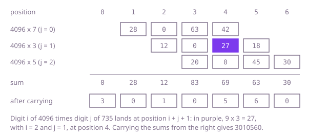

## The question

Given two non-negative integers as strings of decimal digits, up to 200 digits each, return their product as a string, without converting either number into a built-in number type. The answer has no leading zeros, and a zero product is `"0"`.

What makes it harder than it looks: a `long` stops at 19 digits, so the arithmetic has to happen on the digits, with carries that can run the whole length of the number (try 200 nines times 200 nines). The product of an m-digit and an n-digit number has m + n or m + n - 1 digits, so a fixed m + n slots can leave one leading zero to drop, while the zeros inside and at the end of the product must stay; and a zero operand must give `"0"`, not an empty string or a row of zeros.

## How to think about it

The definition is repeated addition: add `num1` to a running total `num2` times. Adding two digit strings is easy, so that is a correct first version, but `num2` can have 200 digits, which means up to 10^200 additions. The paper method fixes that by working per digit of `num2` instead of per unit: multiply `num1` by one digit, shift the row left by the digit's place, and add the rows up. That is n rows of about m digits, each added into a total of up to m + n digits.

Look at where each digit product ends up. Number the digits from the left, `i` in `num1` and `j` in `num2`. The digit `num1[i]` has place value 10^(m - 1 - i) and `num2[j]` has 10^(n - 1 - j), so their product has place value 10^(m + n - 2 - i - j), which is position `i + j + 1` in an array of m + n digits numbered from the left. So there is no need for the rows at all: add every digit product straight into its position, carry what passes 9 into the position on its left, and read the array from the first non-zero digit. Carrying as you go keeps every slot small, and position 0 only ever receives carries.

Walk Example 1, `"4096"` times `"735"`. The products of 7 with 4, 0, 9 and 6 land at positions 1 to 4 (28, 0, 63, 42), those of 3 at positions 2 to 5 (12, 0, 27, 18), those of 5 at positions 3 to 6 (20, 0, 45, 30). The sums per position are 0, 28, 12, 83, 69, 63 and 30; carrying from the right gives 3, 0, 1, 0, 5, 6, 0, which is 3010560. Here all seven positions are used; for `"15"` times `"6"` the first of three positions stays 0 and is dropped, giving `"90"`.



## Brute force

Add `num1` to a total that starts at `"0"`, counting the rounds in a second digit string until it equals `num2`. It comes first because it needs nothing but digit-string addition, which is short and easy to get right, and on small inputs it fixes the answer the faster versions must agree with. It is correct because multiplying by `num2` is adding `num2` copies, and the addition carries from the right exactly as on paper.

```java
static String multiply(String num1, String num2) {
    String total = "0";
    for (String done = "0"; !done.equals(num2); done = add(done, "1")) { // num2 rounds of adding num1
        total = add(total, num1);
    }
    return total;
}

private static String add(String a, String b) {
    StringBuilder sum = new StringBuilder();
    int carry = 0;
    for (int i = a.length() - 1, j = b.length() - 1; i >= 0 || j >= 0 || carry > 0; i--, j--) {
        int digit = carry + (i >= 0 ? a.charAt(i) - '0' : 0) + (j >= 0 ? b.charAt(j) - '0' : 0);
        sum.append((char) ('0' + digit % 10));
        carry = digit / 10;
    }
    return sum.reverse().toString();
}
```

**Complexity:** time O(v · (m + n)) for the value v of `num2`, which can be about 10^200, so it only finishes when `num2` is small; extra space O(m + n).

## Better: one row per digit, as on paper

For each digit of `num2`, from the right, build the row `num1` times that digit, padded with one zero per digit to its right, and add the row into the total with the same digit-string addition. A zero digit adds nothing, and a zero operand returns `"0"` at once, so no row ever starts with a zero.

```java
static String multiply(String num1, String num2) {
    if (num1.equals("0") || num2.equals("0")) {
        return "0"; // otherwise the rows would be strings of zeros
    }
    String total = "0";
    for (int j = num2.length() - 1; j >= 0; j--) {
        int digit = num2.charAt(j) - '0';
        if (digit == 0) {
            continue; // a row of zeros adds nothing
        }
        StringBuilder row = new StringBuilder(); // num1 times this digit, built from its last digit
        for (int shift = j; shift < num2.length() - 1; shift++) {
            row.append('0'); // one zero per digit of num2 to the right of j
        }
        int carry = 0;
        for (int i = num1.length() - 1; i >= 0; i--) {
            int product = (num1.charAt(i) - '0') * digit + carry;
            row.append((char) ('0' + product % 10));
            carry = product / 10;
        }
        if (carry > 0) {
            row.append((char) ('0' + carry));
        }
        total = add(total, row.reverse().toString());
    }
    return total;
}

private static String add(String a, String b) {
    StringBuilder sum = new StringBuilder();
    int carry = 0;
    for (int i = a.length() - 1, j = b.length() - 1; i >= 0 || j >= 0 || carry > 0; i--, j--) {
        int digit = carry + (i >= 0 ? a.charAt(i) - '0' : 0) + (j >= 0 ? b.charAt(j) - '0' : 0);
        sum.append((char) ('0' + digit % 10));
        carry = digit / 10;
    }
    return sum.reverse().toString();
}
```

**Complexity:** time O(n · (m + n)): n rows, each built in O(m + n) and added into a total of up to m + n digits; extra space O(m + n).

**Prefer it when:** you already have a digit-string addition, or need one anyway, as a calculator does: multiplication is then a short loop on top of it, and each row is a value you can print to show the working.

## Optimal: add each digit product into its position

Keep an array of m + n digits. For every pair of digits, add their product into position `i + j + 1` and move what passes 9 into position `i + j`. With both loops running from the right, the last update to every position after the first is one that reduces it modulo 10, so each slot ends as a single digit. Then skip the leading zeros, keeping a single `"0"` for a zero product. This is the reference solution.

```java
static String multiply(String num1, String num2) {
    int m = num1.length(), n = num2.length();
    int[] place = new int[m + n]; // place[k]: digit k of the product, most significant first
    for (int i = m - 1; i >= 0; i--) {
        for (int j = n - 1; j >= 0; j--) {
            // digit i times digit j lands at position i + j + 1, and its carry at i + j
            int sum = (num1.charAt(i) - '0') * (num2.charAt(j) - '0') + place[i + j + 1];
            place[i + j + 1] = sum % 10;
            place[i + j] += sum / 10; // may pass 9 for a moment; the next step that lands here settles it
        }
    }
    StringBuilder out = new StringBuilder();
    for (int digit : place) {
        if (out.length() > 0 || digit != 0) { // skip the leading zeros only
            out.append(digit);
        }
    }
    return out.length() == 0 ? "0" : out.toString();
}
```

**Complexity:** time O(m · n), one multiplication per pair of digits; extra space O(m + n) for the positions and the result.

## Complexity

| Approach | Time | Extra space |
| --- | --- | --- |
| Brute force: add num1, num2 times | O(v · (m + n)), v the value of num2 | O(m + n) |
| Better: one row per digit, as on paper | O(n · (m + n)) | O(m + n) |
| Optimal: each digit product into its position | O(m · n) | O(m + n) |

## Where it shows up

No coding-round problem is linked to this question. Arbitrary-precision arithmetic, as in Java's `BigInteger`, Python's integers and the GMP library, starts from this schoolbook method and switches to faster algorithms only for very long numbers; cryptography multiplies numbers of hundreds of digits all the time. In an interview, `BigInteger` would solve the question in one line, which is exactly why it is ruled out: the question is how the digits and the carries work, and a library call shows none of that.

## Follow-up answers

**How would you multiply two numbers with a million digits each?** The schoolbook method is 10^12 digit products, far too slow. Karatsuba's method splits each number in two halves and gets the product from three half-size products instead of four, O(n^1.585); for millions of digits, libraries switch to FFT-based multiplication, which treats the digits as coefficients of polynomials and runs in about O(n log n). Working in base 10^9 per array slot instead of base 10 also cuts the work by a large constant.

**How would you divide such a number by a small int, giving the quotient and the remainder?** Long division from the left: keep a remainder, and for each digit set it to `remainder * 10 + digit`, write `remainder / d` as the next quotient digit and keep `remainder % d`. Drop the quotient's leading zeros, keeping `"0"` if nothing is left. That is O(m) time, and the remainder never exceeds 10d, so it fits an `int` for any `int` divisor below about 2 · 10^8.

**What changes if the numbers may be negative, such as "-37"?** Strip the signs, multiply the digit strings as before, and put a `-` in front when exactly one operand was negative and the product is not zero, so that zero never comes out as `"-0"`.
