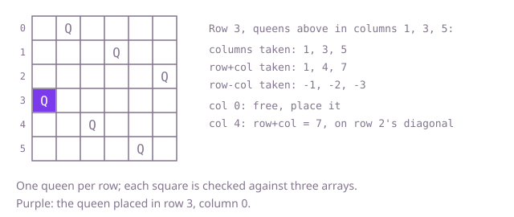

## The question

Place n queens on an n by n board so that no two share a row, a column or a diagonal, and list every such placement as rows of `.` and `Q`. Some board sizes, such as 2 and 3, have none.

What makes it harder than it looks is the size of the search. Putting n queens on any n of the n² squares means C(81, 9), about 260 billion, choices for n = 9; even one queen per row is 9^9, about 387 million boards. The search has to reject a square the moment an earlier queen attacks it, and the attack test must cover both diagonals, not just one; checking only the down-right diagonal passes for some boards and silently lists attacking queens on others.

## How to think about it

Two queens in one row attack each other, so every placement has exactly one queen per row, and a placement is a list of n column numbers, one per row. The first idea is to try every list, n choices per row, and check each finished board. It is correct and fixes the answer to compare against, but almost every board fails, and most of them fail because of the first two or three rows.

So check as you go: place queens row by row and only put a queen on a square no earlier queen attacks. When a row has no safe square, back up and move the queen in the row above to its next safe column. Checking a square by scanning the earlier queens costs O(n); marking what is taken makes it O(1). A column is a number, and so is a diagonal: every square on a down-right diagonal has the same row − col, and every square on a down-left diagonal the same row + col. Three boolean arrays, set when a queen is placed and cleared when it is taken back, answer "is this square attacked?" in three lookups.

Walk Example 1, `n = 6`, on its first placement. Rows 0, 1 and 2 hold queens in columns 1, 3 and 5, so the taken columns are 1, 3, 5, the taken row + col values 1, 4, 7, and the taken row − col values −1, −2, −3. In row 3, column 0 has row + col = 3 and row − col = 3, both free, so the queen goes there. Rows 4 and 5 then find columns 2 and 4, and the board is complete.



## Brute force

Put a queen in every column of every row in turn, and when all n rows have a queen, check every pair. It comes first because it uses only the one-queen-per-row fact and the plain definition of an attack, and it fixes the answer the faster versions must agree with. It is correct because every placement is one of the n^n lists it tries, and the pair check rejects exactly the attacking ones.

```java
static List<List<String>> solve(int n) {
    List<List<String>> result = new ArrayList<>();
    fill(n, 0, new int[n], result);
    return result;
}

// Tries every column in every row and checks the whole board only once all n queens stand.
private static void fill(int n, int row, int[] colOf, List<List<String>> result) {
    if (row == n) {
        if (safe(colOf)) {
            result.add(draw(colOf));
        }
        return;
    }
    for (int c = 0; c < n; c++) {
        colOf[row] = c;
        fill(n, row + 1, colOf, result);
    }
}

private static boolean safe(int[] colOf) {
    for (int i = 0; i < colOf.length; i++) {
        for (int j = i + 1; j < colOf.length; j++) {
            if (colOf[i] == colOf[j] || Math.abs(colOf[i] - colOf[j]) == j - i) {
                return false; // same column, or as many columns apart as rows: same diagonal
            }
        }
    }
    return true;
}

private static List<String> draw(int[] colOf) {
    List<String> board = new ArrayList<>();
    for (int c : colOf) {
        char[] row = new char[colOf.length];
        Arrays.fill(row, '.');
        row[c] = 'Q';
        board.add(new String(row));
    }
    return board;
}
```

**Complexity:** time O(n^n · n²) on every input, since all n^n lists are built and each check compares up to n² pairs; extra space O(n) for the columns and a recursion depth of n, beyond the output.

## Better: row by row, checking against the queens placed so far

Place a queen in a row only on a column that no earlier queen attacks, checked by scanning the rows above. A branch dies at the first row with no safe square, so most of the n^n lists are never built. `draw` is the same as above.

```java
static List<List<String>> solve(int n) {
    List<List<String>> result = new ArrayList<>();
    place(n, 0, new int[n], result);
    return result;
}

// Places a queen in row and every row below it; colOf[r] is the column of the queen in row r.
private static void place(int n, int row, int[] colOf, List<List<String>> result) {
    if (row == n) {
        result.add(draw(colOf));
        return;
    }
    for (int c = 0; c < n; c++) {
        if (attacked(colOf, row, c)) {
            continue;
        }
        colOf[row] = c; // later rows overwrite this, so nothing needs undoing
        place(n, row + 1, colOf, result);
    }
}

private static boolean attacked(int[] colOf, int row, int c) {
    for (int r = 0; r < row; r++) {
        if (colOf[r] == c || Math.abs(colOf[r] - c) == row - r) {
            return true;
        }
    }
    return false;
}
```

**Complexity:** time O(n² · n!) as an upper bound (no two rows share a column, so at most about e · n! partial boards are reached, each trying n columns at O(n) per check), far less in practice because diagonals cut most branches; extra space O(n) for the columns and a recursion depth of n, beyond the output.

**Prefer it when:** you want the least state to get right; there are no arrays to set and clear, only the list of columns.

## Optimal: row by row with taken columns and diagonals

Keep three boolean arrays: taken columns, taken row − col diagonals (shifted by n − 1 so the index is never negative) and taken row + col diagonals. A square is safe when all three are free; mark them when placing and clear them when backing out. This is the reference solution.

```java
static List<List<String>> solve(int n) {
    List<List<String>> result = new ArrayList<>();
    // a diagonal going down-right keeps row - col fixed, one going down-left keeps row + col fixed
    place(n, 0, new int[n], new boolean[n], new boolean[2 * n - 1], new boolean[2 * n - 1], result);
    return result;
}

// Places a queen in row and every row below it; colOf[r] is the column of the queen in row r.
private static void place(int n, int row, int[] colOf, boolean[] colTaken, boolean[] downRight, boolean[] downLeft, List<List<String>> result) {
    if (row == n) {
        result.add(draw(colOf));
        return;
    }
    for (int c = 0; c < n; c++) {
        int dr = row - c + n - 1; // shifted so the index is never negative
        int dl = row + c;
        if (colTaken[c] || downRight[dr] || downLeft[dl]) {
            continue; // an earlier queen attacks this square
        }
        colTaken[c] = downRight[dr] = downLeft[dl] = true;
        colOf[row] = c;
        place(n, row + 1, colOf, colTaken, downRight, downLeft, result);
        colTaken[c] = downRight[dr] = downLeft[dl] = false; // free the lines for the next column
    }
}

private static List<String> draw(int[] colOf) {
    List<String> board = new ArrayList<>();
    for (int c : colOf) {
        char[] row = new char[colOf.length];
        Arrays.fill(row, '.');
        row[c] = 'Q';
        board.add(new String(row));
    }
    return board;
}
```

**Complexity:** time O(n · n!) as an upper bound (the same partial boards, each trying n columns at O(1) per check), plus O(n²) to draw each placement found; extra space O(n) for the three arrays and a recursion depth of n, beyond the output.

## Complexity

| Approach | Time | Extra space (beyond the output) |
| --- | --- | --- |
| Brute force: every column in every row, check at the end | O(n^n · n²) on every input | O(n), recursion depth n |
| Better: row by row, scan earlier queens | O(n² · n!) upper bound | O(n), recursion depth n |
| Optimal: row by row, taken columns and diagonals | O(n · n!) upper bound, plus O(n²) per placement drawn | O(n), recursion depth n |

## Where it shows up

No coding-round problem is linked to this question. Placing items one at a time under "no two may conflict" rules is how timetabling tools seat exams so that no student has two at once, how a register allocator assigns registers to variables that are live together, and how puzzle solvers fill Sudoku grids. Marking a constraint as taken with an array index, as with the diagonals here, is the step that makes those searches fast.

## Follow-up answers

**How would you only count the placements, as fast as possible?** Skip drawing the boards and keep the three "taken" sets as bitmasks in ints. The free squares of a row are then `~(cols | diagRight | diagLeft) & ((1 << n) - 1)`; take the lowest set bit, recurse with the diagonal masks shifted one place left and right, and clear the bit. Each step is a few bit operations instead of a loop over columns.

**How could symmetry cut the work?** Every placement mirrored left to right is also a placement. Try only the first half of the columns for the queen in row 0 and count each result twice; when n is odd, the middle column of row 0 is searched once and counted once. That halves the work, and rotations can cut it further with more bookkeeping.

**How would you find just one placement for a board of a thousand squares a side?** Backtracking to the first solution gets slow on large boards, but a placement for every n of 4 or more can be written down directly from known constructions, built from stepping by two columns per row with a few cases by n modulo 6. Without the formula, a local search (place one queen per row and column, then repeatedly move the queen with the most conflicts) finds a placement for n = 1,000 in moments.
